# Smollan Design System - Slide Catalog

190 slide recipes across 16 categories. Every recipe is one on-brand slide that the `smollan` Python package fills with your content.

**How to use:** pick a recipe below (or `find('what you want to show')`), check its slots with `show('<id>')`, then `deck.add('<id>', **slots)`. AI agents: start with [AGENTS.md](AGENTS.md); people: see [docs/](docs/).

## Quick picker

| I want to show... | Category | Start with |
|---|---|---|
| a title / opening slide | cover | `cover.dark_blue` |
| a new section | divider | `divider.dark_blue` |
| a heading and some text / bullets | title | `title.one_line_sub` |
| 1-5 headline numbers | stats | `stats.3` |
| what we will measure | kpis | `kpis.6` |
| a step-by-step method | process | `process.5` |
| a concept / framework | infographic | `infographic.triad` |
| N points / benefits / services | buckets | `buckets.6` |
| a chart / trend | graphs | `graphs.1` |
| a data table / comparison | tables | `tables.clean` |
| a team structure | org | `org.tree` |
| client survey results | feedback | `feedback.chart_quote` |
| an app or dashboard screenshot | devices | `devices.laptop_large` |
| why choose Smollan | why | `why.pillars` |
| the end | closing | `closing` |

## cover

Opening slides. Core shape covers (3 colour tones) and photo-led covers (6 photo families).

| id | what it is |
|---|---|
| [`cover.dark_blue`](#coverdark_blue) | Shape cover - dark blue |
| [`cover.blue`](#coverblue) | Shape cover - Smollan blue |
| [`cover.charcoal`](#covercharcoal) | Shape cover - charcoal |
| [`cover.photo.laptop_sofa`](#coverphotolaptop_sofa) | Photo cover - woman with laptop |
| [`cover.photo.beauty`](#coverphotobeauty) | Photo cover - beauty consultant |
| [`cover.photo.shoppers`](#coverphotoshoppers) | Photo cover - two shoppers |
| [`cover.photo.merchandiser`](#coverphotomerchandiser) | Photo cover - Smollan merchandiser |
| [`cover.photo.shelf_curve`](#coverphotoshelf_curve) | Photo cover - shelf (curved mask) |
| [`cover.photo.rfp_client`](#coverphotorfp_client) | Photo cover - RFP response with client logo |
| [`cover.photo.shelf_glasses`](#coverphotoshelf_glasses) | Photo cover - shopper in glasses (curved mask) |
| [`cover.photo.shelf_curve_dark`](#coverphotoshelf_curve_dark) | Photo cover - shelf (curved mask, darker) |
| [`cover.photo.woman_left`](#coverphotowoman_left) | Photo cover - woman, photo left |
| [`cover.photo.woman_left_dark`](#coverphotowoman_left_dark) | Photo cover - woman, photo left (darker) |
| [`cover.photo.shelf_top`](#coverphotoshelf_top) | Photo cover - shelf photo top |
| [`cover.photo.shelf_top_sub`](#coverphotoshelf_top_sub) | Photo cover - shelf photo top, with sub-heading |
| [`cover.photo.pharmacy`](#coverphotopharmacy) | Photo cover - pharmacy shelf |
| [`cover.photo.pharmacy_dark`](#coverphotopharmacy_dark) | Photo cover - pharmacy shelf (darker) |
| [`cover.photo.client_logo`](#coverphotoclient_logo) | Photo cover - co-branded with client logo |

### cover.dark_blue

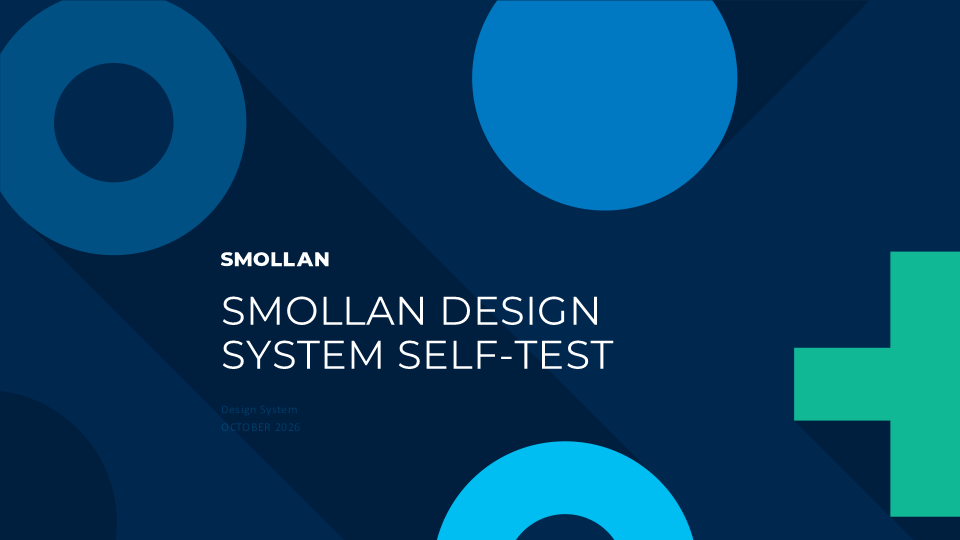

**Shape cover - dark blue** - Full-bleed dark-blue cover with Smollan geometric shapes (rings, plus, circles) and the SMOLLAN wordmark; title over two lines, presenter line and date beneath.

- **Use when:** Default opening slide of any Smollan deck.
- **Avoid when:** You want a photo-led opening - use cover.photo.*.
- **Source:** `Smollan_Core-Template_2024.pptx` -> layout `COVER - Shape Dark Blue`

| slot | kind | limit | what goes here |
|---|---|---|---|
| `heading` | text | max 2 lines, ~23 chars/line | presentation title, max 2 lines |
| `presenter` | text | fits ~1 line, ~29 chars/line | NAME SURNAME, TITLE |
| `date` | text | fits ~1 line, ~29 chars/line | e.g. OCTOBER 2026 |

```python
deck.add("cover.dark_blue",
    heading='YOUR HEADING',
    presenter='Presenter text',
    date='Date text',
)
```

### cover.blue

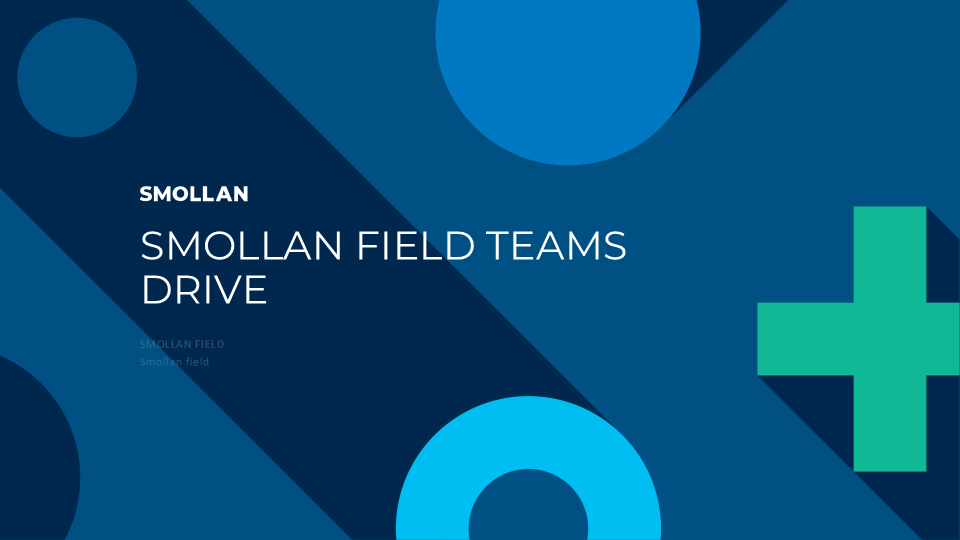

**Shape cover - Smollan blue** - Same geometric cover in the lighter Smollan blue tone; title upper-left, presenter and date beneath.

- **Use when:** Opening slide when a lighter, brighter feel suits the client.
- **Avoid when:** Photo-led opening - use cover.photo.*.
- **Source:** `Smollan_Core-Template_2024.pptx` -> layout `COVER - Shape Blue`

| slot | kind | limit | what goes here |
|---|---|---|---|
| `heading` | text | max 2 lines, ~24 chars/line | presentation title, max 2 lines |
| `presenter` | text | fits ~1 line, ~29 chars/line | NAME SURNAME, TITLE |
| `date` | text | fits ~1 line, ~29 chars/line | e.g. OCTOBER 2026 |

```python
deck.add("cover.blue",
    heading='YOUR HEADING',
    presenter='Presenter text',
    date='Date text',
)
```

### cover.charcoal

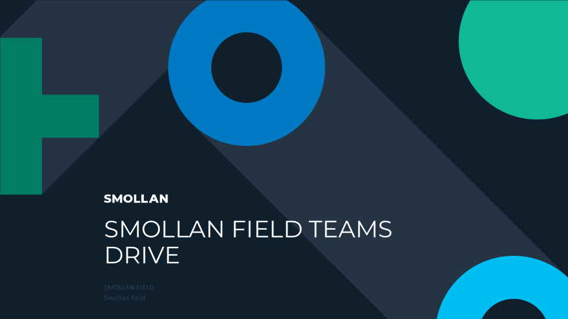

**Shape cover - charcoal** - Geometric cover in charcoal / near-black with a green accent; title lower-left.

- **Use when:** Opening slide for a sober, premium feel or when the client brand is dark.
- **Avoid when:** Photo-led opening.
- **Source:** `Smollan_Core-Template_2024.pptx` -> layout `1_COVER - Shape Charcoal`

| slot | kind | limit | what goes here |
|---|---|---|---|
| `heading` | text | max 2 lines, ~24 chars/line | presentation title, max 2 lines |
| `presenter` | text | fits ~1 line, ~29 chars/line | NAME SURNAME, TITLE |
| `date` | text | fits ~1 line, ~29 chars/line | e.g. OCTOBER 2026 |

```python
deck.add("cover.charcoal",
    heading='YOUR HEADING',
    presenter='Presenter text',
    date='Date text',
)
```

### cover.photo.laptop_sofa

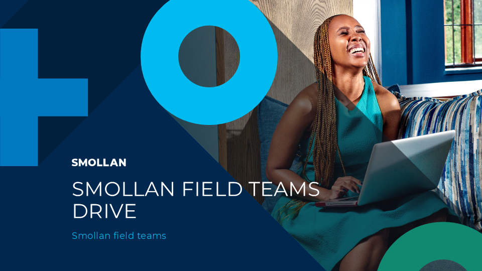

**Photo cover - woman with laptop** - Dark-blue cover, large cyan ring and blue plus shapes; photo of a smiling woman on a sofa with a laptop on the right; SMOLLAN wordmark left; title and sub-heading lower-left.

- **Use when:** Digital / e-commerce / connected-shopper themed opening.
- **Avoid when:** 
- **Source:** `1  -  Smollan_Photo-Covers.pptx` -> layout `8_COVER - Photo DB 5`

| slot | kind | limit | what goes here |
|---|---|---|---|
| `heading` | text | max 2 lines, ~23 chars/line | presentation title (2-3 lines) |
| `subheading` | text | fits ~1 line, ~35 chars/line | one line, e.g. client / purpose |

```python
deck.add("cover.photo.laptop_sofa",
    heading='YOUR HEADING',
    subheading='Subheading text',
)
```

### cover.photo.beauty

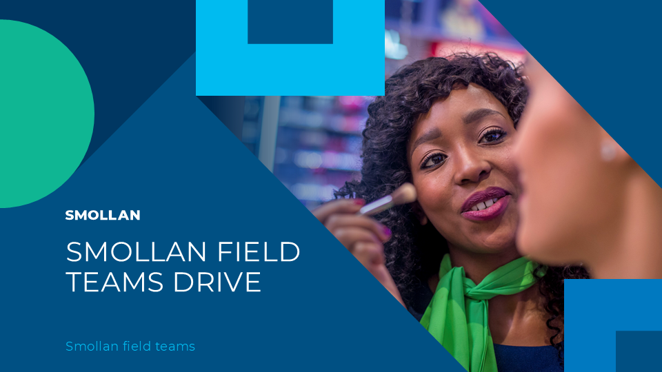

**Photo cover - beauty consultant** - Blue cover with green and cyan geometric shapes; photo of a woman applying make-up (beauty / cosmetics); title lower-left.

- **Use when:** Beauty, personal care, cosmetics or in-store promoter themes.
- **Avoid when:** 
- **Source:** `1  -  Smollan_Photo-Covers.pptx` -> layout `7_COVER - Photo DB 5`

| slot | kind | limit | what goes here |
|---|---|---|---|
| `heading` | text | max 3 lines, ~16 chars/line | presentation title (2-3 lines) |
| `subheading` | text | fits ~1 line, ~35 chars/line | one line, e.g. client / purpose |

```python
deck.add("cover.photo.beauty",
    heading='YOUR HEADING',
    subheading='Subheading text',
)
```

### cover.photo.shoppers

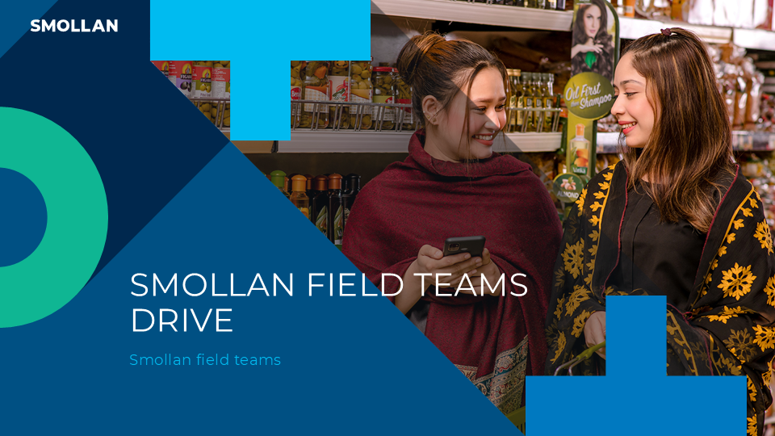

**Photo cover - two shoppers** - Dark-blue cover with green ring and cyan plus; photo of two women shopping in a store, one holding a phone.

- **Use when:** Shopper marketing / shopper insight themes.
- **Avoid when:** 
- **Source:** `1  -  Smollan_Photo-Covers.pptx` -> layout `9_COVER - Photo DB 5`

| slot | kind | limit | what goes here |
|---|---|---|---|
| `heading` | text | max 2 lines, ~23 chars/line | presentation title (2-3 lines) |
| `subheading` | text | fits ~1 line, ~35 chars/line | one line, e.g. client / purpose |

```python
deck.add("cover.photo.shoppers",
    heading='YOUR HEADING',
    subheading='Subheading text',
)
```

### cover.photo.merchandiser

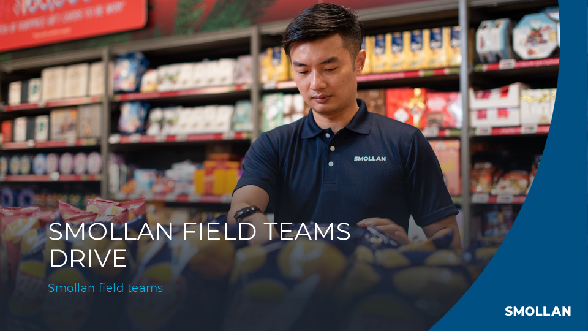

**Photo cover - Smollan merchandiser** - Full-bleed photo of a Smollan merchandiser (branded polo) working a store aisle, framed by a dark-blue curve; SMOLLAN bottom-right.

- **Use when:** Field execution / merchandising / retail services decks.
- **Avoid when:** 
- **Source:** `1  -  Smollan_Photo-Covers.pptx` -> layout `10_COVER - Photo DB 6`

| slot | kind | limit | what goes here |
|---|---|---|---|
| `heading` | text | max 2 lines, ~27 chars/line | presentation title (2-3 lines) |
| `subheading` | text | fits ~1 line, ~35 chars/line | one line, e.g. client / purpose |

```python
deck.add("cover.photo.merchandiser",
    heading='YOUR HEADING',
    subheading='Subheading text',
)
```

### cover.photo.shelf_curve

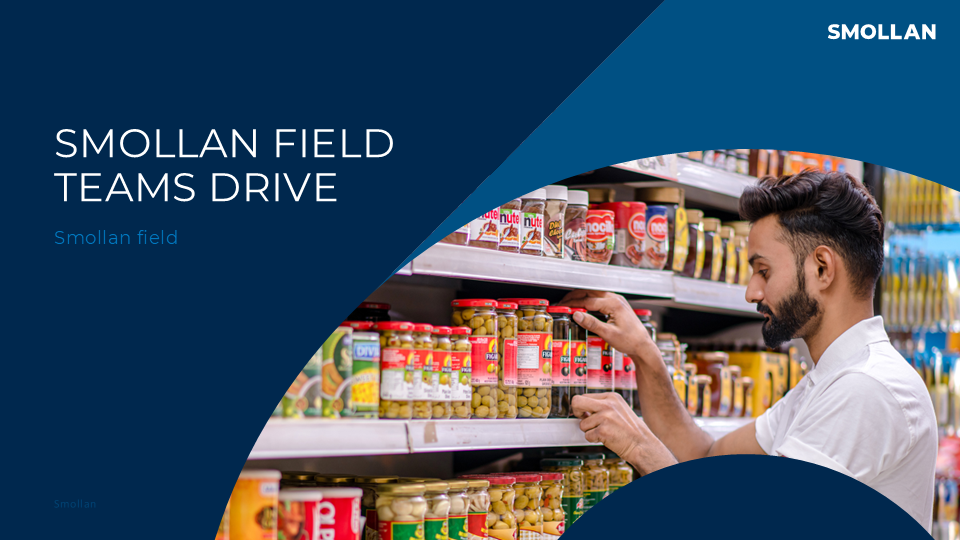

**Photo cover - shelf (curved mask)** - Dark-blue cover, photo of a man stocking a shelf of jars inside a large curved mask on the right; title, sub-heading upper-left; date bottom-left.

- **Use when:** Retail execution / availability themes.
- **Avoid when:** 
- **Source:** `1  -  Smollan_Photo-Covers.pptx` -> layout `1_COVER - Photo DB 1`

| slot | kind | limit | what goes here |
|---|---|---|---|
| `heading` | text | max 3 lines, ~16 chars/line | presentation title (2-3 lines) |
| `subheading` | text | fits ~1 line, ~25 chars/line | one line, e.g. client / purpose |
| `date` | text | fits ~1 line, ~15 chars/line | e.g. OCTOBER 2026 |

```python
deck.add("cover.photo.shelf_curve",
    heading='YOUR HEADING',
    subheading='Subheading text',
    date='Date text',
)
```

### cover.photo.rfp_client

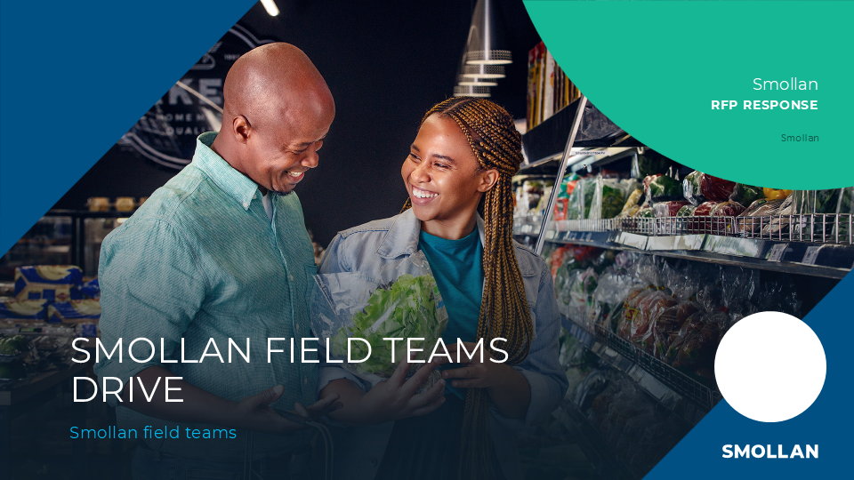

**Photo cover - RFP response with client logo** - Photo of a couple choosing fresh produce, green arc top-right with an 'RFP RESPONSE' label, client name, date and a white circle for the client logo; SMOLLAN bottom-right.

- **Use when:** Responses to RFPs / tenders, co-branded with the client.
- **Avoid when:** 
- **Source:** `1  -  Smollan_Photo-Covers.pptx` -> layout `12_COVER - Photo DB 6`

| slot | kind | limit | what goes here |
|---|---|---|---|
| `heading` | text | max 2 lines, ~27 chars/line | Click to add Presentation Title over Two Lines or Three lines |
| `subheading` | text | fits ~1 line, ~35 chars/line | Edit Subheading here |
| `client` | text | fits ~1 line, ~21 chars/line | client name |
| `date` | text | fits ~1 line, ~15 chars/line | e.g. 18 OCTOBER 2026 |
| `label` | text | fits ~1 line, ~20 chars/line, optional - keeps Smollan wording | default 'RFP RESPONSE' |
| `logo` | logo |  | client logo image (optional; removed if omitted) |

```python
deck.add("cover.photo.rfp_client",
    heading='YOUR HEADING',
    subheading='Subheading text',
    client='Client text',
    date='Date text',
    label='Label text',
    logo='path/to/client_logo.png',
)
```

### cover.photo.shelf_glasses

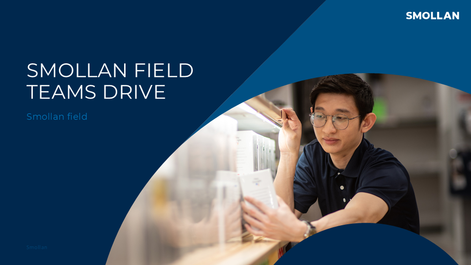

**Photo cover - shopper in glasses (curved mask)** - Dark-blue cover; photo of a man in glasses examining a product at the shelf inside a curved mask; date bottom-left.

- **Use when:** Shopper insight, product / pack decks.
- **Avoid when:** 
- **Source:** `1  -  Smollan_Photo-Covers.pptx` -> layout `3_COVER - Photo DB 1`

| slot | kind | limit | what goes here |
|---|---|---|---|
| `heading` | text | max 3 lines, ~16 chars/line | presentation title (2-3 lines) |
| `subheading` | text | fits ~1 line, ~25 chars/line | one line, e.g. client / purpose |
| `date` | text | fits ~1 line, ~15 chars/line | e.g. OCTOBER 2026 |

```python
deck.add("cover.photo.shelf_glasses",
    heading='YOUR HEADING',
    subheading='Subheading text',
    date='Date text',
)
```

### cover.photo.shelf_curve_dark

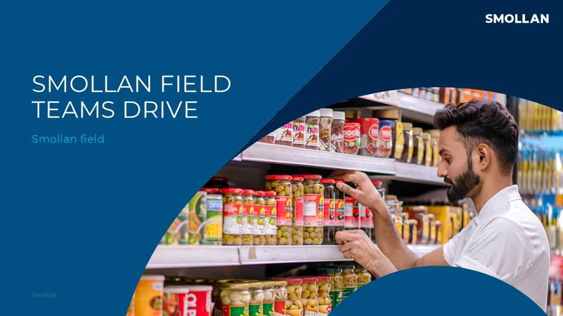

**Photo cover - shelf (curved mask, darker)** - Darker variant of cover.photo.shelf_curve (same shelf photo, deeper blue).

- **Use when:** 
- **Avoid when:** 
- **Source:** `1  -  Smollan_Photo-Covers.pptx` -> layout `2_COVER - Photo DB 1`

| slot | kind | limit | what goes here |
|---|---|---|---|
| `heading` | text | max 3 lines, ~16 chars/line | presentation title (2-3 lines) |
| `subheading` | text | fits ~1 line, ~25 chars/line | one line, e.g. client / purpose |
| `date` | text | fits ~1 line, ~15 chars/line | e.g. OCTOBER 2026 |

```python
deck.add("cover.photo.shelf_curve_dark",
    heading='YOUR HEADING',
    subheading='Subheading text',
    date='Date text',
)
```

### cover.photo.woman_left

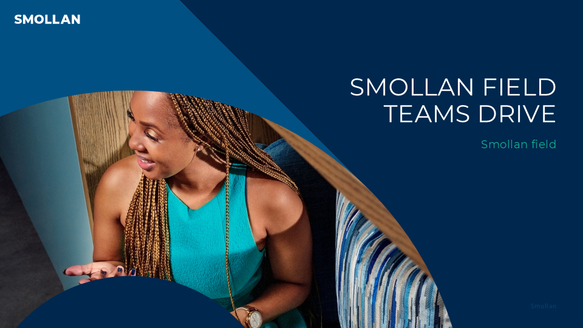

**Photo cover - woman, photo left** - Photo of a smiling woman on the left inside a curved mask; title, sub-heading and date on the right.

- **Use when:** Opening where the text should sit on the right.
- **Avoid when:** 
- **Source:** `1  -  Smollan_Photo-Covers.pptx` -> layout `COVER - Photo DB 2`

| slot | kind | limit | what goes here |
|---|---|---|---|
| `heading` | text | max 3 lines, ~16 chars/line | presentation title (2-3 lines) |
| `subheading` | text | fits ~1 line, ~27 chars/line | one line, e.g. client / purpose |
| `date` | text | fits ~1 line, ~15 chars/line | e.g. OCTOBER 2026 |

```python
deck.add("cover.photo.woman_left",
    heading='YOUR HEADING',
    subheading='Subheading text',
    date='Date text',
)
```

### cover.photo.woman_left_dark

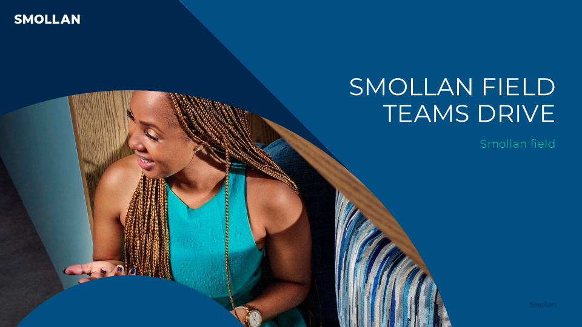

**Photo cover - woman, photo left (darker)** - Darker variant of cover.photo.woman_left.

- **Use when:** 
- **Avoid when:** 
- **Source:** `1  -  Smollan_Photo-Covers.pptx` -> layout `1_COVER - Photo DB 2`

| slot | kind | limit | what goes here |
|---|---|---|---|
| `heading` | text | max 3 lines, ~16 chars/line | presentation title (2-3 lines) |
| `subheading` | text | fits ~1 line, ~27 chars/line | one line, e.g. client / purpose |
| `date` | text | fits ~1 line, ~15 chars/line | e.g. OCTOBER 2026 |

```python
deck.add("cover.photo.woman_left_dark",
    heading='YOUR HEADING',
    subheading='Subheading text',
    date='Date text',
)
```

### cover.photo.shelf_top

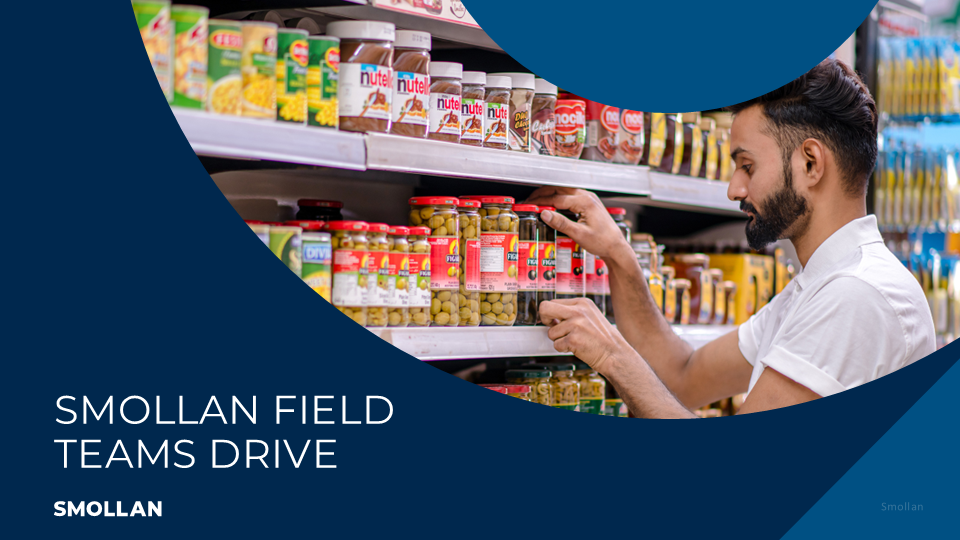

**Photo cover - shelf photo top** - Photo of a man at a well-stocked shelf across the top inside a curved mask; title lower-left; date bottom-right; no sub-heading.

- **Use when:** 
- **Avoid when:** 
- **Source:** `1  -  Smollan_Photo-Covers.pptx` -> layout `3_COVER - Photo DB 3`

| slot | kind | limit | what goes here |
|---|---|---|---|
| `heading` | text | max 3 lines, ~16 chars/line | presentation title (2-3 lines) |
| `date` | text | fits ~1 line, ~15 chars/line | e.g. OCTOBER 2026 |

```python
deck.add("cover.photo.shelf_top",
    heading='YOUR HEADING',
    date='Date text',
)
```

### cover.photo.shelf_top_sub

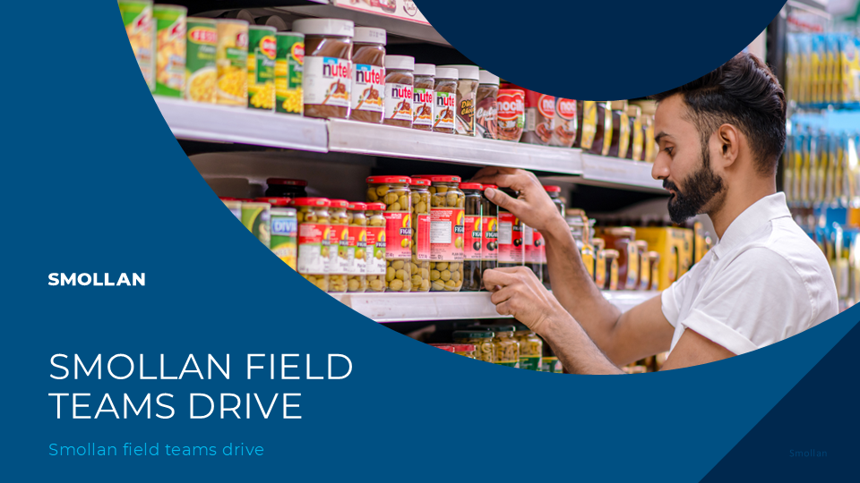

**Photo cover - shelf photo top, with sub-heading** - As cover.photo.shelf_top, plus a sub-heading line under the title.

- **Use when:** 
- **Avoid when:** 
- **Source:** `1  -  Smollan_Photo-Covers.pptx` -> layout `4_COVER - Photo DB 3`

| slot | kind | limit | what goes here |
|---|---|---|---|
| `heading` | text | max 3 lines, ~16 chars/line | presentation title (2-3 lines) |
| `subheading` | text | fits ~1 line, ~63 chars/line | one line, e.g. client / purpose |
| `date` | text | fits ~1 line, ~15 chars/line | e.g. OCTOBER 2026 |

```python
deck.add("cover.photo.shelf_top_sub",
    heading='YOUR HEADING',
    subheading='Subheading text',
    date='Date text',
)
```

### cover.photo.pharmacy

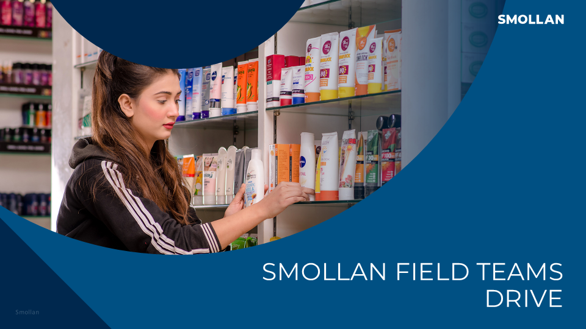

**Photo cover - pharmacy shelf** - Photo of a woman choosing a product in a pharmacy / health-and-beauty aisle inside a large curve; title right; date bottom-left.

- **Use when:** Pharmacy, health, personal-care themes.
- **Avoid when:** 
- **Source:** `1  -  Smollan_Photo-Covers.pptx` -> layout `5_COVER - Photo DB 4`

| slot | kind | limit | what goes here |
|---|---|---|---|
| `heading` | text | max 2 lines, ~23 chars/line | presentation title (2-3 lines) |
| `date` | text | fits ~1 line, ~13 chars/line | e.g. OCTOBER 2026 |

```python
deck.add("cover.photo.pharmacy",
    heading='YOUR HEADING',
    date='Date text',
)
```

### cover.photo.pharmacy_dark

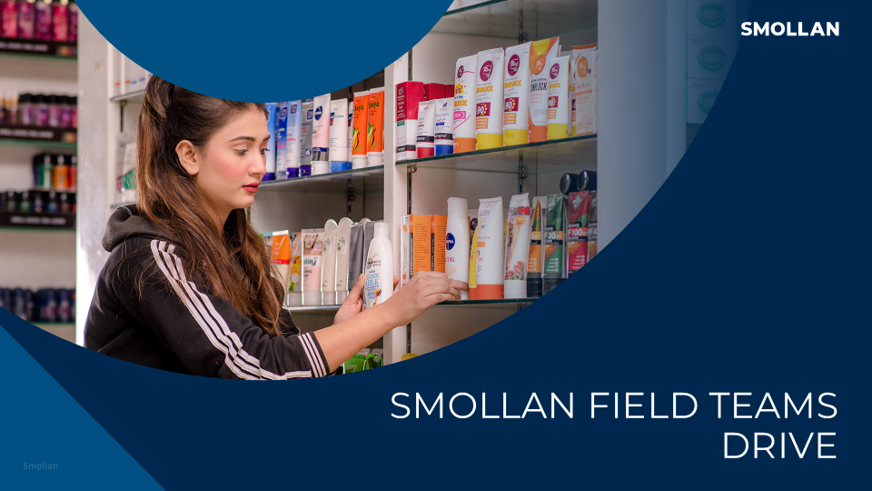

**Photo cover - pharmacy shelf (darker)** - Darker variant of cover.photo.pharmacy.

- **Use when:** 
- **Avoid when:** 
- **Source:** `1  -  Smollan_Photo-Covers.pptx` -> layout `6_COVER - Photo DB 4`

| slot | kind | limit | what goes here |
|---|---|---|---|
| `heading` | text | max 2 lines, ~23 chars/line | presentation title (2-3 lines) |
| `date` | text | fits ~1 line, ~13 chars/line | e.g. OCTOBER 2026 |

```python
deck.add("cover.photo.pharmacy_dark",
    heading='YOUR HEADING',
    date='Date text',
)
```

### cover.photo.client_logo

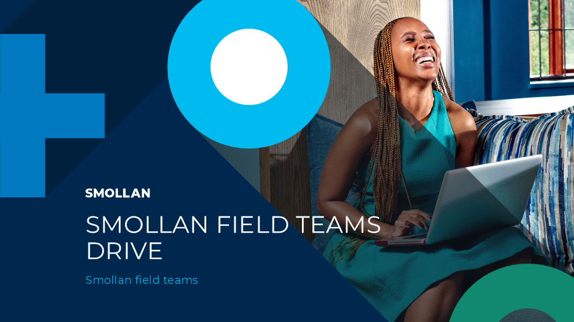

**Photo cover - co-branded with client logo** - cover.photo.laptop_sofa with a white circle inside the cyan ring that holds the client's logo.

- **Use when:** Co-branded opening when the client logo must appear on the cover.
- **Avoid when:** 
- **Source:** `2  -  Smollan_Photo+Client.pptx` -> layout `8_COVER - Photo DB 5`

| slot | kind | limit | what goes here |
|---|---|---|---|
| `heading` | text | max 2 lines, ~23 chars/line | presentation title (2-3 lines) |
| `subheading` | text | fits ~1 line, ~35 chars/line | one line, e.g. client / purpose |

```python
deck.add("cover.photo.client_logo",
    heading='YOUR HEADING',
    subheading='Subheading text',
)
```

## divider

Section breaks between chapters of the deck.

| id | what it is |
|---|---|
| [`divider.dark_blue`](#dividerdark_blue) | Section divider - dark blue |
| [`divider.blue`](#dividerblue) | Section divider - Smollan blue |
| [`divider.charcoal`](#dividercharcoal) | Section divider - charcoal |

### divider.dark_blue

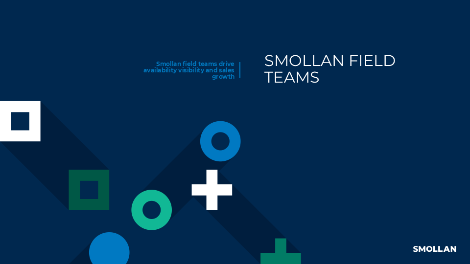

**Section divider - dark blue** - Dark-blue divider with the small Smollan shape cluster on the left; section number and a short title on the right.

- **Use when:** Start of each major section of a deck.
- **Avoid when:** More than ~6 sections (dividers lose meaning).
- **Source:** `Smollan_Core-Template_2024.pptx` -> layout `DIVIDER - Shape Dark Blue`

| slot | kind | limit | what goes here |
|---|---|---|---|
| `heading` | text | max 2 lines, ~20 chars/line | short section title, max 2 lines |
| `section` | text | fits ~5 lines, ~24 chars/line | section number / label, e.g. SECTION 02 |

```python
deck.add("divider.dark_blue",
    heading='YOUR HEADING',
    section='Section text',
)
```

### divider.blue

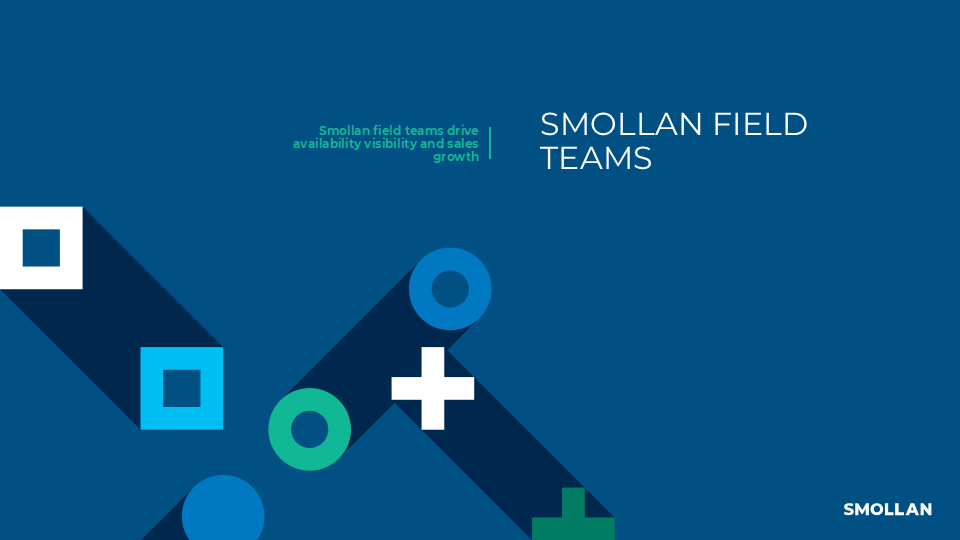

**Section divider - Smollan blue** - Divider in Smollan blue with the shape cluster; section number and title.

- **Use when:** Section break in a deck that opened with cover.blue.
- **Avoid when:** 
- **Source:** `Smollan_Core-Template_2024.pptx` -> layout `1_DIVIDER - Shape Blue`

| slot | kind | limit | what goes here |
|---|---|---|---|
| `heading` | text | max 2 lines, ~20 chars/line | short section title, max 2 lines |
| `section` | text | fits ~5 lines, ~24 chars/line | section number / label, e.g. SECTION 02 |

```python
deck.add("divider.blue",
    heading='YOUR HEADING',
    section='Section text',
)
```

### divider.charcoal

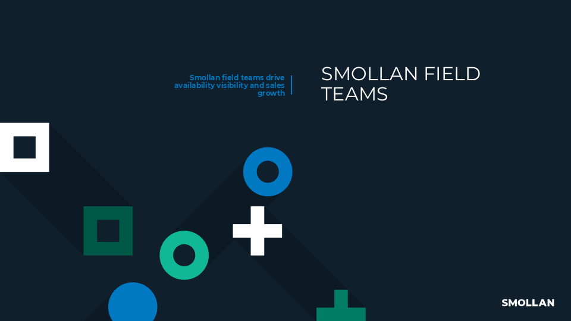

**Section divider - charcoal** - Divider in charcoal with the shape cluster; section number and title.

- **Use when:** Section break in a deck that opened with cover.charcoal.
- **Avoid when:** 
- **Source:** `Smollan_Core-Template_2024.pptx` -> layout `2_DIVIDER - Shape Charcoal`

| slot | kind | limit | what goes here |
|---|---|---|---|
| `heading` | text | max 2 lines, ~20 chars/line | short section title, max 2 lines |
| `section` | text | fits ~5 lines, ~24 chars/line | section number / label, e.g. SECTION 02 |

```python
deck.add("divider.charcoal",
    heading='YOUR HEADING',
    section='Section text',
)
```

## title

Plain content slides: heading (+ sub-heading) and a body text area. The fallback for anything.

| id | what it is |
|---|---|
| [`title.one_line`](#titleone_line) | Heading + body |
| [`title.one_line_sub`](#titleone_line_sub) | Heading + sub-heading + body |
| [`title.one_line_sub_caps`](#titleone_line_sub_caps) | Heading + CAPS sub-heading + body |
| [`title.one_line_sub_below`](#titleone_line_sub_below) | Heading + body with sub-heading above body |
| [`title.two_line`](#titletwo_line) | Two-line heading + body |
| [`title.two_line_sub`](#titletwo_line_sub) | Two-line heading + sub-heading + body |
| [`title.two_line_sub_below`](#titletwo_line_sub_below) | Two-line heading + lead-in + body |

### title.one_line

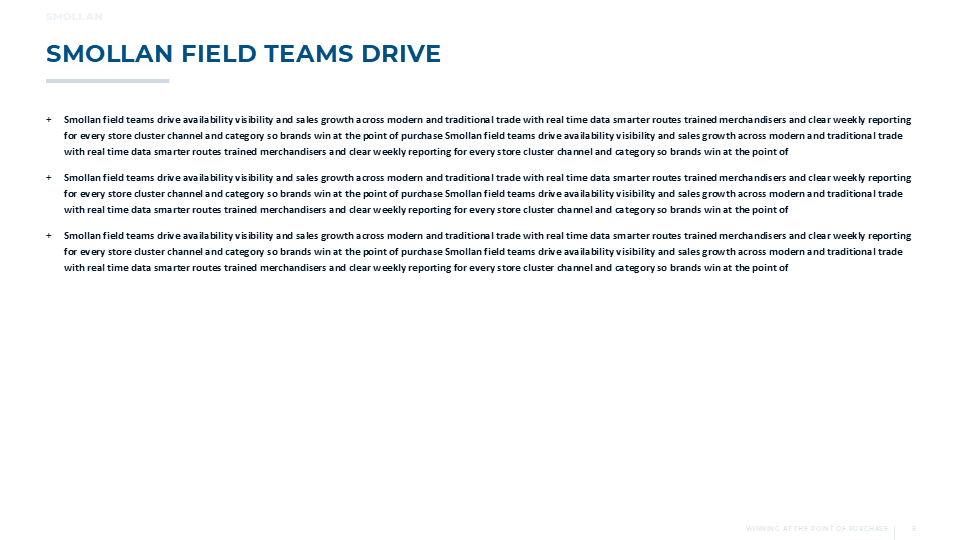

**Heading + body** - White content slide: one-line ALL-CAPS heading with a short rule, and a large body area for paragraphs or bullets.

- **Use when:** Any text content that has no better-structured recipe; agendas; short narratives.
- **Avoid when:** Content that is really N parallel points (use buckets.*), numbers (stats.*) or steps (process.*).
- **Source:** `Smollan_Core-Template_2024.pptx` -> layout `Title Slide - ONE LINE`

| slot | kind | limit | what goes here |
|---|---|---|---|
| `heading` | text | max 1 line, ~50 chars/line | CLICK TO INSERT ONE LINE HEADING |
| `body` | text | fits ~30 lines, ~141 chars/line | paragraphs or bullets ('- ' for level 2) |

```python
deck.add("title.one_line",
    heading='YOUR HEADING',
    body='Body text',
)
```

### title.one_line_sub

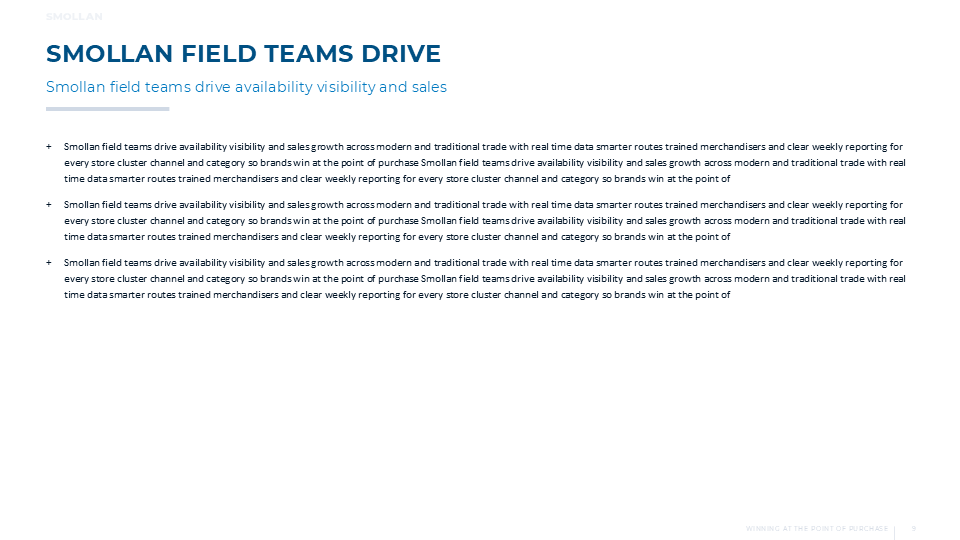

**Heading + sub-heading + body** - One-line heading, a sentence-case sub-heading directly beneath, then a body area.

- **Use when:** Text slide that needs a one-line framing statement under the heading.
- **Avoid when:** 
- **Source:** `Smollan_Core-Template_2024.pptx` -> layout `3_Title Slide - ONE + Sub-Heading`

| slot | kind | limit | what goes here |
|---|---|---|---|
| `heading` | text | max 1 line, ~50 chars/line | CLICK TO INSERT ONE LINE HEADING |
| `subheading` | text | fits ~1 line, ~111 chars/line | Click to edit Sub-heading |
| `body` | text | fits ~28 lines, ~141 chars/line | paragraphs or bullets ('- ' for level 2) |

```python
deck.add("title.one_line_sub",
    heading='YOUR HEADING',
    subheading='Subheading text',
    body='Body text',
)
```

### title.one_line_sub_caps

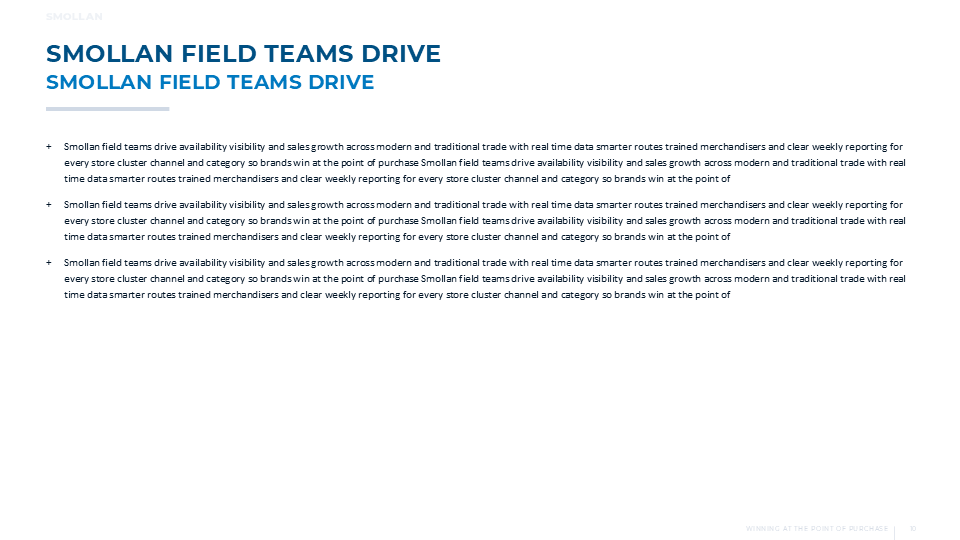

**Heading + CAPS sub-heading + body** - One-line heading, larger ALL-CAPS blue sub-heading beneath, then body.

- **Use when:** Text slide where the sub-heading is a strong second headline.
- **Avoid when:** 
- **Source:** `Smollan_Core-Template_2024.pptx` -> layout `ONE + Sub-Heading 2`

| slot | kind | limit | what goes here |
|---|---|---|---|
| `heading` | text | max 1 line, ~50 chars/line | CLICK TO INSERT ONE LINE HEADING |
| `subheading` | text | fits ~1 line, ~60 chars/line | CLICK TO EDIT SUB-HEADING |
| `body` | text | fits ~28 lines, ~141 chars/line | paragraphs or bullets ('- ' for level 2) |

```python
deck.add("title.one_line_sub_caps",
    heading='YOUR HEADING',
    subheading='Subheading text',
    body='Body text',
)
```

### title.one_line_sub_below

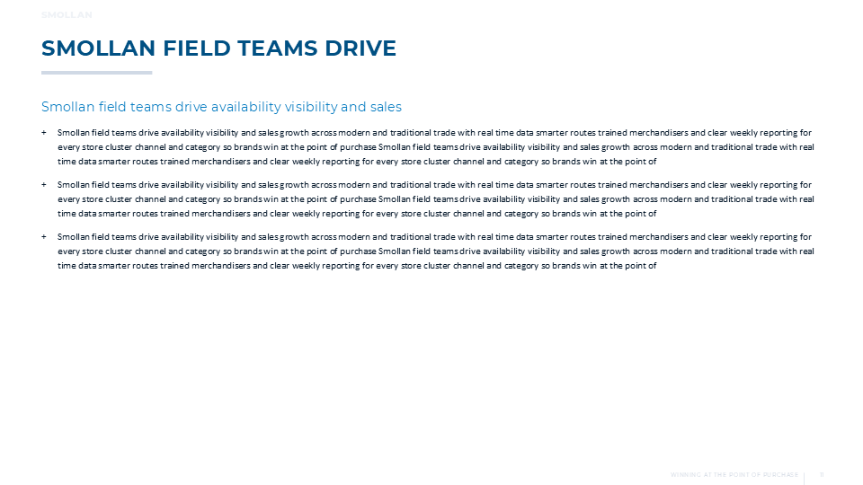

**Heading + body with sub-heading above body** - One-line heading; the sub-heading sits lower, as a lead-in line right above the body text.

- **Use when:** Text slide with a lead-in sentence introducing the body.
- **Avoid when:** 
- **Source:** `Smollan_Core-Template_2024.pptx` -> layout `Title Slide - ONE LINE + SUB`

| slot | kind | limit | what goes here |
|---|---|---|---|
| `heading` | text | max 1 line, ~50 chars/line | CLICK TO INSERT ONE LINE HEADING |
| `subheading` | text | fits ~1 line, ~111 chars/line | Click to edit Sub-heading |
| `body` | text | fits ~28 lines, ~141 chars/line | paragraphs or bullets ('- ' for level 2) |

```python
deck.add("title.one_line_sub_below",
    heading='YOUR HEADING',
    subheading='Subheading text',
    body='Body text',
)
```

### title.two_line

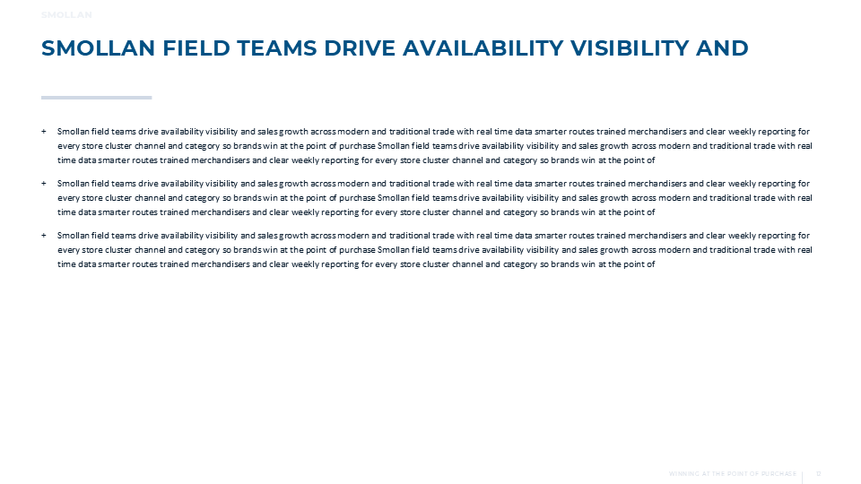

**Two-line heading + body** - Heading over two lines, body area beneath.

- **Use when:** When the heading needs two lines.
- **Avoid when:** 
- **Source:** `Smollan_Core-Template_2024.pptx` -> layout `1_Title Slide - TWO LINE`

| slot | kind | limit | what goes here |
|---|---|---|---|
| `heading` | text | max 2 lines, ~50 chars/line | CLICK TO INSERT TWO LINE HEADING OVER TWO LINES |
| `body` | text | fits ~28 lines, ~141 chars/line | paragraphs or bullets ('- ' for level 2) |

```python
deck.add("title.two_line",
    heading='YOUR HEADING',
    body='Body text',
)
```

### title.two_line_sub

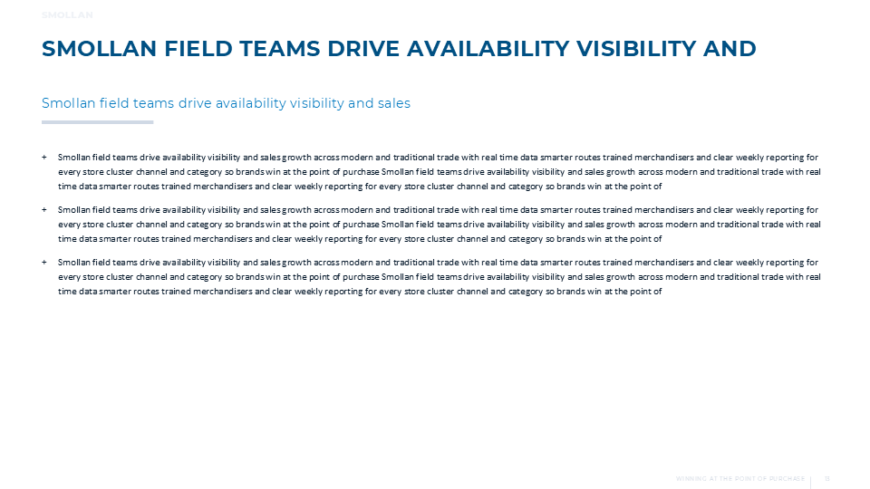

**Two-line heading + sub-heading + body** - Two-line heading, sub-heading directly beneath, body.

- **Use when:** Two-line heading plus a framing line.
- **Avoid when:** 
- **Source:** `Smollan_Core-Template_2024.pptx` -> layout `3_Title Slide - TWO + Sub-Heading`

| slot | kind | limit | what goes here |
|---|---|---|---|
| `heading` | text | max 2 lines, ~50 chars/line | CLICK TO INSERT TWO LINE HEADING OVER TWO LINES |
| `subheading` | text | fits ~1 line, ~111 chars/line | Click to edit Sub-heading |
| `body` | text | fits ~26 lines, ~141 chars/line | paragraphs or bullets ('- ' for level 2) |

```python
deck.add("title.two_line_sub",
    heading='YOUR HEADING',
    subheading='Subheading text',
    body='Body text',
)
```

### title.two_line_sub_below

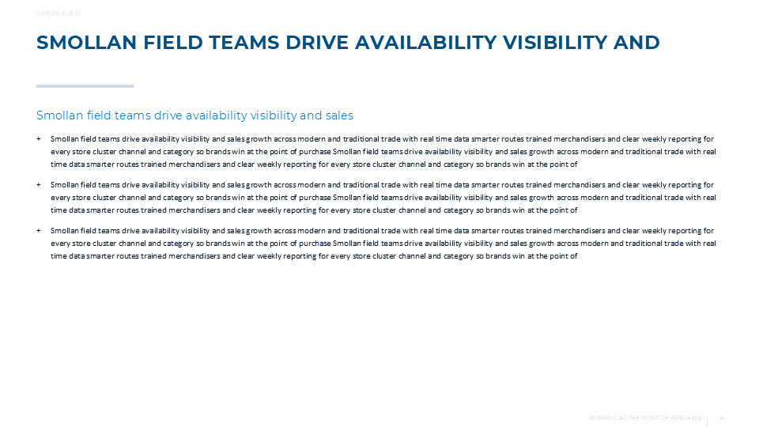

**Two-line heading + lead-in + body** - Two-line heading; sub-heading placed lower as the body lead-in.

- **Use when:** 
- **Avoid when:** 
- **Source:** `Smollan_Core-Template_2024.pptx` -> layout `2_Title Slide - TWO LINE + Sub-Heading`

| slot | kind | limit | what goes here |
|---|---|---|---|
| `heading` | text | max 2 lines, ~50 chars/line | CLICK TO INSERT TWO LINE HEADING OVER TWO LINES |
| `subheading` | text | fits ~1 line, ~111 chars/line | Click to edit Sub-heading |
| `body` | text | fits ~26 lines, ~141 chars/line | paragraphs or bullets ('- ' for level 2) |

```python
deck.add("title.two_line_sub_below",
    heading='YOUR HEADING',
    subheading='Subheading text',
    body='Body text',
)
```

## closing

The Smollan end slide (logo, contact line).

| id | what it is |
|---|---|
| [`closing`](#closing) | Smollan closing slide |

### closing

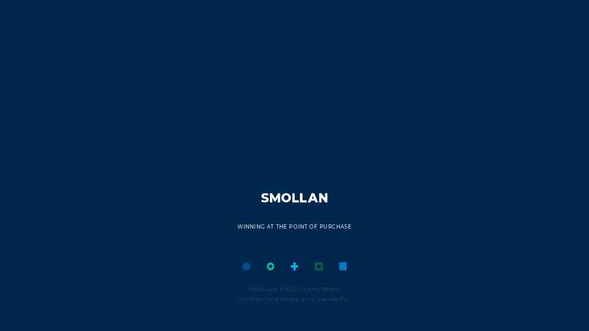

**Smollan closing slide** - Dark-blue end slide: centred SMOLLAN logo, 'WINNING AT THE POINT OF PURCHASE' strapline, brand icons and a small contact line.

- **Use when:** Always the last slide (added automatically by Deck.save).
- **Avoid when:** 
- **Source:** `Smollan_Core-Template_2024.pptx` -> layout `CLOSING Slide`

| slot | kind | limit | what goes here |
|---|---|---|---|
| `contact` | text | fits ~1 line, ~65 chars/line | NAME SURNAME   |   +27 000 0000 |
| `email` | text | fits ~1 line, ~83 chars/line | name.surname@smollan.com |

```python
deck.add("closing",
    contact='Contact text',
    email='Email text',
)
```

## thankyou

Thank-you slides with a personal message and next steps.

| id | what it is |
|---|---|
| [`thankyou.a`](#thankyoua) | Thank you - A (pale band, dark message panel) |
| [`thankyou.c`](#thankyouc) | Thank you - C (dark band, blue circle) |
| [`thankyou.a_1`](#thankyoua_1) | Thank you - A variant (no sub-heading) |
| [`thankyou.a_2`](#thankyoua_2) | Thank you - A variant (with sub-heading) |
| [`thankyou.a_3`](#thankyoua_3) | Thank you - A variant (no sub-heading) |
| [`thankyou.b_1`](#thankyoub_1) | Thank you - B variant (with sub-heading) |
| [`thankyou.b_2`](#thankyoub_2) | Thank you - B variant (no sub-heading) |
| [`thankyou.b_3`](#thankyoub_3) | Thank you - B variant (with sub-heading) |
| [`thankyou.b_4`](#thankyoub_4) | Thank you - B variant (no sub-heading) |
| [`thankyou.c_2`](#thankyouc_2) | Thank you - C variant (with sub-heading) |
| [`thankyou.c_4`](#thankyouc_4) | Thank you - C variant (no sub-heading) |
| [`thankyou.c_7`](#thankyouc_7) | Thank you - C variant (no sub-heading) |
| [`thankyou.c_3`](#thankyouc_3) | Thank you - C variant (with sub-heading) |
| [`thankyou.c_5`](#thankyouc_5) | Thank you - C variant (no sub-heading) |
| [`thankyou.c_8`](#thankyouc_8) | Thank you - C variant (with sub-heading) |
| [`thankyou.c_9`](#thankyouc_9) | Thank you - C variant (no sub-heading) |

### thankyou.a

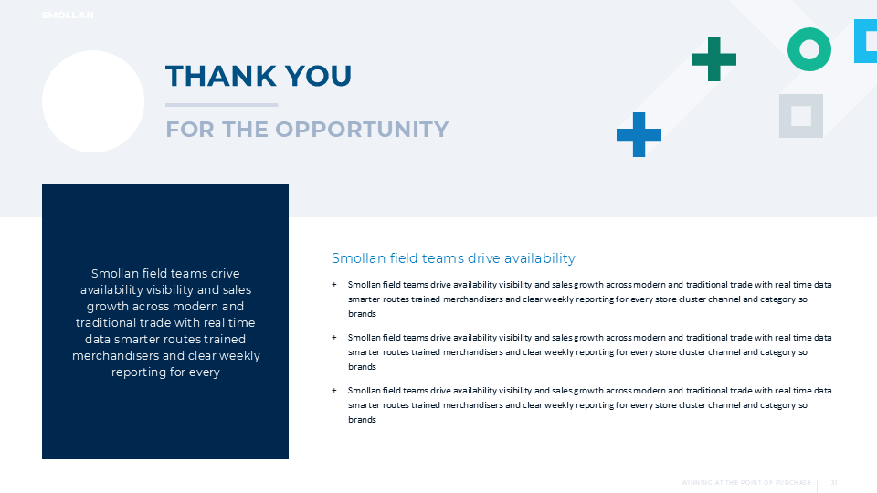

**Thank you - A (pale band, dark message panel)** - Pale top band with brand icons; 'THANK YOU / FOR THE OPPORTUNITY' with a white circle accent; dark-blue panel lower-left for a personal message; sub-heading + body on the right (e.g. next steps).

- **Use when:** Closing a pitch with a thank-you message and next steps.
- **Avoid when:** 
- **Source:** `3  -  Thank-You.pptx` -> layout `Thank you - A`

| slot | kind | limit | what goes here |
|---|---|---|---|
| `heading` | text | fits ~1 line, ~10 chars/line, optional - keeps Smollan wording | default 'THANK YOU' |
| `subheading` | text | fits ~1 line, ~70 chars/line | e.g. NEXT STEPS |
| `heading_2` | text | max 1 line, ~25 chars/line, optional - keeps Smollan wording | default 'FOR THE OPPORTUNITY' |
| `message` | text | max 9 lines, ~40 chars/line | short personal message |
| `body` | text | fits ~15 lines, ~89 chars/line | paragraphs or bullets |

```python
deck.add("thankyou.a",
    heading='YOUR HEADING',
    subheading='Subheading text',
    heading_2='Heading 2 text',
    message='Message text',
    body='Body text',
)
```

### thankyou.c

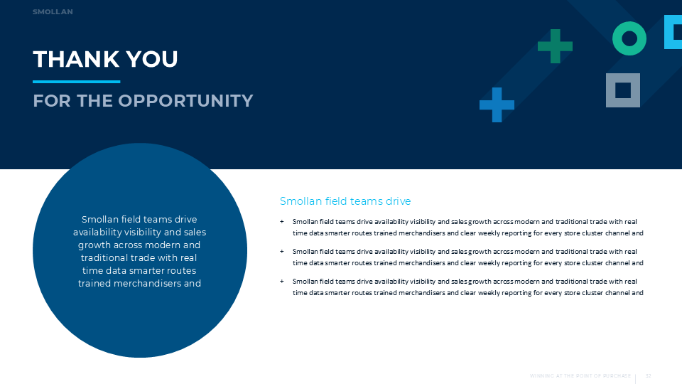

**Thank you - C (dark band, blue circle)** - Dark-blue top band with brand icons; THANK YOU heading left; big blue circle holding the message; sub-heading + body right.

- **Use when:** Closing with a thank-you message and next steps.
- **Avoid when:** 
- **Source:** `3  -  Thank-You.pptx` -> layout `6_Thank you - C`

| slot | kind | limit | what goes here |
|---|---|---|---|
| `heading` | text | fits ~1 line, ~10 chars/line, optional - keeps Smollan wording | default 'THANK YOU' |
| `subheading` | text | fits ~1 line, ~66 chars/line | e.g. NEXT STEPS |
| `heading_2` | text | max 1 line, ~25 chars/line, optional - keeps Smollan wording | default 'FOR THE OPPORTUNITY' |
| `message` | text | max 9 lines, ~33 chars/line | short personal message |
| `body` | text | fits ~15 lines, ~84 chars/line | paragraphs or bullets |

```python
deck.add("thankyou.c",
    heading='YOUR HEADING',
    subheading='Subheading text',
    heading_2='Heading 2 text',
    message='Message text',
    body='Body text',
)
```

### thankyou.a_1

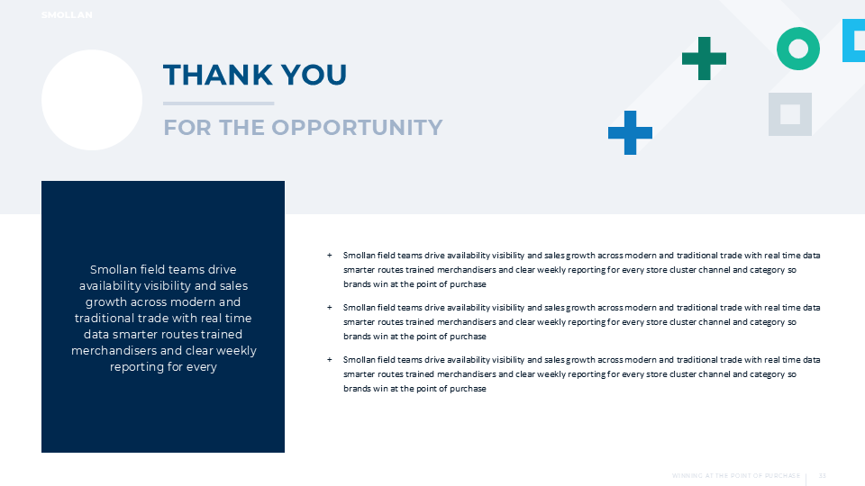

**Thank you - A variant (no sub-heading)** - Hidden master variant of the Thank-you A family: THANK YOU / FOR THE OPPORTUNITY, a message panel and a body area. See its thumbnail for the colour treatment.

- **Use when:** Alternative thank-you treatment when thankyou.a / thankyou.c do not suit.
- **Avoid when:** 
- **Source:** `3  -  Thank-You.pptx` -> layout `1_Thank you - A`

| slot | kind | limit | what goes here |
|---|---|---|---|
| `heading` | text | fits ~1 line, ~10 chars/line, optional - keeps Smollan wording | default 'THANK YOU' |
| `heading_2` | text | max 1 line, ~25 chars/line, optional - keeps Smollan wording | default 'FOR THE OPPORTUNITY' |
| `message` | text | max 9 lines, ~40 chars/line | short personal message |
| `body` | text | fits ~17 lines, ~89 chars/line | paragraphs or bullets |

```python
deck.add("thankyou.a_1",
    heading='YOUR HEADING',
    heading_2='Heading 2 text',
    message='Message text',
    body='Body text',
)
```

### thankyou.a_2

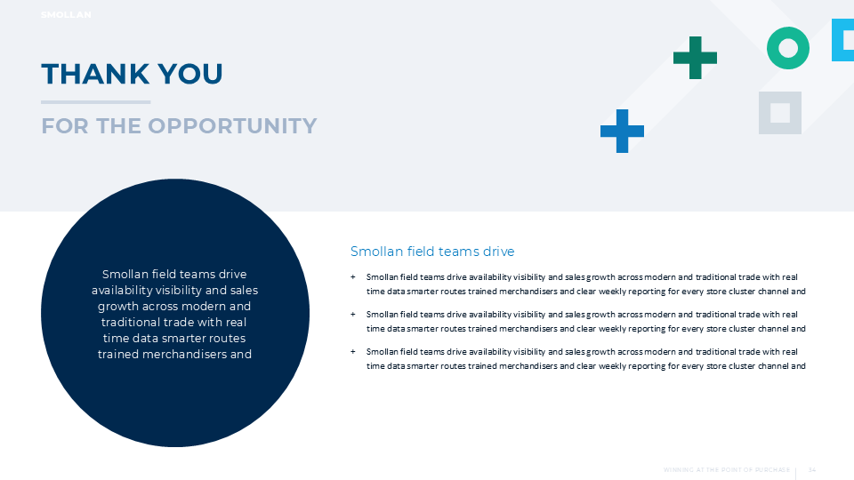

**Thank you - A variant (with sub-heading)** - Hidden master variant of the Thank-you A family: THANK YOU / FOR THE OPPORTUNITY, a message panel and a body area with a sub-heading. See its thumbnail for the colour treatment.

- **Use when:** Alternative thank-you treatment when thankyou.a / thankyou.c do not suit.
- **Avoid when:** 
- **Source:** `3  -  Thank-You.pptx` -> layout `2_Thank you - A`

| slot | kind | limit | what goes here |
|---|---|---|---|
| `heading` | text | fits ~1 line, ~10 chars/line, optional - keeps Smollan wording | default 'THANK YOU' |
| `subheading` | text | fits ~1 line, ~66 chars/line | e.g. NEXT STEPS |
| `heading_2` | text | max 1 line, ~25 chars/line, optional - keeps Smollan wording | default 'FOR THE OPPORTUNITY' |
| `message` | text | max 9 lines, ~33 chars/line | short personal message |
| `body` | text | fits ~15 lines, ~84 chars/line | paragraphs or bullets |

```python
deck.add("thankyou.a_2",
    heading='YOUR HEADING',
    subheading='Subheading text',
    heading_2='Heading 2 text',
    message='Message text',
    body='Body text',
)
```

### thankyou.a_3

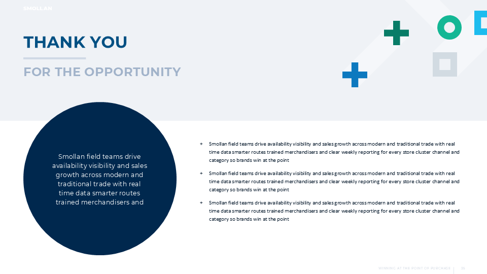

**Thank you - A variant (no sub-heading)** - Hidden master variant of the Thank-you A family: THANK YOU / FOR THE OPPORTUNITY, a message panel and a body area. See its thumbnail for the colour treatment.

- **Use when:** Alternative thank-you treatment when thankyou.a / thankyou.c do not suit.
- **Avoid when:** 
- **Source:** `3  -  Thank-You.pptx` -> layout `3_Thank you - A`

| slot | kind | limit | what goes here |
|---|---|---|---|
| `heading` | text | fits ~1 line, ~10 chars/line, optional - keeps Smollan wording | default 'THANK YOU' |
| `heading_2` | text | max 1 line, ~25 chars/line, optional - keeps Smollan wording | default 'FOR THE OPPORTUNITY' |
| `message` | text | max 9 lines, ~33 chars/line | short personal message |
| `body` | text | fits ~17 lines, ~84 chars/line | paragraphs or bullets |

```python
deck.add("thankyou.a_3",
    heading='YOUR HEADING',
    heading_2='Heading 2 text',
    message='Message text',
    body='Body text',
)
```

### thankyou.b_1

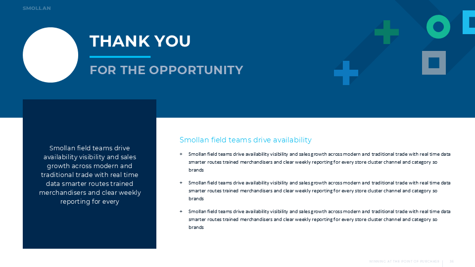

**Thank you - B variant (with sub-heading)** - Hidden master variant of the Thank-you B family: THANK YOU / FOR THE OPPORTUNITY, a message panel and a body area with a sub-heading. See its thumbnail for the colour treatment.

- **Use when:** Alternative thank-you treatment when thankyou.a / thankyou.c do not suit.
- **Avoid when:** 
- **Source:** `3  -  Thank-You.pptx` -> layout `1_Thank you - B`

| slot | kind | limit | what goes here |
|---|---|---|---|
| `heading` | text | fits ~1 line, ~10 chars/line, optional - keeps Smollan wording | default 'THANK YOU' |
| `subheading` | text | fits ~1 line, ~70 chars/line | e.g. NEXT STEPS |
| `heading_2` | text | max 1 line, ~25 chars/line, optional - keeps Smollan wording | default 'FOR THE OPPORTUNITY' |
| `message` | text | max 9 lines, ~40 chars/line | short personal message |
| `body` | text | fits ~15 lines, ~89 chars/line | paragraphs or bullets |

```python
deck.add("thankyou.b_1",
    heading='YOUR HEADING',
    subheading='Subheading text',
    heading_2='Heading 2 text',
    message='Message text',
    body='Body text',
)
```

### thankyou.b_2

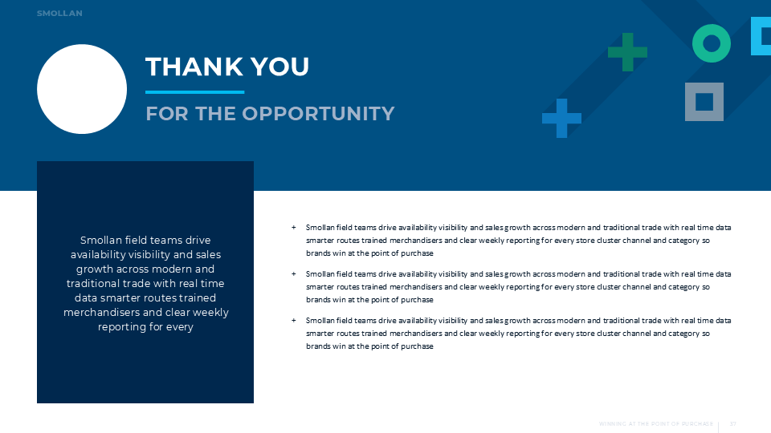

**Thank you - B variant (no sub-heading)** - Hidden master variant of the Thank-you B family: THANK YOU / FOR THE OPPORTUNITY, a message panel and a body area. See its thumbnail for the colour treatment.

- **Use when:** Alternative thank-you treatment when thankyou.a / thankyou.c do not suit.
- **Avoid when:** 
- **Source:** `3  -  Thank-You.pptx` -> layout `2_Thank you - B`

| slot | kind | limit | what goes here |
|---|---|---|---|
| `heading` | text | fits ~1 line, ~10 chars/line, optional - keeps Smollan wording | default 'THANK YOU' |
| `heading_2` | text | max 1 line, ~25 chars/line, optional - keeps Smollan wording | default 'FOR THE OPPORTUNITY' |
| `message` | text | max 9 lines, ~40 chars/line | short personal message |
| `body` | text | fits ~17 lines, ~89 chars/line | paragraphs or bullets |

```python
deck.add("thankyou.b_2",
    heading='YOUR HEADING',
    heading_2='Heading 2 text',
    message='Message text',
    body='Body text',
)
```

### thankyou.b_3

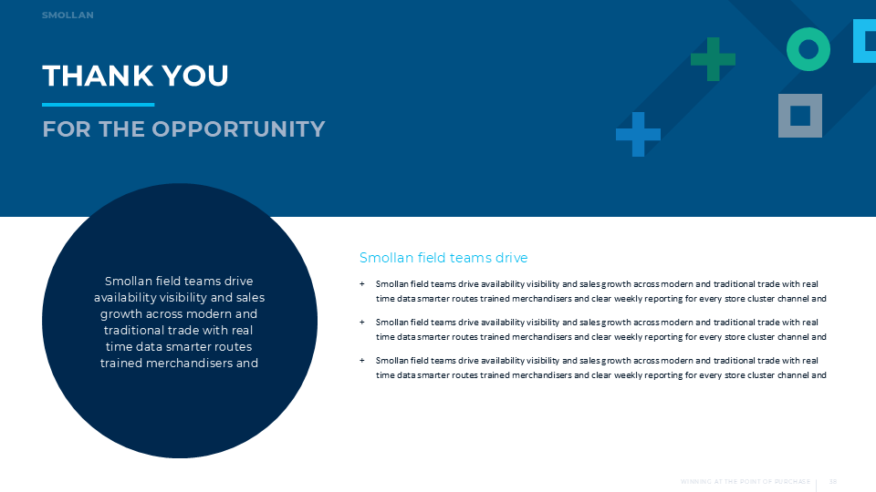

**Thank you - B variant (with sub-heading)** - Hidden master variant of the Thank-you B family: THANK YOU / FOR THE OPPORTUNITY, a message panel and a body area with a sub-heading. See its thumbnail for the colour treatment.

- **Use when:** Alternative thank-you treatment when thankyou.a / thankyou.c do not suit.
- **Avoid when:** 
- **Source:** `3  -  Thank-You.pptx` -> layout `3_Thank you - B`

| slot | kind | limit | what goes here |
|---|---|---|---|
| `heading` | text | fits ~1 line, ~10 chars/line, optional - keeps Smollan wording | default 'THANK YOU' |
| `subheading` | text | fits ~1 line, ~66 chars/line | e.g. NEXT STEPS |
| `heading_2` | text | max 1 line, ~25 chars/line, optional - keeps Smollan wording | default 'FOR THE OPPORTUNITY' |
| `message` | text | max 9 lines, ~33 chars/line | short personal message |
| `body` | text | fits ~15 lines, ~84 chars/line | paragraphs or bullets |

```python
deck.add("thankyou.b_3",
    heading='YOUR HEADING',
    subheading='Subheading text',
    heading_2='Heading 2 text',
    message='Message text',
    body='Body text',
)
```

### thankyou.b_4

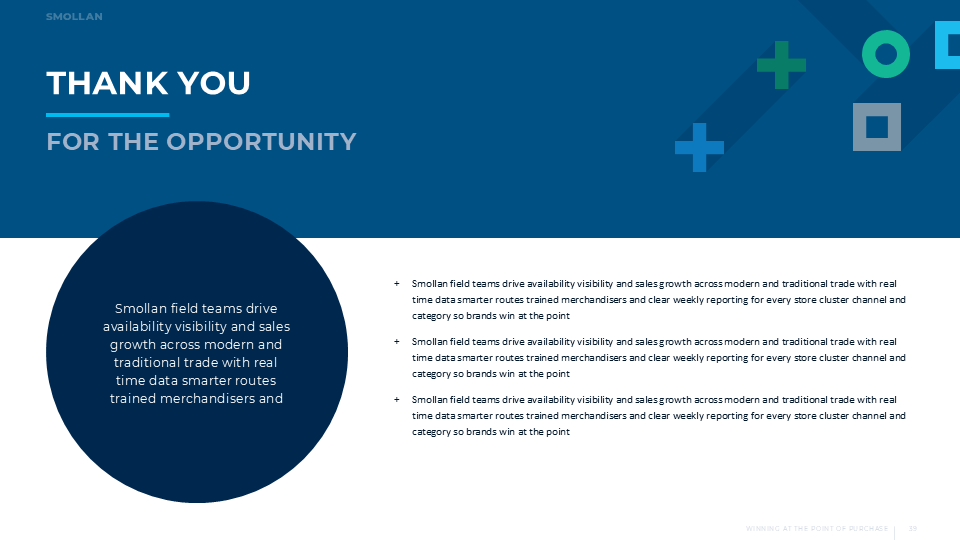

**Thank you - B variant (no sub-heading)** - Hidden master variant of the Thank-you B family: THANK YOU / FOR THE OPPORTUNITY, a message panel and a body area. See its thumbnail for the colour treatment.

- **Use when:** Alternative thank-you treatment when thankyou.a / thankyou.c do not suit.
- **Avoid when:** 
- **Source:** `3  -  Thank-You.pptx` -> layout `4_Thank you - B`

| slot | kind | limit | what goes here |
|---|---|---|---|
| `heading` | text | fits ~1 line, ~10 chars/line, optional - keeps Smollan wording | default 'THANK YOU' |
| `heading_2` | text | max 1 line, ~25 chars/line, optional - keeps Smollan wording | default 'FOR THE OPPORTUNITY' |
| `message` | text | max 9 lines, ~33 chars/line | short personal message |
| `body` | text | fits ~17 lines, ~84 chars/line | paragraphs or bullets |

```python
deck.add("thankyou.b_4",
    heading='YOUR HEADING',
    heading_2='Heading 2 text',
    message='Message text',
    body='Body text',
)
```

### thankyou.c_2


**Thank you - C variant (with sub-heading)** - Hidden master variant of the Thank-you C family: THANK YOU / FOR THE OPPORTUNITY, a message panel and a body area with a sub-heading. See its thumbnail for the colour treatment.

- **Use when:** Alternative thank-you treatment when thankyou.a / thankyou.c do not suit.
- **Avoid when:** 
- **Source:** `3  -  Thank-You.pptx` -> layout `2_Thank you - C`

| slot | kind | limit | what goes here |
|---|---|---|---|
| `heading` | text | fits ~1 line, ~10 chars/line, optional - keeps Smollan wording | default 'THANK YOU' |
| `subheading` | text | fits ~1 line, ~70 chars/line | e.g. NEXT STEPS |
| `heading_2` | text | max 1 line, ~25 chars/line, optional - keeps Smollan wording | default 'FOR THE OPPORTUNITY' |
| `message` | text | max 9 lines, ~40 chars/line | short personal message |
| `body` | text | fits ~15 lines, ~89 chars/line | paragraphs or bullets |

```python
deck.add("thankyou.c_2",
    heading='YOUR HEADING',
    subheading='Subheading text',
    heading_2='Heading 2 text',
    message='Message text',
    body='Body text',
)
```

### thankyou.c_4

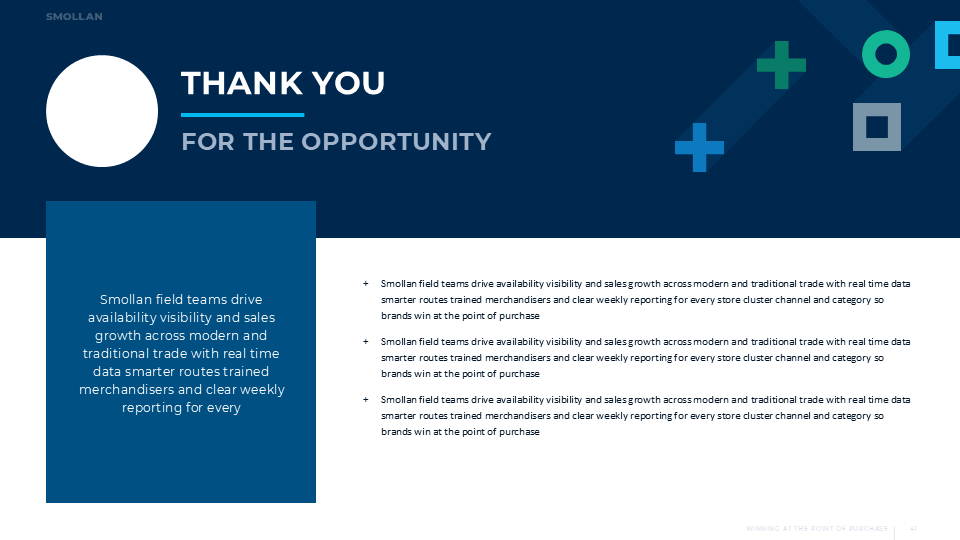

**Thank you - C variant (no sub-heading)** - Hidden master variant of the Thank-you C family: THANK YOU / FOR THE OPPORTUNITY, a message panel and a body area. See its thumbnail for the colour treatment.

- **Use when:** Alternative thank-you treatment when thankyou.a / thankyou.c do not suit.
- **Avoid when:** 
- **Source:** `3  -  Thank-You.pptx` -> layout `4_Thank you - C`

| slot | kind | limit | what goes here |
|---|---|---|---|
| `heading` | text | fits ~1 line, ~10 chars/line, optional - keeps Smollan wording | default 'THANK YOU' |
| `heading_2` | text | max 1 line, ~25 chars/line, optional - keeps Smollan wording | default 'FOR THE OPPORTUNITY' |
| `message` | text | max 9 lines, ~40 chars/line | short personal message |
| `body` | text | fits ~17 lines, ~89 chars/line | paragraphs or bullets |

```python
deck.add("thankyou.c_4",
    heading='YOUR HEADING',
    heading_2='Heading 2 text',
    message='Message text',
    body='Body text',
)
```

### thankyou.c_7

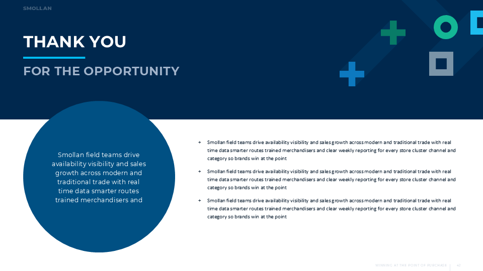

**Thank you - C variant (no sub-heading)** - Hidden master variant of the Thank-you C family: THANK YOU / FOR THE OPPORTUNITY, a message panel and a body area. See its thumbnail for the colour treatment.

- **Use when:** Alternative thank-you treatment when thankyou.a / thankyou.c do not suit.
- **Avoid when:** 
- **Source:** `3  -  Thank-You.pptx` -> layout `7_Thank you - C`

| slot | kind | limit | what goes here |
|---|---|---|---|
| `heading` | text | fits ~1 line, ~10 chars/line, optional - keeps Smollan wording | default 'THANK YOU' |
| `heading_2` | text | max 1 line, ~25 chars/line, optional - keeps Smollan wording | default 'FOR THE OPPORTUNITY' |
| `message` | text | max 9 lines, ~33 chars/line | short personal message |
| `body` | text | fits ~17 lines, ~84 chars/line | paragraphs or bullets |

```python
deck.add("thankyou.c_7",
    heading='YOUR HEADING',
    heading_2='Heading 2 text',
    message='Message text',
    body='Body text',
)
```

### thankyou.c_3

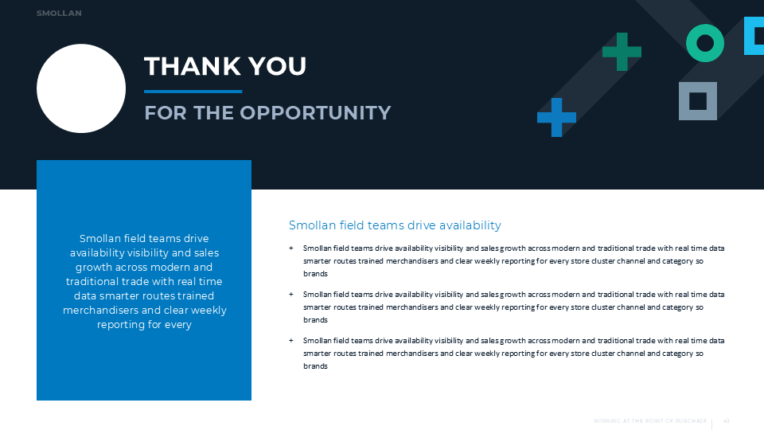

**Thank you - C variant (with sub-heading)** - Hidden master variant of the Thank-you C family: THANK YOU / FOR THE OPPORTUNITY, a message panel and a body area with a sub-heading. See its thumbnail for the colour treatment.

- **Use when:** Alternative thank-you treatment when thankyou.a / thankyou.c do not suit.
- **Avoid when:** 
- **Source:** `3  -  Thank-You.pptx` -> layout `3_Thank you - C`

| slot | kind | limit | what goes here |
|---|---|---|---|
| `heading` | text | fits ~1 line, ~10 chars/line, optional - keeps Smollan wording | default 'THANK YOU' |
| `subheading` | text | fits ~1 line, ~70 chars/line | e.g. NEXT STEPS |
| `heading_2` | text | max 1 line, ~25 chars/line, optional - keeps Smollan wording | default 'FOR THE OPPORTUNITY' |
| `message` | text | max 9 lines, ~40 chars/line | short personal message |
| `body` | text | fits ~15 lines, ~89 chars/line | paragraphs or bullets |

```python
deck.add("thankyou.c_3",
    heading='YOUR HEADING',
    subheading='Subheading text',
    heading_2='Heading 2 text',
    message='Message text',
    body='Body text',
)
```

### thankyou.c_5


**Thank you - C variant (no sub-heading)** - Hidden master variant of the Thank-you C family: THANK YOU / FOR THE OPPORTUNITY, a message panel and a body area. See its thumbnail for the colour treatment.

- **Use when:** Alternative thank-you treatment when thankyou.a / thankyou.c do not suit.
- **Avoid when:** 
- **Source:** `3  -  Thank-You.pptx` -> layout `5_Thank you - C`

| slot | kind | limit | what goes here |
|---|---|---|---|
| `heading` | text | fits ~1 line, ~10 chars/line, optional - keeps Smollan wording | default 'THANK YOU' |
| `heading_2` | text | max 1 line, ~25 chars/line, optional - keeps Smollan wording | default 'FOR THE OPPORTUNITY' |
| `message` | text | max 9 lines, ~40 chars/line | short personal message |
| `body` | text | fits ~17 lines, ~89 chars/line | paragraphs or bullets |

```python
deck.add("thankyou.c_5",
    heading='YOUR HEADING',
    heading_2='Heading 2 text',
    message='Message text',
    body='Body text',
)
```

### thankyou.c_8

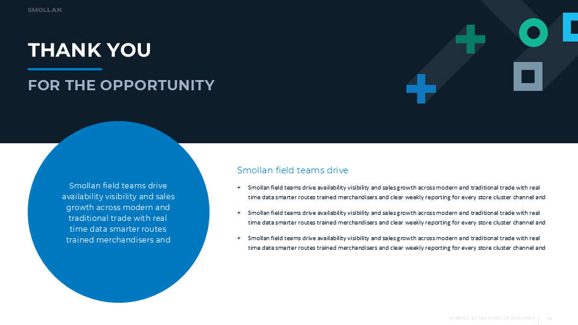

**Thank you - C variant (with sub-heading)** - Hidden master variant of the Thank-you C family: THANK YOU / FOR THE OPPORTUNITY, a message panel and a body area with a sub-heading. See its thumbnail for the colour treatment.

- **Use when:** Alternative thank-you treatment when thankyou.a / thankyou.c do not suit.
- **Avoid when:** 
- **Source:** `3  -  Thank-You.pptx` -> layout `8_Thank you - C`

| slot | kind | limit | what goes here |
|---|---|---|---|
| `heading` | text | fits ~1 line, ~10 chars/line, optional - keeps Smollan wording | default 'THANK YOU' |
| `subheading` | text | fits ~1 line, ~66 chars/line | e.g. NEXT STEPS |
| `heading_2` | text | max 1 line, ~25 chars/line, optional - keeps Smollan wording | default 'FOR THE OPPORTUNITY' |
| `message` | text | max 9 lines, ~33 chars/line | short personal message |
| `body` | text | fits ~15 lines, ~84 chars/line | paragraphs or bullets |

```python
deck.add("thankyou.c_8",
    heading='YOUR HEADING',
    subheading='Subheading text',
    heading_2='Heading 2 text',
    message='Message text',
    body='Body text',
)
```

### thankyou.c_9

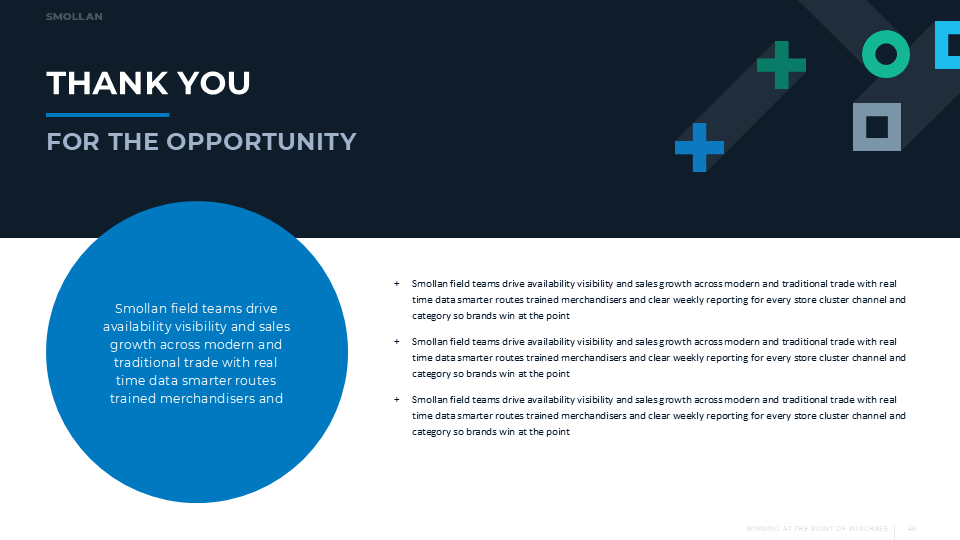

**Thank you - C variant (no sub-heading)** - Hidden master variant of the Thank-you C family: THANK YOU / FOR THE OPPORTUNITY, a message panel and a body area. See its thumbnail for the colour treatment.

- **Use when:** Alternative thank-you treatment when thankyou.a / thankyou.c do not suit.
- **Avoid when:** 
- **Source:** `3  -  Thank-You.pptx` -> layout `9_Thank you - C`

| slot | kind | limit | what goes here |
|---|---|---|---|
| `heading` | text | fits ~1 line, ~10 chars/line, optional - keeps Smollan wording | default 'THANK YOU' |
| `heading_2` | text | max 1 line, ~25 chars/line, optional - keeps Smollan wording | default 'FOR THE OPPORTUNITY' |
| `message` | text | max 9 lines, ~33 chars/line | short personal message |
| `body` | text | fits ~17 lines, ~84 chars/line | paragraphs or bullets |

```python
deck.add("thankyou.c_9",
    heading='YOUR HEADING',
    heading_2='Heading 2 text',
    message='Message text',
    body='Body text',
)
```

## stats

Big-number proof points: 1-5 statistics, with or without photos.

| id | what it is |
|---|---|
| [`stats.1_photo`](#stats1_photo) | 1 big stat + photo |
| [`stats.3_gauges_photos`](#stats3_gauges_photos) | 3 gauge stats with photos |
| [`stats.4_photo`](#stats4_photo) | 4 stats + tall photo |
| [`stats.4_cards`](#stats4_cards) | 4 stat cards |
| [`stats.5_photos`](#stats5_photos) | 5 stats on dark panel + photos |
| [`stats.2_doughnut`](#stats2_doughnut) | 2 stats with doughnut |
| [`stats.3`](#stats3) | 3 big stats (dark band) |
| [`stats.bubbles`](#statsbubbles) | 4 bubble values + year target |
| [`stats.mosaic_2`](#statsmosaic_2) | Mosaic: 2 stats, photos, statement |
| [`stats.mosaic_3`](#statsmosaic_3) | Mosaic: 3 stats, 2 statements |
| [`stats.4_rings_dark`](#stats4_rings_dark) | 4 ring stats on dark photo |

### stats.1_photo

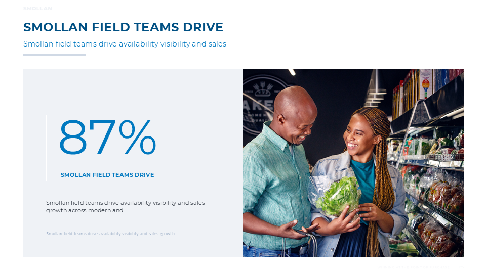

**1 big stat + photo** - One huge statistic with title, descriptive text and secondary note on the left; large photo on the right.

- **Use when:** One headline proof point.
- **Avoid when:** 
- **Source:** `13  -  Stats.pptx` -> layout `HEAD + Photo + 1 x Stat`

| slot | kind | limit | what goes here |
|---|---|---|---|
| `heading` | text | max 1 line, ~50 chars/line | CLICK TO INSERT ONE LINE HEADING |
| `subheading` | text | fits ~1 line, ~111 chars/line | Click to edit Sub-heading |
| `photo` | photo |  | Insert Image |
| `value` | text | fits ~1 line, ~4 chars/line | 56% |
| `label` | text | fits ~1 line, ~50 chars/line | Statistic title |
| `text` | text | max 3 lines, ~57 chars/line | Insert descriptive text for this statistic here. No longer than 3 line... |
| `note` | text | fits ~2 lines, ~60 chars/line | Click to edit your secondary text here. Click to edit your secondary t... |

```python
deck.add("stats.1_photo",
    heading='YOUR HEADING',
    subheading='Subheading text',
    photo='path/to/photo.jpg',
    value='87%',
    label='Label text',
    text='Text text',
    note='Note text',
)
```

### stats.3_gauges_photos

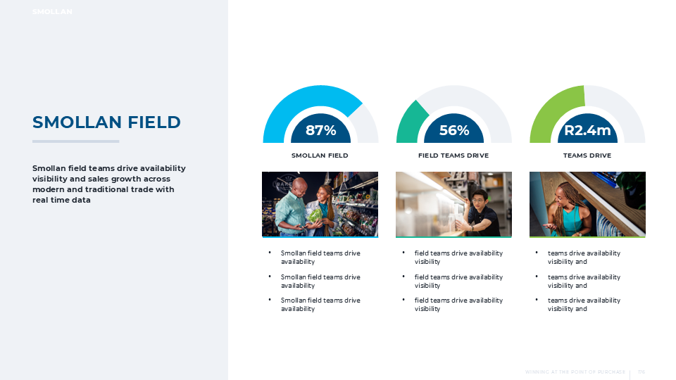

**3 gauge stats with photos** - Left panel heading + intro; three ring gauges (percentage), each with a short heading, a photo and bullets.

- **Use when:** Three percentage results with visuals.
- **Avoid when:** 
- **Source:** `13  -  Stats.pptx` -> layout `HEAD + 3 x Stat + Photos`
- **Note:** The gauge arcs are drawn shapes - their length does not change with the value; adjust them in PowerPoint if needed.

| slot | kind | limit | what goes here |
|---|---|---|---|
| `heading` | text | fits ~2 lines, ~13 chars/line | CLICK TO INSERT YOUR HEADING |
| `intro` | text | fits ~6 lines, ~38 chars/line | Insert introductory text of slide here. Insert introductory text here.... |
| `items[3].value` | text |  |  |
| `items[3].label` | text | fits ~1 line, ~32 chars/line | Short heading here |
| `items[3].photo` | photo |  | Insert Image |
| `items[3].bullets` | text | fits ~10 lines, ~23 chars/line | Click to edit text styles Second level |

```python
deck.add("stats.3_gauges_photos",
    heading='YOUR HEADING',
    intro='Intro text',
    items=[{'value': '87%', 'label': 'Label text', 'photo': 'path/to/photo.jpg', 'bullets': 'Bullets text'},  # x3
           ...],
)
```

### stats.4_photo

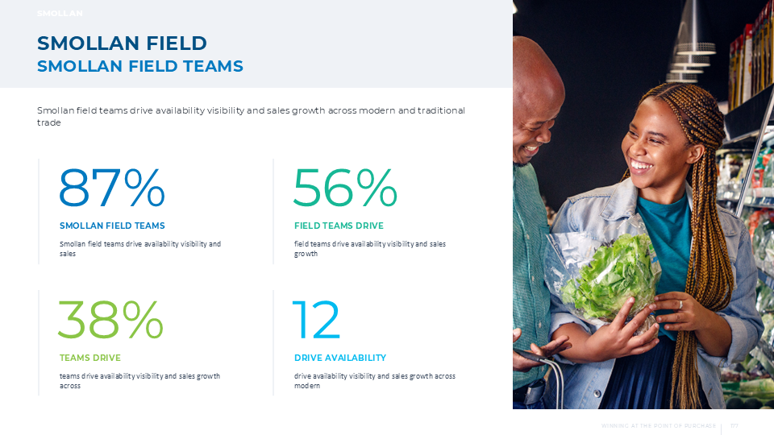

**4 stats + tall photo** - Heading, sub-heading and intro; four stats in a 2 x 2 grid (value, title, text); tall photo on the right.

- **Use when:** 
- **Avoid when:** 
- **Source:** `13  -  Stats.pptx` -> layout `1_HEAD + Photo + 4 x Stats`

| slot | kind | limit | what goes here |
|---|---|---|---|
| `heading` | text | max 1 line, ~31 chars/line | CLICK TO INSERT ONE LINE HEADING |
| `subheading` | text | fits ~1 line, ~38 chars/line | CLICK TO ADD SUB-HEADING |
| `intro` | text | max 2 lines, ~93 chars/line | Insert introductory text or Sub-heading of slide here. No longer than ... |
| `photo` | photo |  | Insert Image |
| `items[4].value` | text | fits ~1 line, ~4 chars/line | 56% |
| `items[4].label` | text | fits ~1 line, ~37 chars/line | Statistic title |
| `items[4].text` | text | fits ~3 lines, ~37 chars/line | Click to edit your two line brief description. Click to edit your brie... |

```python
deck.add("stats.4_photo",
    heading='YOUR HEADING',
    subheading='Subheading text',
    intro='Intro text',
    photo='path/to/photo.jpg',
    items=[{'value': '87%', 'label': 'Label text', 'text': 'Text text'},  # x4
           ...],
)
```

### stats.4_cards

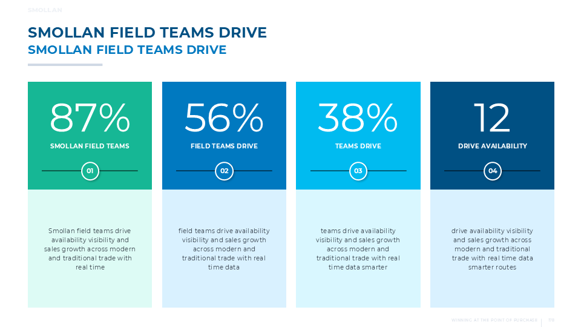

**4 stat cards** - Four coloured cards (green to blue) with big value, title and a numbered badge; description panels beneath.

- **Use when:** Four headline numbers with explanation.
- **Avoid when:** 
- **Source:** `13  -  Stats.pptx` -> layout `HEAD + Sub-Head + 4 x Stats`

| slot | kind | limit | what goes here |
|---|---|---|---|
| `heading` | text | max 1 line, ~50 chars/line | CLICK TO INSERT ONE LINE HEADING |
| `subheading` | text | fits ~1 line, ~60 chars/line | CLICK TO ADD SUB-HEADING |
| `items[4].value` | text | fits ~1 line, ~4 chars/line | 92% |
| `items[4].label` | text | fits ~1 line, ~36 chars/line | Statistic title |
| `items[4].text` | text | max 8 lines, ~27 chars/line | Insert descriptive text here. No longer than 8 lines maximum. Insert i... |

```python
deck.add("stats.4_cards",
    heading='YOUR HEADING',
    subheading='Subheading text',
    items=[{'value': '87%', 'label': 'Label text', 'text': 'Text text'},  # x4
           ...],
)
```

### stats.5_photos

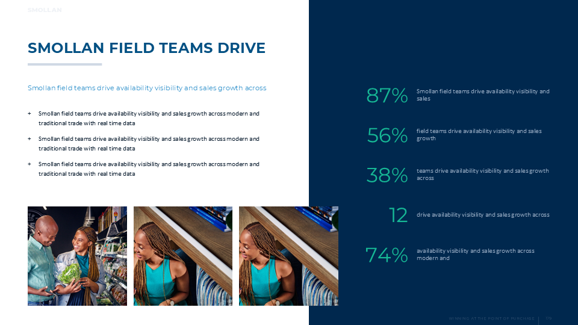

**5 stats on dark panel + photos** - Two-line heading, intro, bullets and three photos on the left; dark panel with five stat rows on the right.

- **Use when:** 
- **Avoid when:** 
- **Source:** `13  -  Stats.pptx` -> layout `HEAD + Photos + 5 x Stats`

| slot | kind | limit | what goes here |
|---|---|---|---|
| `heading` | text | max 2 lines, ~24 chars/line | CLICK TO INSERT YOUR TWO LINE HEADING |
| `intro` | text | max 2 lines, ~71 chars/line | Insert introductory text of slide here. No longer than 2 lines maximum... |
| `body` | text | fits ~10 lines, ~68 chars/line | Click to edit Master text styles Second level |
| `photo` | photo |  | Insert Image |
| `photo_2` | photo |  | Insert Image |
| `photo_3` | photo |  | Insert Image |
| `items[5].value` | text | fits ~1 line, ~3 chars/line | 56% |
| `items[5].text` | text | max 3 lines, ~36 chars/line | Click to edit your paragraph that speaks to this statistic. No longer ... |

```python
deck.add("stats.5_photos",
    heading='YOUR HEADING',
    intro='Intro text',
    body='Body text',
    photo='path/to/photo.jpg',
    photo_2='path/to/photo.jpg',
    photo_3='path/to/photo.jpg',
    items=[{'value': '87%', 'text': 'Text text'},  # x5
           ...],
)
```

### stats.2_doughnut

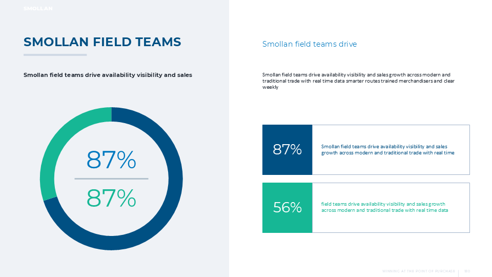

**2 stats with doughnut** - Left panel: heading, intro and a doughnut chart with the two values; right: sub-heading, paragraph and two value boxes with text.

- **Use when:** A two-part split (e.g. 70 / 30).
- **Avoid when:** 
- **Source:** `13  -  Stats.pptx` -> layout `HEAD + 2 x Stats`
- **Note:** chart = {'categories': ['A', 'B'], 'series': {'Split': [70, 30]}}; chart_value_1/2 are the labels inside the ring.

| slot | kind | limit | what goes here |
|---|---|---|---|
| `heading` | text | fits ~2 lines, ~19 chars/line | CLICK TO INSERT YOUR HEADING |
| `subheading` | text | fits ~1 line, ~51 chars/line | Click to edit Sub-heading |
| `intro` | text | max 2 lines, ~58 chars/line | Insert introductory text or Sub-heading of slide here. No longer than ... |
| `text` | text | fits ~5 lines, ~65 chars/line | Click to edit your paragraph that will tell the story of the two perce... |
| `chart` | chart |  |  |
| `chart_value_1` | text | fits ~1 line, ~7 chars/line | 70% |
| `chart_value_2` | text | fits ~1 line, ~7 chars/line | 30% |
| `items[2].value` | text | fits ~3 lines, ~4 chars/line | 70% |
| `items[2].text` | text | max 5 lines, ~43 chars/line | Click to edit your paragraph that shares more specific detail about th... |

```python
deck.add("stats.2_doughnut",
    heading='YOUR HEADING',
    subheading='Subheading text',
    intro='Intro text',
    text='Text text',
    chart={'type': 'column', 'categories': ['Q1', 'Q2', 'Q3'], 'series': {'2026': [4.1, 5.2, 6.3]}},
    chart_value_1='Chart value 1 text',
    chart_value_2='Chart value 2 text',
    items=[{'value': '87%', 'text': 'Text text'},  # x2
           ...],
)
```

### stats.3

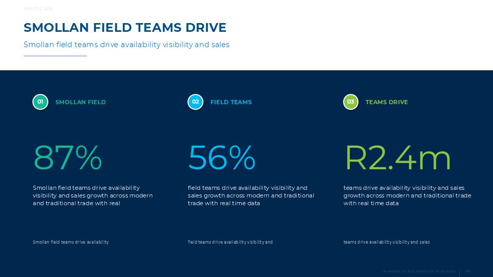

**3 big stats (dark band)** - Dark band with three numbered columns: heading, big value, descriptive text and a secondary note.

- **Use when:** Three headline numbers - the default stats slide.
- **Avoid when:** 
- **Source:** `13  -  Stats.pptx` -> layout `HEAD + 3 x Stats`

| slot | kind | limit | what goes here |
|---|---|---|---|
| `heading` | text | max 1 line, ~50 chars/line | CLICK TO INSERT ONE LINE HEADING |
| `subheading` | text | fits ~1 line, ~111 chars/line | Click to edit Sub-heading |
| `items[3].label` | text | fits ~1 line, ~25 chars/line | HEADING 1 |
| `items[3].value` | text | fits ~1 line, ~5 chars/line | 56% |
| `items[3].text` | text | max 5 lines, ~42 chars/line | Insert descriptive text for this statistic here. No longer than 5 line... |
| `items[3].note` | text | fits ~2 lines, ~44 chars/line | Click to edit your secondary text here. Click to edit your secondary t... |

```python
deck.add("stats.3",
    heading='YOUR HEADING',
    subheading='Subheading text',
    items=[{'label': 'Label text', 'value': '87%', 'text': 'Text text', 'note': 'Note text'},  # x3
           ...],
)
```

### stats.bubbles


**4 bubble values + year target** - Four overlapping coloured bubbles (value + title, e.g. quarters) and a large target value on the right.

- **Use when:** Quarterly figures adding up to a target.
- **Avoid when:** 
- **Source:** `13  -  Stats.pptx` -> layout `HEAD + 5 x Stats`

| slot | kind | limit | what goes here |
|---|---|---|---|
| `heading` | text | fits ~1 line, ~24 chars/line | CLICK TO INSERT YOUR SLIDE HEADING |
| `intro` | text | max 2 lines, ~71 chars/line | Insert introductory text or Sub-heading of slide here. No longer than ... |
| `text` | text | max 3 lines, ~61 chars/line | Click to edit your paragraph that introduces the story on this slide. ... |
| `target_title` | text | fits ~3 lines, ~29 chars/line | YOUR TITLE |
| `target_value` | text | fits ~1 line, ~9 chars/line | $8.8Mil |
| `conclusion` | text | fits ~3 lines, ~68 chars/line | Click to edit your paragraph that will conclude the story on this slid... |
| `items[4].value` | text | fits ~1 line, ~7 chars/line | $0.00 |
| `items[4].label` | text | fits ~1 line, ~24 chars/line | First title |

```python
deck.add("stats.bubbles",
    heading='YOUR HEADING',
    intro='Intro text',
    text='Text text',
    target_title='Target title text',
    target_value='Target value text',
    conclusion='Conclusion text',
    items=[{'value': '87%', 'label': 'Label text'},  # x4
           ...],
)
```

### stats.mosaic_2


**Mosaic: 2 stats, photos, statement** - Tile mosaic: intro box, big stat with arrow to text, large statement tile; bottom row photo, text, circle stat, wide photo.

- **Use when:** 
- **Avoid when:** 
- **Source:** `13  -  Stats.pptx` -> layout `HEAD + Sub-Head + 2 x Stats + Photos`

| slot | kind | limit | what goes here |
|---|---|---|---|
| `heading` | text | max 1 line, ~50 chars/line | CLICK TO INSERT ONE LINE HEADING |
| `subheading` | text | fits ~1 line, ~60 chars/line | CLICK TO ADD SUB-HEADING |
| `intro` | text | max 1 line, ~148 chars/line | Insert introductory text here. No longer than 1 line maximum. Insert i... |
| `side_intro` | text | max 7 lines, ~20 chars/line | Insert intro text here. No longer than 7 lines maximum. Insert intro t... |
| `statement` | text | fits ~6 lines, ~13 chars/line | CLICK TO ADD YOUR LARGE STATEMENT THAT YOU WISH TO CALLOUT IN THIS BOX... |
| `photo` | photo |  | Insert Image |
| `photo_2` | photo |  | Insert Image |
| `items[2].value` | text | fits ~1 line, ~4 chars/line | 57% |
| `items[2].label` | text | fits ~1 line, ~31 chars/line | Statistic title |
| `items[2].text` | text | max 7 lines, ~44 chars/line | Insert descriptive text for this statistic here. No longer than 7 line... |

```python
deck.add("stats.mosaic_2",
    heading='YOUR HEADING',
    subheading='Subheading text',
    intro='Intro text',
    side_intro='Side intro text',
    statement='Statement text',
    photo='path/to/photo.jpg',
    photo_2='path/to/photo.jpg',
    items=[{'value': '87%', 'label': 'Label text', 'text': 'Text text'},  # x2
           ...],
)
```

### stats.mosaic_3


**Mosaic: 3 stats, 2 statements** - Tile mosaic with three stats (two in cyan tiles, one in a circle), each with descriptive text, and two statement tiles.

- **Use when:** 
- **Avoid when:** 
- **Source:** `13  -  Stats.pptx` -> layout `HEAD + Sub-Head + 3 x Stats`

| slot | kind | limit | what goes here |
|---|---|---|---|
| `heading` | text | max 1 line, ~50 chars/line | CLICK TO INSERT ONE LINE HEADING |
| `subheading` | text | fits ~1 line, ~60 chars/line | CLICK TO ADD SUB-HEADING |
| `intro` | text | max 1 line, ~148 chars/line | Insert introductory text here. No longer than 1 line maximum. Insert i... |
| `statement` | text | fits ~6 lines, ~13 chars/line | CLICK TO ADD YOUR LARGE STATEMENT THAT YOU WISH TO CALLOUT IN THIS BOX... |
| `statement_2` | text | fits ~6 lines, ~13 chars/line | CLICK TO ADD YOUR LARGE STATEMENT THAT YOU WISH TO CALLOUT IN THIS BOX... |
| `items[3].value` | text | fits ~1 line, ~4 chars/line | 57% |
| `items[3].label` | text | fits ~1 line, ~31 chars/line | Statistic title |
| `items[3].text` | text | max 7 lines, ~44 chars/line | Insert descriptive text for this statistic here. No longer than 7 line... |

```python
deck.add("stats.mosaic_3",
    heading='YOUR HEADING',
    subheading='Subheading text',
    intro='Intro text',
    statement='Statement text',
    statement_2='Statement 2 text',
    items=[{'value': '87%', 'label': 'Label text', 'text': 'Text text'},  # x3
           ...],
)
```

### stats.4_rings_dark


**4 ring stats on dark photo** - Dark photographic background; four circular rings with value and title, bullets under each.

- **Use when:** 
- **Avoid when:** 
- **Source:** `13  -  Stats.pptx` -> layout `1_HEAD + Sub-Head + 3 x Stats`

| slot | kind | limit | what goes here |
|---|---|---|---|
| `heading` | text | max 1 line, ~50 chars/line | CLICK TO INSERT ONE LINE HEADING |
| `subheading` | text | fits ~1 line, ~60 chars/line | CLICK TO ADD SUB-HEADING |
| `items[4].value` | text | fits ~1 line, ~4 chars/line | 63% |
| `items[4].label` | text | fits ~1 line, ~17 chars/line | STATISTIC TITLE |
| `items[4].bullets` | text | fits ~8 lines, ~23 chars/line | Click to edit text styles Second level |

```python
deck.add("stats.4_rings_dark",
    heading='YOUR HEADING',
    subheading='Subheading text',
    items=[{'value': '87%', 'label': 'Label text', 'bullets': 'Bullets text'},  # x4
           ...],
)
```

## kpis

What we will measure: KPI grids, KPI tables and scorecards.

| id | what it is |
|---|---|
| [`kpis.6`](#kpis6) | 6 KPI columns with icons (dark) |
| [`kpis.5`](#kpis5) | 5 suggested KPIs |
| [`kpis.4_callouts`](#kpis4_callouts) | 4 highlight callouts + 4 statements |
| [`kpis.3_callouts`](#kpis3_callouts) | 3 highlight callouts + 5 statements |
| [`kpis.7`](#kpis7) | 7 business KPIs (dark panel) |
| [`kpis.table`](#kpistable) | Objective / key-result table + notes |
| [`kpis.strategic_table`](#kpisstrategic_table) | Strategic KPI table |
| [`kpis.scorecard`](#kpisscorecard) | KPI scorecard image + metrics |

### kpis.6


**6 KPI columns with icons (dark)** - Dark-blue slide: numbered 01-06 timeline, six brand icons and under each a short list of measures.

- **Use when:** Our commitment: six KPI areas with their measures.
- **Avoid when:** 
- **Source:** `9  -  KPIs.pptx` -> layout `HEAD + Sub-Head + 6 x KPI`
- **Note:** Heading template wording 'OUR COMMITMENT TO [CLIENT] KPIs' - [Client] is replaced by Deck(client=...).

| slot | kind | limit | what goes here |
|---|---|---|---|
| `heading` | text | fits ~1 line, ~50 chars/line | OUR COMMITMENT TO [CLIENT] KPIs |
| `subheading` | text | fits ~1 line, ~60 chars/line | YOUR KPI MEASURES HEADING |
| `items[6].measures` | text | fits ~11 lines, ~13 chars/line | list of 3-5 short measures (CAPS) |

```python
deck.add("kpis.6",
    heading='YOUR HEADING',
    subheading='Subheading text',
    items=[{'measures': 'Measures text'},  # x6
           ...],
)
```

### kpis.5


**5 suggested KPIs** - Left: 'SUGGESTED KPIs' + intro; right: five coloured KPI labels joined to description boxes.

- **Use when:** Proposing KPIs to co-create with the client.
- **Avoid when:** 
- **Source:** `9  -  KPIs.pptx` -> layout `HEAD + Intro + 5 x KPI`

| slot | kind | limit | what goes here |
|---|---|---|---|
| `heading` | text | fits ~1 line, ~12 chars/line | SUGGESTED KPIs |
| `intro` | text | fits ~2 lines, ~24 chars/line | These KPIs can be co-created with [Client] |
| `items[5].label` | text | fits ~2 lines, ~12 chars/line | one-two line KPI name (CAPS) |
| `items[5].text` | text | fits ~2 lines, ~51 chars/line | These KPIs can be co-created with [Client X] |

```python
deck.add("kpis.5",
    heading='YOUR HEADING',
    intro='Intro text',
    items=[{'label': 'Label text', 'text': 'Text text'},  # x5
           ...],
)
```

### kpis.4_callouts


**4 highlight callouts + 4 statements** - Left panel heading + intro; four icon highlight callouts across the top; four arrowed statements beneath.

- **Use when:** Performance principles / team commitments.
- **Avoid when:** 
- **Source:** `9  -  KPIs.pptx` -> layout `HEAD + Intro + 4 x 4 KPI`

| slot | kind | limit | what goes here |
|---|---|---|---|
| `heading` | text | fits ~2 lines, ~12 chars/line | PERFORMANCE DRIVEN TEAM |
| `intro` | text | fits ~3 lines, ~28 chars/line | The following principles underpin holistic Performance Management with... |
| `items[4].callout` | text | fits ~2 lines, ~11 chars/line | HIGHLIGHT CALLOUT 1 |
| `items[4].text` | text | max 3 lines, ~81 chars/line | Insert your text here. No longer than 3 lines maximum. Insert your tex... |

```python
deck.add("kpis.4_callouts",
    heading='YOUR HEADING',
    intro='Intro text',
    items=[{'callout': 'Callout text', 'text': 'Text text'},  # x4
           ...],
)
```

### kpis.3_callouts


**3 highlight callouts + 5 statements** - Left panel heading + intro; three icon callouts and five arrowed statements.

- **Use when:** 
- **Avoid when:** 
- **Source:** `9  -  KPIs.pptx` -> layout `1_HEAD + Intro + 3 x 5 KPI`

| slot | kind | limit | what goes here |
|---|---|---|---|
| `heading` | text | fits ~2 lines, ~12 chars/line | PERFORMANCE DRIVEN TEAM |
| `intro` | text | fits ~3 lines, ~28 chars/line | The following principles underpin holistic Performance Management with... |
| `callout_1` | text | fits ~2 lines, ~11 chars/line | HIGHLIGHT CALLOUT 1 |
| `callout_2` | text | fits ~2 lines, ~11 chars/line | HIGHLIGHT CALLOUT 2 |
| `callout_3` | text | fits ~2 lines, ~11 chars/line | HIGHLIGHT CALLOUT 3 |
| `items[5].text` | text | max 2 lines, ~81 chars/line | Insert your text here. No longer than 2 lines maximum. Insert your tex... |

```python
deck.add("kpis.3_callouts",
    heading='YOUR HEADING',
    intro='Intro text',
    callout_1='Callout 1 text',
    callout_2='Callout 2 text',
    callout_3='Callout 3 text',
    items=[{'text': 'Text text'},  # x5
           ...],
)
```

### kpis.7


**7 business KPIs (dark panel)** - Dark left panel with heading, intro and bullets; seven coloured KPI labels with descriptions on the right.

- **Use when:** Listing up to seven KPIs with definitions.
- **Avoid when:** 
- **Source:** `9  -  KPIs.pptx` -> layout `1_HEAD + Intro + 7 x KPI`

| slot | kind | limit | what goes here |
|---|---|---|---|
| `heading` | text | fits ~1 line, ~14 chars/line | BUSINESS KPIs |
| `intro` | text | fits ~3 lines, ~28 chars/line | These KPIs can be co-created with [Client] to drive Business and Team ... |
| `body` | text | fits ~22 lines, ~41 chars/line | Click to edit Master text styles |
| `items[7].label` | text | fits ~2 lines, ~12 chars/line | TWO-LINE SPACE HERE |
| `items[7].text` | text | max 2 lines, ~60 chars/line | Insert your text here. No longer than 2 lines maximum. Insert your tex... |

```python
deck.add("kpis.7",
    heading='YOUR HEADING',
    intro='Intro text',
    body='Body text',
    items=[{'label': 'Label text', 'text': 'Text text'},  # x7
           ...],
)
```

### kpis.table


**Objective / key-result table + notes** - Objective vs. key-result table (4 objectives) with an arrowed note beside each row.

- **Use when:** OKR-style measurement framework.
- **Avoid when:** 
- **Source:** `9  -  KPIs.pptx` -> layout `HEAD + 4 x KPI Table`
- **Note:** Table rows: ['Service Perception\n\nYour objective...', ['Key result one', 'Key result two']] - 4 body rows.

| slot | kind | limit | what goes here |
|---|---|---|---|
| `heading` | text | max 1 line, ~50 chars/line | INSERT YOUR ONE LINE HEADING HERE |
| `table` | table | 1 header row(s), FIXED grid | template grid 5 rows x 2 cols; first row: OBJECTIVE | KEY RESULT |
| `items[4].note` | text | max 5 lines, ~44 chars/line | Insert your text here. No longer than 5 lines maximum. Insert your tex... |

```python
deck.add("kpis.table",
    heading='YOUR HEADING',
    table={'header': ['COLUMN A', 'COLUMN B'], 'rows': [['Row 1', 'Value'], ['Row 2', 'Value']]},
    items=[{'note': 'Note text'},  # x4
           ...],
)
```

### kpis.strategic_table


**Strategic KPI table** - Strategic priorities / KPI / weighting / target / YTD score & actual table with a TOTAL row.

- **Use when:** Weighted KPI scorecards.
- **Avoid when:** 
- **Source:** `9  -  KPIs.pptx` -> layout `HEAD + 4 Strategic KPI Table`
- **Note:** Fixed-structure preset (merged cells): pass the full grid with exactly the template's rows x columns; values at merged positions are ignored.

| slot | kind | limit | what goes here |
|---|---|---|---|
| `heading` | text | max 1 line, ~50 chars/line | INSERT YOUR ONE LINE HEADING HERE |
| `table` | table | 2 header row(s), 1 footer row(s), FIXED grid | template grid 9 rows x 7 cols (merged cells); first row: STRATEGIC PRIORITI | KPI | - | WEIGHTING | TARGET | YTD | - |

```python
deck.add("kpis.strategic_table",
    heading='YOUR HEADING',
    table={'header': ['COLUMN A', 'COLUMN B'], 'rows': [['Row 1', 'Value'], ['Row 2', 'Value']]},
)
```

### kpis.scorecard


**KPI scorecard image + metrics** - Large image (e.g. dashboard screenshot) with a heading line; six bullet metrics on the right.

- **Use when:** Showing a live scorecard / dashboard with example metrics.
- **Avoid when:** 
- **Source:** `9  -  KPIs.pptx` -> layout `HEAD + KPI Scorecard Example`

| slot | kind | limit | what goes here |
|---|---|---|---|
| `heading` | text | max 1 line, ~50 chars/line | INSERT YOUR ONE LINE HEADING HERE |
| `title` | text | fits ~1 line, ~57 chars/line | INSERT YOUR HEADING FOR THE IMAGE YOU ADD BELOW: |
| `text` | text | fits ~2 lines, ~26 chars/line | Metrics are co-created with our Clients, examples below: |
| `photo` | photo |  | Insert Image |
| `items[6].metric` | text | fits ~1 line, ~25 chars/line | Metric example here |

```python
deck.add("kpis.scorecard",
    heading='YOUR HEADING',
    title='Title text',
    text='Text text',
    photo='path/to/photo.jpg',
    items=[{'metric': 'Metric text'},  # x6
           ...],
)
```

## process

Step-by-step methods: 3 to 8 steps (hard ceiling 8 per slide).

| id | what it is |
|---|---|
| [`process.3`](#process3) | 3-step process (plus signs) |
| [`process.3_arrows`](#process3_arrows) | 3-step process (arrows) |
| [`process.phases_matrix`](#processphases_matrix) | 4 phases x 3 rows matrix |
| [`process.4_quad`](#process4_quad) | 4-step quadrant + side text |
| [`process.4_timeline`](#process4_timeline) | 4 steps with timeframe arrow |
| [`process.5`](#process5) | 5-step process on an arrow |
| [`process.5_photos`](#process5_photos) | 5-step process with photos |
| [`process.6_circle`](#process6_circle) | 6-step circular process |
| [`process.7`](#process7) | 6 steps + result |
| [`process.8_circle`](#process8_circle) | 8-step circular process |
| [`process.8`](#process8) | 8 steps (2 rows of 4) |
| [`process.8_loop`](#process8_loop) | 8 steps repeating loop |

### process.3


**3-step process (plus signs)** - Three tall coloured cards (01. 02. 03.) joined by plus signs: concept heading + descriptive text.

- **Use when:** Three components that add up.
- **Avoid when:** 
- **Source:** `10  -  Process.pptx` -> layout `Double HEAD + Intro + 3 Step`
- **Note:** Max 8 steps per slide. For more, split across two slides or use infographic.cycle.

| slot | kind | limit | what goes here |
|---|---|---|---|
| `heading` | text | max 1 line, ~50 chars/line | CLICK TO INSERT ONE LINE HEADING |
| `subheading` | text | fits ~1 line, ~60 chars/line | CLICK TO EDIT SUB-HEADING |
| `intro` | text | max 2 lines, ~148 chars/line | Insert introductory text here. No longer than 2 lines maximum. Insert ... |
| `items[3].heading` | text | fits ~2 lines, ~19 chars/line | INSERT YOUR MAIN CONCEPT HEADING OR COPY HERE |
| `items[3].text` | text | max 3 lines, ~29 chars/line | ADD DESCRIPTIVE TEXT HERE CAN BE OVER THREE LINES IF YOU WISH |

```python
deck.add("process.3",
    heading='YOUR HEADING',
    subheading='Subheading text',
    intro='Intro text',
    items=[{'heading': 'YOUR HEADING', 'text': 'Text text'},  # x3
           ...],
)
```

### process.3_arrows


**3-step process (arrows)** - Three tall coloured cards joined by chevron arrows.

- **Use when:** A three-step sequence.
- **Avoid when:** 
- **Source:** `10  -  Process.pptx` -> layout `1_Double HEAD + Intro + 3 Step`
- **Note:** Max 8 steps per slide. For more, split across two slides or use infographic.cycle.

| slot | kind | limit | what goes here |
|---|---|---|---|
| `heading` | text | max 1 line, ~50 chars/line | CLICK TO INSERT ONE LINE HEADING |
| `subheading` | text | fits ~1 line, ~60 chars/line | CLICK TO EDIT SUB-HEADING |
| `intro` | text | max 2 lines, ~148 chars/line | Insert introductory text here. No longer than 2 lines maximum. Insert ... |
| `items[3].heading` | text | fits ~2 lines, ~19 chars/line | INSERT YOUR MAIN CONCEPT HEADING OR COPY HERE |
| `items[3].text` | text | max 3 lines, ~29 chars/line | ADD DESCRIPTIVE TEXT HERE CAN BE OVER THREE LINES IF YOU WISH |

```python
deck.add("process.3_arrows",
    heading='YOUR HEADING',
    subheading='Subheading text',
    intro='Intro text',
    items=[{'heading': 'YOUR HEADING', 'text': 'Text text'},  # x3
           ...],
)
```

### process.phases_matrix


**4 phases x 3 rows matrix** - Phase columns (Phase 1-4 + heading) on an arrow, three numbered row headings on the left, bullet cells in the grid.

- **Use when:** Phased plans where each phase covers the same 3 workstreams.
- **Avoid when:** Fewer than 4 phases.
- **Source:** `10  -  Process.pptx` -> layout `HEAD + Sub-Head + 3-4 Step`
- **Note:** Max 8 steps per slide. For more, split across two slides or use infographic.cycle.

| slot | kind | limit | what goes here |
|---|---|---|---|
| `heading` | text | max 1 line, ~50 chars/line | CLICK TO INSERT ONE LINE HEADING |
| `subheading` | text | fits ~1 line, ~111 chars/line | Click to edit Sub-heading |
| `row_1` | text | fits ~1 line, ~16 chars/line | HEADING 1 |
| `row_2` | text | fits ~1 line, ~16 chars/line | HEADING 2 |
| `row_3` | text | fits ~1 line, ~16 chars/line | HEADING 3 |
| `items[4].phase` | text | fits ~1 line, ~31 chars/line | Phase 1 |
| `items[4].heading` | text | fits ~1 line, ~15 chars/line | HEADING |
| `items[4].row_1` | text | fits ~8 lines, ~26 chars/line | Click to edit Master text styles of your description here |
| `items[4].row_2` | text | fits ~8 lines, ~26 chars/line | Click to edit Master text styles of your description here |
| `items[4].row_3` | text | fits ~8 lines, ~26 chars/line | Click to edit Master text styles of your description here |

```python
deck.add("process.phases_matrix",
    heading='YOUR HEADING',
    subheading='Subheading text',
    row_1='Row 1 text',
    row_2='Row 2 text',
    row_3='Row 3 text',
    items=[{'phase': 'Phase text', 'heading': 'YOUR HEADING', 'row_1': 'Row 1 text', 'row_2': 'Row 2 text', 'row_3': 'Row 3 text'},  # x4
           ...],
)
```

### process.4_quad


**4-step quadrant + side text** - Four numbered quadrant tiles (2 x 2) around a ring; two-line heading, intro and bullets on the right.

- **Use when:** Four steps of a cycle with explanation.
- **Avoid when:** 
- **Source:** `10  -  Process.pptx` -> layout `HEAD + Intro + 4 Step`
- **Note:** Max 8 steps per slide. For more, split across two slides or use infographic.cycle.

| slot | kind | limit | what goes here |
|---|---|---|---|
| `heading` | text | max 2 lines, ~20 chars/line | CLICK TO INSERT TWO LINE HEADING |
| `intro` | text | max 3 lines, ~59 chars/line | Insert introductory text here. No longer than 3 lines maximum. Insert ... |
| `body` | text | fits ~17 lines, ~56 chars/line | Click to edit Master text styles Second level |
| `items[4].heading` | text | max 2 lines, ~21 chars/line | Click to edit heading over two lines only |
| `items[4].text` | text | fits ~7 lines, ~23 chars/line | Add descriptive text here Add descriptive text here Add descriptive te... |

```python
deck.add("process.4_quad",
    heading='YOUR HEADING',
    intro='Intro text',
    body='Body text',
    items=[{'heading': 'YOUR HEADING', 'text': 'Text text'},  # x4
           ...],
)
```

### process.4_timeline


**4 steps with timeframe arrow** - Process title, four STEP columns (coloured tabs, heading, bullets), descriptive text and a green timeframe arrow.

- **Use when:** Four-step plan with a timeframe.
- **Avoid when:** 
- **Source:** `10  -  Process.pptx` -> layout `Double HEAD + 4 Step`
- **Note:** Max 8 steps per slide. For more, split across two slides or use infographic.cycle.

| slot | kind | limit | what goes here |
|---|---|---|---|
| `heading` | text | max 1 line, ~50 chars/line | CLICK TO INSERT ONE LINE HEADING |
| `subheading` | text | fits ~1 line, ~60 chars/line | CLICK TO ADD SUB-HEADING |
| `title` | text | fits ~1 line, ~119 chars/line | Process Title goes here |
| `text` | text | max 2 lines, ~172 chars/line | Insert descriptive text here. No longer than 2 lines maximum. Insert d... |
| `timeframe` | text | fits ~2 lines, ~83 chars/line | e.g. 12-WEEK ROLL-OUT |
| `items[4].step` | text | fits ~2 lines, ~25 chars/line | tab label, e.g. STEP 1 / WEEK 1-2 |
| `items[4].heading` | text | max 2 lines, ~23 chars/line | Click to edit heading over two lines only |
| `items[4].bullets` | text | fits ~3 lines, ~33 chars/line | Click to edit Master text styles Second level Click to edit Master tex... |

```python
deck.add("process.4_timeline",
    heading='YOUR HEADING',
    subheading='Subheading text',
    title='Title text',
    text='Text text',
    timeframe='Timeframe text',
    items=[{'step': 'Step text', 'heading': 'YOUR HEADING', 'bullets': 'Bullets text'},  # x4
           ...],
)
```

### process.5


**5-step process on an arrow** - Numbered 01-05 timeline arrow over five coloured columns (heading, bullets) with a detail line under each.

- **Use when:** Five-step method.
- **Avoid when:** 
- **Source:** `10  -  Process.pptx` -> layout `3_Double HEAD + Intro + 5 Step`
- **Note:** Max 8 steps per slide. For more, split across two slides or use infographic.cycle.

| slot | kind | limit | what goes here |
|---|---|---|---|
| `heading` | text | max 1 line, ~50 chars/line | CLICK TO INSERT ONE LINE HEADING |
| `subheading` | text | fits ~1 line, ~60 chars/line | CLICK TO EDIT SUB-HEADING |
| `intro` | text | max 2 lines, ~148 chars/line | Insert introductory text here. No longer than 2 lines maximum. Insert ... |
| `items[5].heading` | text | max 2 lines, ~27 chars/line | Click to edit heading over two lines only |
| `items[5].bullets` | text | fits ~8 lines, ~22 chars/line | Click to edit Master text styles Second level |
| `items[5].detail` | text | fits ~3 lines, ~28 chars/line | Click to edit Master text styles of your description here |

```python
deck.add("process.5",
    heading='YOUR HEADING',
    subheading='Subheading text',
    intro='Intro text',
    items=[{'heading': 'YOUR HEADING', 'bullets': 'Bullets text', 'detail': 'Detail text'},  # x5
           ...],
)
```

### process.5_photos


**5-step process with photos** - Numbered timeline over five coloured headings, each with a photo and descriptive text.

- **Use when:** 
- **Avoid when:** 
- **Source:** `10  -  Process.pptx` -> layout `4_Double HEAD + Intro + Photos + 5 Step`
- **Note:** Max 8 steps per slide. For more, split across two slides or use infographic.cycle.

| slot | kind | limit | what goes here |
|---|---|---|---|
| `heading` | text | max 1 line, ~50 chars/line | CLICK TO INSERT ONE LINE HEADING |
| `subheading` | text | fits ~1 line, ~60 chars/line | CLICK TO EDIT SUB-HEADING |
| `intro` | text | max 1 line, ~148 chars/line | Insert introductory text here. No longer than 1 line maximum. Insert i... |
| `items[5].photo` | photo |  |  |
| `items[5].heading` | text | max 2 lines, ~27 chars/line | Click to edit heading over two lines only |
| `items[5].bullets` | text | fits ~5 lines, ~28 chars/line | Click to edit Master text styles of your description here |

```python
deck.add("process.5_photos",
    heading='YOUR HEADING',
    subheading='Subheading text',
    intro='Intro text',
    items=[{'photo': 'path/to/photo.jpg', 'heading': 'YOUR HEADING', 'bullets': 'Bullets text'},  # x5
           ...],
)
```

### process.6_circle


**6-step circular process** - Six-segment ring (short headings) around a centre; six sub-headed descriptions in two side columns.

- **Use when:** Six-step cycles.
- **Avoid when:** 
- **Source:** `10  -  Process.pptx` -> layout `SINGLE HEAD + 6 Step`
- **Note:** Max 8 steps per slide. For more, split across two slides or use infographic.cycle.
- **Note:** Steps run clockwise from the top-right segment; descriptions: right column top-down then left column bottom-up.

| slot | kind | limit | what goes here |
|---|---|---|---|
| `heading` | text | max 1 line, ~50 chars/line | CLICK TO INSERT ONE LINE HEADING |
| `items[6].label` | text | fits ~2 lines, ~9 chars/line | 1-2 word segment label |
| `items[6].heading` | text | fits ~1 line, ~31 chars/line | Click to edit Sub-heading |
| `items[6].text` | text | fits ~4 lines, ~31 chars/line | Click to edit Master text styles of your description here |

```python
deck.add("process.6_circle",
    heading='YOUR HEADING',
    items=[{'label': 'Label text', 'heading': 'YOUR HEADING', 'text': 'Text text'},  # x6
           ...],
)
```

### process.7


**6 steps + result** - Three section headings over six numbered columns (two-line heading + bullets) leading to a result box.

- **Use when:** Six steps grouped into three phases, ending in an outcome.
- **Avoid when:** 
- **Source:** `10  -  Process.pptx` -> layout `Double HEAD + Intro + 7 Step`
- **Note:** Max 8 steps per slide. For more, split across two slides or use infographic.cycle.

| slot | kind | limit | what goes here |
|---|---|---|---|
| `heading` | text | max 1 line, ~50 chars/line | CLICK TO INSERT ONE LINE HEADING |
| `subheading` | text | fits ~1 line, ~60 chars/line | CLICK TO EDIT SUB-HEADING |
| `intro` | text | max 2 lines, ~148 chars/line | Insert introductory text here. No longer than 2 lines maximum. Insert ... |
| `section_1` | text | fits ~1 line, ~26 chars/line | SECTION HEADING |
| `section_2` | text | fits ~1 line, ~26 chars/line | SECTION HEADING |
| `section_3` | text | fits ~1 line, ~26 chars/line | SECTION HEADING |
| `result_heading` | text | fits ~2 lines, ~10 chars/line | CLICK TO EDIT YOUR HEADING |
| `result_text` | text | fits ~8 lines, ~18 chars/line | Copy for the result or final step of this process goes here… Copy for ... |
| `footnote` | text | max 2 lines, ~140 chars/line | Descriptive introductory text here. No longer than 2 lines maximum. In... |
| `items[6].heading` | text | max 2 lines, ~15 chars/line | CLICK TO EDIT 2 LINE HEADING |
| `items[6].bullets` | text | fits ~9 lines, ~16 chars/line | Click to edit Master text styles Second level |

```python
deck.add("process.7",
    heading='YOUR HEADING',
    subheading='Subheading text',
    intro='Intro text',
    section_1='Section 1 text',
    section_2='Section 2 text',
    section_3='Section 3 text',
    result_heading='Result heading text',
    result_text='Result text text',
    footnote='Footnote text',
    items=[{'heading': 'YOUR HEADING', 'bullets': 'Bullets text'},  # x6
           ...],
)
```

### process.8_circle


**8-step circular process** - Eight-segment wheel around a centre heading; eight numbered sub-headings with descriptions in two columns.

- **Use when:** Eight-step cycles.
- **Avoid when:** 
- **Source:** `10  -  Process.pptx` -> layout `SINGLE HEAD + 8 Step`
- **Note:** Max 8 steps per slide. For more, split across two slides or use infographic.cycle.
- **Note:** Wheel segments run clockwise from the top-right; descriptions 1-4 left column, 5-8 right column.

| slot | kind | limit | what goes here |
|---|---|---|---|
| `heading` | text | max 1 line, ~50 chars/line | CLICK TO INSERT ONE LINE HEADING |
| `diagram_heading` | text | fits ~6 lines, ~10 chars/line | EDIT DIAGRAM HEADING |
| `items[8].label` | text | fits ~3 lines, ~10 chars/line | INSERT SHORT HEADING HERE |
| `items[8].heading` | text | fits ~1 line, ~28 chars/line | Click to edit Sub-heading |
| `items[8].text` | text | fits ~2 lines, ~29 chars/line | Click to edit Master text styles of your description here |

```python
deck.add("process.8_circle",
    heading='YOUR HEADING',
    diagram_heading='Diagram heading text',
    items=[{'label': 'Label text', 'heading': 'YOUR HEADING', 'text': 'Text text'},  # x8
           ...],
)
```

### process.8


**8 steps (2 rows of 4)** - Two rows of four numbered coloured cards with heading + text, joined by arrows (snake order).

- **Use when:** Eight-step method.
- **Avoid when:** 
- **Source:** `10  -  Process.pptx` -> layout `Double HEAD + Intro + 8 Step`
- **Note:** Max 8 steps per slide. For more, split across two slides or use infographic.cycle.

| slot | kind | limit | what goes here |
|---|---|---|---|
| `heading` | text | max 1 line, ~50 chars/line | CLICK TO INSERT ONE LINE HEADING |
| `subheading` | text | fits ~1 line, ~60 chars/line | CLICK TO ADD SUB-HEADING |
| `intro` | text | max 2 lines, ~148 chars/line | Insert introductory text here. No longer than 2 lines maximum. Insert ... |
| `items[8].heading` | text | max 2 lines, ~22 chars/line | Click to edit heading over two lines only |
| `items[8].bullets` | text | fits ~4 lines, ~22 chars/line | Click to edit Master text styles |

```python
deck.add("process.8",
    heading='YOUR HEADING',
    subheading='Subheading text',
    intro='Intro text',
    items=[{'heading': 'YOUR HEADING', 'bullets': 'Bullets text'},  # x8
           ...],
)
```

### process.8_loop


**8 steps repeating loop** - Two rows of four cards with loop arrows at both ends - an 8-step cycle that repeats.

- **Use when:** Continuous improvement loops.
- **Avoid when:** More than 8 steps (this is NOT a 9+ step layout).
- **Source:** `10  -  Process.pptx` -> layout `1_Double HEAD + Intro + Repeat 8 Step`
- **Note:** Max 8 steps per slide. For more, split across two slides or use infographic.cycle.

| slot | kind | limit | what goes here |
|---|---|---|---|
| `heading` | text | max 1 line, ~50 chars/line | CLICK TO INSERT ONE LINE HEADING |
| `subheading` | text | fits ~1 line, ~60 chars/line | CLICK TO ADD SUB-HEADING |
| `intro` | text | max 2 lines, ~148 chars/line | Insert introductory text here. No longer than 2 lines maximum. Insert ... |
| `items[8].heading` | text | max 2 lines, ~22 chars/line | Click to edit heading over two lines only |
| `items[8].bullets` | text | fits ~4 lines, ~22 chars/line | Click to edit Master text styles |

```python
deck.add("process.8_loop",
    heading='YOUR HEADING',
    subheading='Subheading text',
    intro='Intro text',
    items=[{'heading': 'YOUR HEADING', 'bullets': 'Bullets text'},  # x8
           ...],
)
```

## infographic

Concept diagrams: triad, triangle, circular, pivot-point (Venn), loop, cycle, SWOT.

| id | what it is |
|---|---|
| [`infographic.triad`](#infographictriad) | Triad (3 circles in a cycle) |
| [`infographic.triangle`](#infographictriangle) | Triangle / pyramid (4 levels) |
| [`infographic.circular_photo`](#infographiccircular_photo) | Circular infographic around a photo (5 points) |
| [`infographic.photo_list`](#infographicphoto_list) | Photo circle + 5 numbered points |
| [`infographic.pivot_point`](#infographicpivot_point) | Pivot point (3-circle Venn) |
| [`infographic.pivot_point_data`](#infographicpivot_point_data) | Pivot point - people, technology, data |
| [`infographic.four_circle`](#infographicfour_circle) | Four overlapping circles + 8 descriptions |
| [`infographic.loop`](#infographicloop) | Loop (4 arrows) |
| [`infographic.loop_intro`](#infographicloop_intro) | Loop (4 arrows) with intro |
| [`infographic.cycle`](#infographiccycle) | Cycle / hourglass model |
| [`infographic.swot`](#infographicswot) | SWOT analysis |

### infographic.triad


**Triad (3 circles in a cycle)** - Three circles in a triangle joined by arrows (each with a short descriptor) around a centre heading; three numbered sub-headed descriptions on the left.

- **Use when:** Three-part models where each part leads to the next.
- **Avoid when:** 
- **Source:** `11  -  Infographic.pptx` -> layout `HEAD + INTRO + Triad Infographic`

| slot | kind | limit | what goes here |
|---|---|---|---|
| `heading` | text | fits ~2 lines, ~19 chars/line | CLICK TO INSERT YOUR HEADING |
| `intro` | text | max 3 lines, ~58 chars/line | Insert introductory text or Sub-heading of slide here. No longer than ... |
| `diagram_title` | text | fits ~1 line, ~63 chars/line | Click to add Heading |
| `centre` | text | fits ~6 lines, ~10 chars/line | EDIT DIAGRAM HEADING |
| `items[3].label` | text | fits ~1 line, ~10 chars/line | HEADING |
| `items[3].heading` | text | fits ~1 line, ~53 chars/line | Click to edit Sub-heading |
| `items[3].text` | text | fits ~4 lines, ~55 chars/line | Click to edit Master text styles of your description here |
| `items[3].note` | text | fits ~1 line, ~19 chars/line | arrow descriptor from this node to the next (2-3 words) |

```python
deck.add("infographic.triad",
    heading='YOUR HEADING',
    intro='Intro text',
    diagram_title='Diagram title text',
    centre='Centre text',
    items=[{'label': 'Label text', 'heading': 'YOUR HEADING', 'text': 'Text text', 'note': 'Note text'},  # x3
           ...],
)
```

### infographic.triangle


**Triangle / pyramid (4 levels)** - Four-level pyramid (green to blue) with short headings; four sub-headed bullet blocks on the right.

- **Use when:** Hierarchies of need / maturity levels / layered models.
- **Avoid when:** 
- **Source:** `11  -  Infographic.pptx` -> layout `HEAD + Triangle Infographic`

| slot | kind | limit | what goes here |
|---|---|---|---|
| `heading` | text | max 1 line, ~50 chars/line | CLICK TO INSERT ONE LINE HEADING |
| `diagram_title` | text | fits ~2 lines, ~22 chars/line | Click to add Heading |
| `items[4].label` | text | fits ~2 lines, ~16 chars/line | Click to edit short Heading |
| `items[4].heading` | text | fits ~1 line, ~68 chars/line | Click to edit one line Sub-heading |
| `items[4].bullets` | text | fits ~4 lines, ~68 chars/line | Click to edit Master text styles Click to edit Master text styles Clic... |

```python
deck.add("infographic.triangle",
    heading='YOUR HEADING',
    diagram_title='Diagram title text',
    items=[{'label': 'Label text', 'heading': 'YOUR HEADING', 'bullets': 'Bullets text'},  # x4
           ...],
)
```

### infographic.circular_photo


**Circular infographic around a photo (5 points)** - A round photo inside a ring with five numbered nodes; five headed bullet blocks around it.

- **Use when:** Five aspects of one central idea.
- **Avoid when:** 
- **Source:** `11  -  Infographic.pptx` -> layout `DOUBLE HEAD + Circular Infographic`

| slot | kind | limit | what goes here |
|---|---|---|---|
| `heading` | text | max 1 line, ~50 chars/line | CLICK TO INSERT ONE LINE HEADING |
| `subheading` | text | fits ~1 line, ~60 chars/line | CLICK TO EDIT SUB-HEADING |
| `diagram_title` | text | fits ~1 line, ~32 chars/line | Click to add Infographic Heading. Can be two lines or more. |
| `photo` | photo |  |  |
| `items[5].heading` | text | fits ~1 line, ~23 chars/line | HEADING 1 |
| `items[5].bullets` | text | fits ~6 lines, ~33 chars/line | Click to edit Master text styles of your description here |

```python
deck.add("infographic.circular_photo",
    heading='YOUR HEADING',
    subheading='Subheading text',
    diagram_title='Diagram title text',
    photo='path/to/photo.jpg',
    items=[{'heading': 'YOUR HEADING', 'bullets': 'Bullets text'},  # x5
           ...],
)
```

### infographic.photo_list


**Photo circle + 5 numbered points** - Intro and bullets on the left; a circular photo with five numbered points fanning out to the right; caption beneath.

- **Use when:** 
- **Avoid when:** 
- **Source:** `11  -  Infographic.pptx` -> layout `1_Title Slide - ONE LINE + SUB`

| slot | kind | limit | what goes here |
|---|---|---|---|
| `heading` | text | max 1 line, ~50 chars/line | CLICK TO INSERT ONE LINE HEADING |
| `intro` | text | max 4 lines, ~29 chars/line | Insert introductory text here. No longer than 4 lines maximum. Insert ... |
| `body` | text | fits ~20 lines, ~26 chars/line | Click to edit Master text styles |
| `photo` | photo |  |  |
| `caption` | text | fits ~1 line, ~94 chars/line | Click to add Heading |
| `items[5].heading` | text | max 1 line, ~40 chars/line | Click to edit one line heading |
| `items[5].text` | text | fits ~2 lines, ~40 chars/line | Click to edit Master text styles. Click to edit Master text styles. Cl... |

```python
deck.add("infographic.photo_list",
    heading='YOUR HEADING',
    intro='Intro text',
    body='Body text',
    photo='path/to/photo.jpg',
    caption='Caption text',
    items=[{'heading': 'YOUR HEADING', 'text': 'Text text'},  # x5
           ...],
)
```

### infographic.pivot_point


**Pivot point (3-circle Venn)** - Three overlapping circles (top / left / right) meeting at a centre point labelled SMOLLAN; outer labels; text panel on the left.

- **Use when:** Showing Smollan at the intersection of three parties (e.g. retailer, shopper, brand owner).
- **Avoid when:** 
- **Source:** `11  -  Infographic.pptx` -> layout `HEAD + Sub-Head + Pivot-Point`

| slot | kind | limit | what goes here |
|---|---|---|---|
| `heading` | text | fits ~2 lines, ~15 chars/line | CLICK TO INSERT YOU’RE HEADING HERE |
| `subheading` | text | fits ~5 lines, ~46 chars/line | Click to edit Sub-heading |
| `intro` | text | max 3 lines, ~44 chars/line | Short introductory text goes here. No longer than 3 lines maximum. Int... |
| `body` | text | fits ~2 lines, ~32 chars/line | Click to edit Master text styles Second level |
| `circle_top` | text | fits ~1 line, ~11 chars/line | RETAILER |
| `circle_left` | text | fits ~1 line, ~11 chars/line | SHOPPER |
| `circle_right` | text | fits ~2 lines, ~11 chars/line | BRAND OWNER |
| `outer_left` | text | fits ~2 lines, ~16 chars/line | Click to edit Master text styles of description |
| `outer_right` | text | fits ~2 lines, ~16 chars/line | Click to edit Master text styles of description |
| `outer_bottom` | text | fits ~1 line, ~35 chars/line | Click to edit Master text styles of your description here |

```python
deck.add("infographic.pivot_point",
    heading='YOUR HEADING',
    subheading='Subheading text',
    intro='Intro text',
    body='Body text',
    circle_top='Circle top text',
    circle_left='Circle left text',
    circle_right='Circle right text',
    outer_left='Outer left text',
    outer_right='Outer right text',
    outer_bottom='Outer bottom text',
)
```

### infographic.pivot_point_data


**Pivot point - people, technology, data** - Three-circle Venn (TECHNOLOGY / PEOPLE / DATA) with a centre statement and outer labels; text panel left.

- **Use when:** 
- **Avoid when:** 
- **Source:** `11  -  Infographic.pptx` -> layout `1_HEAD + Sub-Head + Data Pivot-Point`

| slot | kind | limit | what goes here |
|---|---|---|---|
| `heading` | text | fits ~2 lines, ~15 chars/line | CLICK TO INSERT YOU’RE HEADING HERE |
| `subheading` | text | fits ~1 line, ~44 chars/line | Click to edit Sub-heading |
| `intro` | text | max 3 lines, ~44 chars/line | Short introductory text goes here. No longer than 3 lines maximum. Int... |
| `body` | text | fits ~8 lines, ~42 chars/line | Click to edit Master text styles Second level |
| `circle_top` | text | fits ~1 line, ~11 chars/line | TECHNOLOGY |
| `circle_left` | text | fits ~1 line, ~11 chars/line | PEOPLE |
| `circle_right` | text | fits ~1 line, ~11 chars/line | DATA |
| `centre` | text | fits ~4 lines, ~18 chars/line, optional - keeps Smollan wording | PEOPLE ENABLED BY TECHNOLOGY, DIRECTED BY INSIGHTS |
| `outer_left` | text | fits ~2 lines, ~12 chars/line | FIELD FORCE AUTOMATION |
| `outer_right` | text | fits ~3 lines, ~12 chars/line | DATA MANAGEMENT PLATFORM |
| `outer_bottom` | text | fits ~2 lines, ~18 chars/line | RESOURCE ALLOCATION & DECISION MAKING |

```python
deck.add("infographic.pivot_point_data",
    heading='YOUR HEADING',
    subheading='Subheading text',
    intro='Intro text',
    body='Body text',
    circle_top='Circle top text',
    circle_left='Circle left text',
    circle_right='Circle right text',
    centre='Centre text',
    outer_left='Outer left text',
    outer_right='Outer right text',
    outer_bottom='Outer bottom text',
)
```

### infographic.four_circle


**Four overlapping circles + 8 descriptions** - Four overlapping circles around a centre model title; eight headed descriptions in two side columns.

- **Use when:** Four-part models.
- **Avoid when:** 
- **Source:** `11  -  Infographic.pptx` -> layout `HEAD +  4 Circular Infographic`

| slot | kind | limit | what goes here |
|---|---|---|---|
| `heading` | text | max 1 line, ~50 chars/line | CLICK TO INSERT ONE LINE HEADING |
| `model_title` | text | fits ~3 lines, ~12 chars/line | ADD YOUR MODEL TITLE HERE |
| `circle_top` | text | fits ~2 lines, ~13 chars/line | HEADING |
| `circle_right` | text | fits ~2 lines, ~9 chars/line | HEADING |
| `circle_bottom` | text | fits ~2 lines, ~9 chars/line | HEADING |
| `circle_left` | text | fits ~2 lines, ~9 chars/line | HEADING |
| `items[8].heading` | text | fits ~1 line, ~35 chars/line | Click to edit Heading |
| `items[8].text` | text | max 3 lines, ~35 chars/line | Add your copy in this space here for the model. Not exceeding 3 lines ... |

```python
deck.add("infographic.four_circle",
    heading='YOUR HEADING',
    model_title='Model title text',
    circle_top='Circle top text',
    circle_right='Circle right text',
    circle_bottom='Circle bottom text',
    circle_left='Circle left text',
    items=[{'heading': 'YOUR HEADING', 'text': 'Text text'},  # x8
           ...],
)
```

### infographic.loop


**Loop (4 arrows)** - Four circular arrows in a row, each with a heading, a descriptive text inside and a detail line beneath.

- **Use when:** Four-stage continuous loops.
- **Avoid when:** 
- **Source:** `11  -  Infographic.pptx` -> layout `HEAD + Sub-Heading + Loop Infographic`

| slot | kind | limit | what goes here |
|---|---|---|---|
| `heading` | text | max 1 line, ~50 chars/line | CLICK TO INSERT ONE LINE HEADING |
| `subheading` | text | fits ~1 line, ~111 chars/line | Click to edit Sub-heading |
| `items[4].label` | text | fits ~2 lines, ~15 chars/line | HEADING HERE |
| `items[4].text` | text | max 6 lines, ~18 chars/line | Insert descriptive text here. No longer than 6 lines maximum. Insert i... |
| `items[4].detail` | text | max 3 lines, ~28 chars/line | Add your detail, or brief explanation copy in this space here for the ... |

```python
deck.add("infographic.loop",
    heading='YOUR HEADING',
    subheading='Subheading text',
    items=[{'label': 'Label text', 'text': 'Text text', 'detail': 'Detail text'},  # x4
           ...],
)
```

### infographic.loop_intro


**Loop (4 arrows) with intro** - Hidden master variant of infographic.loop with an intro paragraph under the heading.

- **Use when:** 
- **Avoid when:** 
- **Source:** `11  -  Infographic.pptx` -> layout `HEAD + INTRO + Loop Infographic`

| slot | kind | limit | what goes here |
|---|---|---|---|
| `heading` | text | max 1 line, ~50 chars/line | CLICK TO INSERT ONE LINE HEADING |
| `intro` | text | max 2 lines, ~148 chars/line | Introductory text goes here. No longer than 2 lines maximum. Introduct... |
| `items[4].label` | text | fits ~1 line, ~15 chars/line | HEADING HERE |
| `items[4].text` | text | max 6 lines, ~18 chars/line | Insert descriptive text here. No longer than 6 lines maximum. Insert i... |
| `items[4].text_2` | text | max 3 lines, ~28 chars/line | Add your detail, or brief explanation copy in this space here for the ... |

```python
deck.add("infographic.loop_intro",
    heading='YOUR HEADING',
    intro='Intro text',
    items=[{'label': 'Label text', 'text': 'Text text', 'text_2': 'Text 2 text'},  # x4
           ...],
)
```

### infographic.cycle


**Cycle / hourglass model** - Hourglass of bands (top: experiences, storytellers; centre: stories; bottom: channels, audience) with side labels and two text columns.

- **Use when:** Two-way flows (develop / communicate).
- **Avoid when:** 
- **Source:** `11  -  Infographic.pptx` -> layout `HEAD +  Cycle Infographic`

| slot | kind | limit | what goes here |
|---|---|---|---|
| `heading` | text | max 1 line, ~50 chars/line | CLICK TO INSERT ONE LINE HEADING |
| `band_1` | text | fits ~1 line, ~15 chars/line | HEADING |
| `band_2` | text | fits ~1 line, ~15 chars/line | HEADING |
| `centre` | text | fits ~1 line, ~9 chars/line | HEADING |
| `band_3` | text | fits ~1 line, ~15 chars/line | HEADING |
| `band_4` | text | fits ~1 line, ~15 chars/line | HEADING |
| `left_label` | text | fits ~2 lines, ~15 chars/line | HEADING ONE GOES HERE |
| `right_label` | text | fits ~2 lines, ~15 chars/line | HEADING TWO GOES HERE |
| `left_heading` | text | max 2 lines, ~26 chars/line | Sub-heading here over two lines maximum |
| `left_body` | text | fits ~22 lines, ~23 chars/line | Click to edit Master text styles |
| `right_heading` | text | max 2 lines, ~26 chars/line | Sub-heading here over two lines maximum |
| `right_body` | text | fits ~22 lines, ~23 chars/line | Click to edit Master text styles |

```python
deck.add("infographic.cycle",
    heading='YOUR HEADING',
    band_1='Band 1 text',
    band_2='Band 2 text',
    centre='Centre text',
    band_3='Band 3 text',
    band_4='Band 4 text',
    left_label='Left label text',
    right_label='Right label text',
    left_heading='Left heading text',
    left_body='Left body text',
    right_heading='Right heading text',
    right_body='Right body text',
)
```

### infographic.swot


**SWOT analysis** - S / W / O / T circles around a 'SWOT Analysis' centre, with Strength, Weakness, Opportunity and Threat bullet lists.

- **Use when:** SWOT analyses.
- **Avoid when:** 
- **Source:** `11  -  Infographic.pptx` -> layout `4_Title Slide - ONE + Sub-Heading`

| slot | kind | limit | what goes here |
|---|---|---|---|
| `heading` | text | max 1 line, ~50 chars/line | CLICK TO INSERT ONE LINE HEADING |
| `subheading` | text | fits ~1 line, ~60 chars/line | CLICK TO EDIT SUB-HEADING |
| `strengths` | text | fits ~12 lines, ~40 chars/line | Click to edit Master text styles |
| `weaknesses` | text | fits ~12 lines, ~40 chars/line | Click to edit Master text styles |
| `opportunities` | text | fits ~12 lines, ~40 chars/line | Click to edit Master text styles |
| `threats` | text | fits ~12 lines, ~40 chars/line | Click to edit Master text styles |

```python
deck.add("infographic.swot",
    heading='YOUR HEADING',
    subheading='Subheading text',
    strengths='Strengths text',
    weaknesses='Weaknesses text',
    opportunities='Opportunities text',
    threats='Threats text',
)
```

## buckets

'Here are N things' grids: 4-8 text buckets, optionally with a photo per bucket.

| id | what it is |
|---|---|
| [`buckets.4`](#buckets4) | 4 numbered buckets |
| [`buckets.5`](#buckets5) | 5 numbered buckets |
| [`buckets.6_highlights`](#buckets6_highlights) | 3 highlights + 6 columns |
| [`buckets.6`](#buckets6) | 6 numbered buckets |
| [`buckets.8`](#buckets8) | 8 buckets (2 x 4, paragraphs) |
| [`buckets.8_bullets`](#buckets8_bullets) | 8 buckets (2 x 4, bullets) |
| [`buckets.8_intro`](#buckets8_intro) | 8 buckets with intro |
| [`buckets.4_photo_intro`](#buckets4_photo_intro) | 4 photo buckets with intro |
| [`buckets.4_photo`](#buckets4_photo) | 4 tall photo buckets (dark band) |
| [`buckets.5_photo`](#buckets5_photo) | 5 photo buckets (dark band) |
| [`buckets.6_photo`](#buckets6_photo) | 6 photo buckets (dark band) |
| [`buckets.6_photo_intro`](#buckets6_photo_intro) | 6 photo buckets with intro (dark band) |
| [`buckets.8_photo`](#buckets8_photo) | 8 photo buckets (2 x 4) |

### buckets.4


**4 numbered buckets** - Four tall columns, each with a numbered circle, coloured header (heading over two lines + intro) and a bullets panel.

- **Use when:** Four parallel points / services / pillars with detail.
- **Avoid when:** 
- **Source:** `6  -  Info-Buckets.pptx` -> layout `Head + Sub-Head + 4 x Text Info`

| slot | kind | limit | what goes here |
|---|---|---|---|
| `heading` | text | max 1 line, ~50 chars/line | CLICK TO INSERT ONE LINE HEADING |
| `subheading` | text | fits ~1 line, ~60 chars/line | CLICK TO EDIT SUB-HEADING |
| `intro` | text | max 2 lines, ~148 chars/line | Insert introductory text here. No longer than 2 lines maximum. Insert ... |
| `items[4].heading` | text | max 2 lines, ~26 chars/line | Click to edit heading over two lines only |
| `items[4].text` | text | fits ~4 lines, ~29 chars/line | Add introductory text here under the heading of this info bucket… |
| `items[4].bullets` | text | fits ~9 lines, ~30 chars/line | Click to edit Master text styles Second level |

```python
deck.add("buckets.4",
    heading='YOUR HEADING',
    subheading='Subheading text',
    intro='Intro text',
    items=[{'heading': 'YOUR HEADING', 'text': 'Text text', 'bullets': 'Bullets text'},  # x4
           ...],
)
```

### buckets.5


**5 numbered buckets** - Five coloured columns: numbered badge, heading over two lines, bullets and a short paragraph below.

- **Use when:** 
- **Avoid when:** 
- **Source:** `6  -  Info-Buckets.pptx` -> layout `1_Head + Sub-Head + 5 x Text Info`

| slot | kind | limit | what goes here |
|---|---|---|---|
| `heading` | text | max 1 line, ~50 chars/line | CLICK TO INSERT ONE LINE HEADING |
| `subheading` | text | fits ~1 line, ~60 chars/line | CLICK TO EDIT SUB-HEADING |
| `intro` | text | max 2 lines, ~148 chars/line | Insert introductory text here. No longer than 2 lines maximum. Insert ... |
| `items[5].heading` | text | max 2 lines, ~27 chars/line | Click to edit heading over two lines only |
| `items[5].bullets` | text | fits ~10 lines, ~22 chars/line | Click to edit Master text styles Second level |
| `items[5].detail` | text | fits ~5 lines, ~28 chars/line | Click to edit Master text styles of your description here |

```python
deck.add("buckets.5",
    heading='YOUR HEADING',
    subheading='Subheading text',
    intro='Intro text',
    items=[{'heading': 'YOUR HEADING', 'bullets': 'Bullets text', 'detail': 'Detail text'},  # x5
           ...],
)
```

### buckets.6_highlights


**3 highlights + 6 columns** - A row of three highlight figures (e.g. '5 388 PEOPLE' with descriptor) above six coloured columns with headings and bullets.

- **Use when:** Headline facts plus six supporting areas.
- **Avoid when:** 
- **Source:** `6  -  Info-Buckets.pptx` -> layout `1_Head + Sub-Head + 6 x Text Info`

| slot | kind | limit | what goes here |
|---|---|---|---|
| `heading` | text | max 1 line, ~50 chars/line | CLICK TO INSERT ONE LINE HEADING |
| `intro` | text | max 1 line, ~148 chars/line | Insert introductory text here. No longer than 1 line maximum. Insert i... |
| `highlight_1` | text | fits ~1 line, ~17 chars/line | EDIT SUB-HEADING |
| `highlight_1_note` | text | fits ~1 line, ~43 chars/line | Short descriptor goes here. |
| `highlight_2` | text | fits ~1 line, ~17 chars/line | EDIT SUB-HEADING |
| `highlight_2_note` | text | fits ~1 line, ~43 chars/line | Short descriptor goes here. |
| `highlight_3` | text | fits ~1 line, ~18 chars/line | EDIT SUB-HEADING |
| `highlight_3_note` | text | fits ~1 line, ~44 chars/line | Short descriptor goes here. |
| `items[6].heading` | text | max 2 lines, ~15 chars/line | CLICK TO EDIT 2 LINE HEADING |
| `items[6].bullets` | text | fits ~16 lines, ~18 chars/line | Click to edit Master text styles Second level |

```python
deck.add("buckets.6_highlights",
    heading='YOUR HEADING',
    intro='Intro text',
    highlight_1='Highlight 1 text',
    highlight_1_note='Highlight 1 note text',
    highlight_2='Highlight 2 text',
    highlight_2_note='Highlight 2 note text',
    highlight_3='Highlight 3 text',
    highlight_3_note='Highlight 3 note text',
    items=[{'heading': 'YOUR HEADING', 'bullets': 'Bullets text'},  # x6
           ...],
)
```

### buckets.6


**6 numbered buckets** - Six coloured columns with numbered badges, a heading over two lines and bullets.

- **Use when:** Six parallel points.
- **Avoid when:** 
- **Source:** `6  -  Info-Buckets.pptx` -> layout `Head + Sub-Head + Intro + 6 x Text Info`

| slot | kind | limit | what goes here |
|---|---|---|---|
| `heading` | text | max 1 line, ~50 chars/line | CLICK TO INSERT ONE LINE HEADING |
| `subheading` | text | fits ~1 line, ~60 chars/line | CLICK TO EDIT SUB-HEADING |
| `intro` | text | max 2 lines, ~148 chars/line | Insert introductory text here. No longer than 2 lines maximum. Insert ... |
| `items[6].heading` | text | max 2 lines, ~13 chars/line | CLICK TO EDIT 2 LINE HEADING |
| `items[6].bullets` | text | fits ~16 lines, ~17 chars/line | Click to edit Master text styles Second level |

```python
deck.add("buckets.6",
    heading='YOUR HEADING',
    subheading='Subheading text',
    intro='Intro text',
    items=[{'heading': 'YOUR HEADING', 'bullets': 'Bullets text'},  # x6
           ...],
)
```

### buckets.8


**8 buckets (2 x 4, paragraphs)** - Pale header band; two rows of four coloured boxes, each numbered with a heading over two lines and a paragraph.

- **Use when:** Eight parallel points.
- **Avoid when:** 
- **Source:** `6  -  Info-Buckets.pptx` -> layout `Heading + Sub-Head + 8 x Info`

| slot | kind | limit | what goes here |
|---|---|---|---|
| `heading` | text | max 1 line, ~50 chars/line | CLICK TO INSERT ONE LINE HEADING |
| `subheading` | text | fits ~1 line, ~60 chars/line | CLICK TO ADD SUB-HEADING |
| `items[8].heading` | text | max 2 lines, ~27 chars/line | Click to edit heading over two lines only |
| `items[8].text` | text | fits ~8 lines, ~27 chars/line | Click to edit your paragraph description here… edit paragraph descript... |

```python
deck.add("buckets.8",
    heading='YOUR HEADING',
    subheading='Subheading text',
    items=[{'heading': 'YOUR HEADING', 'text': 'Text text'},  # x8
           ...],
)
```

### buckets.8_bullets


**8 buckets (2 x 4, bullets)** - Two rows of four coloured boxes with a heading and bullets each.

- **Use when:** 
- **Avoid when:** 
- **Source:** `6  -  Info-Buckets.pptx` -> layout `2 Heading + Sub-Head + 8 x Bullet Info`

| slot | kind | limit | what goes here |
|---|---|---|---|
| `heading` | text | max 1 line, ~50 chars/line | CLICK TO INSERT ONE LINE HEADING |
| `subheading` | text | fits ~1 line, ~60 chars/line | CLICK TO ADD SUB-HEADING |
| `items[8].heading` | text | max 2 lines, ~27 chars/line | Click to edit heading over two lines only |
| `items[8].bullets` | text | max 2 lines, ~29 chars/line | Click to edit your bullet point here Click to edit your bullet point h... |

```python
deck.add("buckets.8_bullets",
    heading='YOUR HEADING',
    subheading='Subheading text',
    items=[{'heading': 'YOUR HEADING', 'bullets': 'Bullets text'},  # x8
           ...],
)
```

### buckets.8_intro


**8 buckets with intro** - Intro paragraph then two rows of four numbered boxes with heading + paragraph.

- **Use when:** 
- **Avoid when:** 
- **Source:** `6  -  Info-Buckets.pptx` -> layout `Heading + Sub-Head + Intro + 8 x Info`

| slot | kind | limit | what goes here |
|---|---|---|---|
| `heading` | text | max 1 line, ~50 chars/line | CLICK TO INSERT ONE LINE HEADING |
| `subheading` | text | fits ~1 line, ~60 chars/line | CLICK TO ADD SUB-HEADING |
| `intro` | text | max 2 lines, ~148 chars/line | Insert introductory text here. No longer than 2 lines maximum. Insert ... |
| `items[8].heading` | text | max 2 lines, ~27 chars/line | Click to edit heading over two lines only |
| `items[8].text` | text | fits ~4 lines, ~27 chars/line | Click to edit your paragraph description here… edit paragraph descript... |

```python
deck.add("buckets.8_intro",
    heading='YOUR HEADING',
    subheading='Subheading text',
    intro='Intro text',
    items=[{'heading': 'YOUR HEADING', 'text': 'Text text'},  # x8
           ...],
)
```

### buckets.4_photo_intro


**4 photo buckets with intro** - Intro, then four photo tiles over dark numbered panels with heading + description.

- **Use when:** Four points that each have a photo.
- **Avoid when:** 
- **Source:** `6  -  Info-Buckets.pptx` -> layout `Heading + Sub-Head + Intro + 4 x Photo-Info`

| slot | kind | limit | what goes here |
|---|---|---|---|
| `heading` | text | max 1 line, ~50 chars/line | CLICK TO INSERT ONE LINE HEADING |
| `subheading` | text | fits ~1 line, ~60 chars/line | CLICK TO ADD SUB-HEADING |
| `intro` | text | max 2 lines, ~148 chars/line | Insert introductory text here. No longer than 2 lines maximum. Insert ... |
| `items[4].photo` | photo |  | Add photo |
| `items[4].heading` | text | max 2 lines, ~27 chars/line | Click to edit heading over two lines only |
| `items[4].bullets` | text | fits ~6 lines, ~27 chars/line | Click to edit Master text styles |

```python
deck.add("buckets.4_photo_intro",
    heading='YOUR HEADING',
    subheading='Subheading text',
    intro='Intro text',
    items=[{'photo': 'path/to/photo.jpg', 'heading': 'YOUR HEADING', 'bullets': 'Bullets text'},  # x4
           ...],
)
```

### buckets.4_photo


**4 tall photo buckets (dark band)** - Dark heading band; four tall photos with a heading over two lines and a short description beneath each.

- **Use when:** 
- **Avoid when:** 
- **Source:** `6  -  Info-Buckets.pptx` -> layout `Heading + Sub-Head + 4 x Photo-Info`

| slot | kind | limit | what goes here |
|---|---|---|---|
| `heading` | text | max 1 line, ~50 chars/line | CLICK TO INSERT ONE LINE HEADING |
| `subheading` | text | fits ~1 line, ~60 chars/line | CLICK TO ADD SUB-HEADING |
| `items[4].photo` | photo |  | Add photo |
| `items[4].heading` | text | max 2 lines, ~33 chars/line | Click to edit heading over two lines only |
| `items[4].text` | text | fits ~3 lines, ~33 chars/line | Click to edit Master text styles of your description here |

```python
deck.add("buckets.4_photo",
    heading='YOUR HEADING',
    subheading='Subheading text',
    items=[{'photo': 'path/to/photo.jpg', 'heading': 'YOUR HEADING', 'text': 'Text text'},  # x4
           ...],
)
```

### buckets.5_photo


**5 photo buckets (dark band)** - Dark heading band; five photos with two-line heading and description each.

- **Use when:** 
- **Avoid when:** 
- **Source:** `6  -  Info-Buckets.pptx` -> layout `Heading + Sub-Head +5 x Photo-Info`

| slot | kind | limit | what goes here |
|---|---|---|---|
| `heading` | text | max 1 line, ~50 chars/line | CLICK TO INSERT ONE LINE HEADING |
| `subheading` | text | fits ~1 line, ~60 chars/line | CLICK TO ADD SUB-HEADING |
| `items[5].photo` | photo |  | Add photo |
| `items[5].heading` | text | max 2 lines, ~26 chars/line | Click to edit heading over two lines only |
| `items[5].bullets` | text | fits ~3 lines, ~26 chars/line | Click to edit Master text styles of your description here |

```python
deck.add("buckets.5_photo",
    heading='YOUR HEADING',
    subheading='Subheading text',
    items=[{'photo': 'path/to/photo.jpg', 'heading': 'YOUR HEADING', 'bullets': 'Bullets text'},  # x5
           ...],
)
```

### buckets.6_photo


**6 photo buckets (dark band)** - Dark heading band; six narrow photos with heading over three lines and description each.

- **Use when:** 
- **Avoid when:** 
- **Source:** `6  -  Info-Buckets.pptx` -> layout `Heading + Sub-Head +6 x Photo-Info`

| slot | kind | limit | what goes here |
|---|---|---|---|
| `heading` | text | max 1 line, ~50 chars/line | CLICK TO INSERT ONE LINE HEADING |
| `subheading` | text | fits ~1 line, ~60 chars/line | CLICK TO ADD SUB-HEADING |
| `items[6].photo` | photo |  | Add photo |
| `items[6].heading` | text | max 3 lines, ~22 chars/line | Click to edit heading over three lines only |
| `items[6].bullets` | text | fits ~3 lines, ~24 chars/line | Click to edit Master text styles of your description here |

```python
deck.add("buckets.6_photo",
    heading='YOUR HEADING',
    subheading='Subheading text',
    items=[{'photo': 'path/to/photo.jpg', 'heading': 'YOUR HEADING', 'bullets': 'Bullets text'},  # x6
           ...],
)
```

### buckets.6_photo_intro


**6 photo buckets with intro (dark band)** - Dark heading band with intro; six photos with heading and description.

- **Use when:** 
- **Avoid when:** 
- **Source:** `6  -  Info-Buckets.pptx` -> layout `1_Heading + Sub-Head +Intro + 6 x Photo-Info`

| slot | kind | limit | what goes here |
|---|---|---|---|
| `heading` | text | max 1 line, ~50 chars/line | CLICK TO INSERT ONE LINE HEADING |
| `subheading` | text | fits ~1 line, ~60 chars/line | CLICK TO ADD SUB-HEADING |
| `intro` | text | max 2 lines, ~148 chars/line | Insert introductory text here. No longer than 2 lines maximum. Insert ... |
| `items[6].photo` | photo |  | Add photo |
| `items[6].heading` | text | max 3 lines, ~22 chars/line | Click to edit heading over three lines only |
| `items[6].bullets` | text | fits ~4 lines, ~24 chars/line | Click to edit Master text styles of your description here |

```python
deck.add("buckets.6_photo_intro",
    heading='YOUR HEADING',
    subheading='Subheading text',
    intro='Intro text',
    items=[{'photo': 'path/to/photo.jpg', 'heading': 'YOUR HEADING', 'bullets': 'Bullets text'},  # x6
           ...],
)
```

### buckets.8_photo


**8 photo buckets (2 x 4)** - Dark heading band; two rows of four photos each with a two-line heading and description.

- **Use when:** 
- **Avoid when:** 
- **Source:** `6  -  Info-Buckets.pptx` -> layout `Heading + Sub-Head + 8 x Photo-Info`

| slot | kind | limit | what goes here |
|---|---|---|---|
| `heading` | text | max 1 line, ~50 chars/line | CLICK TO INSERT ONE LINE HEADING |
| `subheading` | text | fits ~1 line, ~60 chars/line | CLICK TO ADD SUB-HEADING |
| `items[8].photo` | photo |  | Add photo |
| `items[8].heading` | text | max 2 lines, ~34 chars/line | Click to edit heading over max two lines only |
| `items[8].text` | text | fits ~2 lines, ~37 chars/line | Click to edit your paragraph description here… edit text description h... |

```python
deck.add("buckets.8_photo",
    heading='YOUR HEADING',
    subheading='Subheading text',
    items=[{'photo': 'path/to/photo.jpg', 'heading': 'YOUR HEADING', 'text': 'Text text'},  # x8
           ...],
)
```

## graphs

Native, editable charts: 1 or 2 per slide, with intro, description or text columns.

| id | what it is |
|---|---|
| [`graphs.1`](#graphs1) | One chart, full width |
| [`graphs.1_intro`](#graphs1_intro) | One chart with intro line |
| [`graphs.1_sub`](#graphs1_sub) | One chart with sub-heading |
| [`graphs.2_sub`](#graphs2_sub) | Two charts with sub-heading |
| [`graphs.2_desc`](#graphs2_desc) | Two charts in cards with descriptions |
| [`graphs.2_notes`](#graphs2_notes) | Two line charts with descriptor and footnote |
| [`graphs.text_left_intro`](#graphstext_left_intro) | Intro + text column + chart |
| [`graphs.text_left`](#graphstext_left) | Text column + doughnut chart |
| [`graphs.text_left_sub`](#graphstext_left_sub) | Sub-heading, text column + chart |
| [`graphs.takeaways`](#graphstakeaways) | Chart with key-takeaways panel |
| [`graphs.1_intro_wide`](#graphs1_intro_wide) | Intro + wide combo chart |
| [`graphs.1_sub_bar`](#graphs1_sub_bar) | Stacked bar with sub-heading |
| [`graphs.2_intro`](#graphs2_intro) | Two pie charts with intro |

### graphs.1


**One chart, full width** - One-line heading and a single full-width chart (template shows a waterfall).

- **Use when:** One clear chart message.
- **Avoid when:** Two data stories (use graphs.2_*).
- **Source:** `5  -  Graphs.pptx` -> layout `Single Heading + 1 x Graph`
- **Note:** chart = {'type': column|bar|line|pie|doughnut|stacked_column|stacked_bar|stacked_100|area|waterfall, 'categories': [...], 'series': {'name': [...]}}. Omitting 'type' keeps the template chart type and styling.
- **Note:** Template chart is an Office waterfall; a native chart is created - 'type': 'waterfall' emulates it.

| slot | kind | limit | what goes here |
|---|---|---|---|
| `heading` | text | max 1 line, ~50 chars/line | CLICK TO INSERT ONE LINE HEADING |
| `chart` | chart |  | Insert Graph |

```python
deck.add("graphs.1",
    heading='YOUR HEADING',
    chart={'type': 'column', 'categories': ['Q1', 'Q2', 'Q3'], 'series': {'2026': [4.1, 5.2, 6.3]}},
)
```

### graphs.1_intro


**One chart with intro line** - Centred heading, one-line intro, full-width chart.

- **Use when:** One chart that needs a one-line explanation.
- **Avoid when:** 
- **Source:** `5  -  Graphs.pptx` -> layout `Single Head + Intro + 1 x Graph`
- **Note:** chart = {'type': column|bar|line|pie|doughnut|stacked_column|stacked_bar|stacked_100|area|waterfall, 'categories': [...], 'series': {'name': [...]}}. Omitting 'type' keeps the template chart type and styling.
- **Note:** Template chart is an Office waterfall (see graphs.1).

| slot | kind | limit | what goes here |
|---|---|---|---|
| `heading` | text | max 1 line, ~50 chars/line | CLICK TO INSERT ONE LINE HEADING |
| `intro` | text | max 1 line, ~148 chars/line | Insert introductory text here. No longer than 1 line maximum. Insert i... |
| `chart` | chart |  | Insert Graph |

```python
deck.add("graphs.1_intro",
    heading='YOUR HEADING',
    intro='Intro text',
    chart={'type': 'column', 'categories': ['Q1', 'Q2', 'Q3'], 'series': {'2026': [4.1, 5.2, 6.3]}},
)
```

### graphs.1_sub


**One chart with sub-heading** - Heading + CAPS sub-heading over a clustered column chart.

- **Use when:** 
- **Avoid when:** 
- **Source:** `5  -  Graphs.pptx` -> layout `1_Double Heading + 1 x Graph`
- **Note:** chart = {'type': column|bar|line|pie|doughnut|stacked_column|stacked_bar|stacked_100|area|waterfall, 'categories': [...], 'series': {'name': [...]}}. Omitting 'type' keeps the template chart type and styling.

| slot | kind | limit | what goes here |
|---|---|---|---|
| `heading` | text | max 1 line, ~50 chars/line | CLICK TO INSERT ONE LINE HEADING |
| `subheading` | text | fits ~1 line, ~60 chars/line | CLICK TO ADD SUB-HEADING |
| `chart` | chart |  | Insert Graph |

```python
deck.add("graphs.1_sub",
    heading='YOUR HEADING',
    subheading='Subheading text',
    chart={'type': 'column', 'categories': ['Q1', 'Q2', 'Q3'], 'series': {'2026': [4.1, 5.2, 6.3]}},
)
```

### graphs.2_sub


**Two charts with sub-heading** - Heading + sub-heading over two charts side by side (clustered bar left, stacked column + line right).

- **Use when:** Two related charts.
- **Avoid when:** 
- **Source:** `5  -  Graphs.pptx` -> layout `2_Double Heading + 2 x Graph`
- **Note:** chart = {'type': column|bar|line|pie|doughnut|stacked_column|stacked_bar|stacked_100|area|waterfall, 'categories': [...], 'series': {'name': [...]}}. Omitting 'type' keeps the template chart type and styling.

| slot | kind | limit | what goes here |
|---|---|---|---|
| `heading` | text | max 1 line, ~50 chars/line | CLICK TO INSERT ONE LINE HEADING |
| `subheading` | text | fits ~1 line, ~60 chars/line | CLICK TO ADD SUB-HEADING |
| `chart` | chart |  | Insert Graph |
| `chart_2` | chart |  | Insert Graph |

```python
deck.add("graphs.2_sub",
    heading='YOUR HEADING',
    subheading='Subheading text',
    chart={'type': 'column', 'categories': ['Q1', 'Q2', 'Q3'], 'series': {'2026': [4.1, 5.2, 6.3]}},
    chart_2={'type': 'column', 'categories': ['Q1', 'Q2', 'Q3'], 'series': {'2026': [4.1, 5.2, 6.3]}},
)
```

### graphs.2_desc


**Two charts in cards with descriptions** - Two bordered chart cards (area chart, doughnut) each with a one-line heading and a two-line description beneath.

- **Use when:** Two charts that each need their own takeaway.
- **Avoid when:** 
- **Source:** `5  -  Graphs.pptx` -> layout `1_Heading + 2 x Graph + Descript`
- **Note:** chart = {'type': column|bar|line|pie|doughnut|stacked_column|stacked_bar|stacked_100|area|waterfall, 'categories': [...], 'series': {'name': [...]}}. Omitting 'type' keeps the template chart type and styling.

| slot | kind | limit | what goes here |
|---|---|---|---|
| `heading` | text | max 1 line, ~50 chars/line | CLICK TO INSERT ONE LINE HEADING |
| `items[2].chart` | chart |  | Insert Graph |
| `items[2].heading` | text | fits ~1 line, ~70 chars/line | Heading here – 1 line |
| `items[2].text` | text | max 2 lines, ~72 chars/line | Text goes here, over two lines maximum… Text goes here, over two lines... |

```python
deck.add("graphs.2_desc",
    heading='YOUR HEADING',
    items=[{'chart': {'type': 'column', 'categories': ['Q1', 'Q2', 'Q3'], 'series': {'2026': [4.1, 5.2, 6.3]}}, 'heading': 'YOUR HEADING', 'text': 'Text text'},  # x2
           ...],
)
```

### graphs.2_notes


**Two line charts with descriptor and footnote** - Two bordered line-chart cards with a centred descriptor line and a footnote beneath.

- **Use when:** 
- **Avoid when:** 
- **Source:** `5  -  Graphs.pptx` -> layout `2_Heading + 2 x Graph + Descript`
- **Note:** chart = {'type': column|bar|line|pie|doughnut|stacked_column|stacked_bar|stacked_100|area|waterfall, 'categories': [...], 'series': {'name': [...]}}. Omitting 'type' keeps the template chart type and styling.

| slot | kind | limit | what goes here |
|---|---|---|---|
| `heading` | text | max 1 line, ~50 chars/line | CLICK TO INSERT ONE LINE HEADING |
| `text` | text | max 1 line, ~148 chars/line | Insert descriptor text here. No longer than 1 line maximum. Insert des... |
| `note` | text | fits ~1 line, ~172 chars/line | * Any notes go here |
| `logo` | logo |  | client logo image (optional; removed if omitted) |
| `items[2].chart` | chart |  | Insert Graph |

```python
deck.add("graphs.2_notes",
    heading='YOUR HEADING',
    text='Text text',
    note='Note text',
    logo='path/to/client_logo.png',
    items=[{'chart': {'type': 'column', 'categories': ['Q1', 'Q2', 'Q3'], 'series': {'2026': [4.1, 5.2, 6.3]}}},  # x2
           ...],
)
```

### graphs.text_left_intro


**Intro + text column + chart** - Intro under the heading, left text column (short sub-heading + bullets), 100% stacked column chart on the right.

- **Use when:** A chart with commentary.
- **Avoid when:** 
- **Source:** `5  -  Graphs.pptx` -> layout `Intro + Text + 1 x Graph`
- **Note:** chart = {'type': column|bar|line|pie|doughnut|stacked_column|stacked_bar|stacked_100|area|waterfall, 'categories': [...], 'series': {'name': [...]}}. Omitting 'type' keeps the template chart type and styling.

| slot | kind | limit | what goes here |
|---|---|---|---|
| `heading` | text | max 1 line, ~50 chars/line | CLICK TO INSERT ONE LINE HEADING |
| `subheading` | text | fits ~1 line, ~39 chars/line | Click to edit short Sub-heading |
| `intro` | text | max 2 lines, ~148 chars/line | Introductory text goes here. No longer than 2 lines maximum. Introduct... |
| `chart` | chart |  | Insert Graph |
| `body` | text | fits ~24 lines, ~39 chars/line | Click to edit Master text styles Second level |

```python
deck.add("graphs.text_left_intro",
    heading='YOUR HEADING',
    subheading='Subheading text',
    intro='Intro text',
    chart={'type': 'column', 'categories': ['Q1', 'Q2', 'Q3'], 'series': {'2026': [4.1, 5.2, 6.3]}},
    body='Body text',
)
```

### graphs.text_left


**Text column + doughnut chart** - Left text column (short sub-heading + bullets) and a large doughnut chart in a pale panel.

- **Use when:** 
- **Avoid when:** 
- **Source:** `5  -  Graphs.pptx` -> layout `Single Head + Text + 1 x Graph`
- **Note:** chart = {'type': column|bar|line|pie|doughnut|stacked_column|stacked_bar|stacked_100|area|waterfall, 'categories': [...], 'series': {'name': [...]}}. Omitting 'type' keeps the template chart type and styling.

| slot | kind | limit | what goes here |
|---|---|---|---|
| `heading` | text | max 1 line, ~50 chars/line | CLICK TO INSERT ONE LINE HEADING |
| `subheading` | text | fits ~1 line, ~41 chars/line | Click to edit short Sub-heading |
| `body` | text | fits ~29 lines, ~39 chars/line | Click to edit Master text styles Second level |
| `chart` | chart |  | Insert Graph |

```python
deck.add("graphs.text_left",
    heading='YOUR HEADING',
    subheading='Subheading text',
    body='Body text',
    chart={'type': 'column', 'categories': ['Q1', 'Q2', 'Q3'], 'series': {'2026': [4.1, 5.2, 6.3]}},
)
```

### graphs.text_left_sub


**Sub-heading, text column + chart** - Heading + CAPS sub-heading; left bullets column; bordered clustered-column chart on the right.

- **Use when:** 
- **Avoid when:** 
- **Source:** `5  -  Graphs.pptx` -> layout `Double Head + Text + 1 x Graph`
- **Note:** chart = {'type': column|bar|line|pie|doughnut|stacked_column|stacked_bar|stacked_100|area|waterfall, 'categories': [...], 'series': {'name': [...]}}. Omitting 'type' keeps the template chart type and styling.

| slot | kind | limit | what goes here |
|---|---|---|---|
| `heading` | text | max 1 line, ~50 chars/line | CLICK TO INSERT ONE LINE HEADING |
| `subheading` | text | fits ~1 line, ~60 chars/line | CLICK TO ADD SUB-HEADING |
| `body` | text | fits ~34 lines, ~46 chars/line | Click to edit Master text styles Second level |
| `chart` | chart |  | Insert Graph |

```python
deck.add("graphs.text_left_sub",
    heading='YOUR HEADING',
    subheading='Subheading text',
    body='Body text',
    chart={'type': 'column', 'categories': ['Q1', 'Q2', 'Q3'], 'series': {'2026': [4.1, 5.2, 6.3]}},
)
```

### graphs.takeaways


**Chart with key-takeaways panel** - Line chart on the left; 'KEY TAKEAWAYS' panel with bullets and two numbered short descriptors on the right.

- **Use when:** A chart with 2-4 explicit takeaways.
- **Avoid when:** 
- **Source:** `5  -  Graphs.pptx` -> layout `1_Double Head + Text + 1 x Graph`
- **Note:** chart = {'type': column|bar|line|pie|doughnut|stacked_column|stacked_bar|stacked_100|area|waterfall, 'categories': [...], 'series': {'name': [...]}}. Omitting 'type' keeps the template chart type and styling.

| slot | kind | limit | what goes here |
|---|---|---|---|
| `heading` | text | max 1 line, ~50 chars/line | CLICK TO INSERT ONE LINE HEADING |
| `subheading` | text | fits ~1 line, ~60 chars/line | CLICK TO ADD SUB-HEADING |
| `chart` | chart |  | Insert Graph |
| `label` | text | fits ~1 line, ~24 chars/line, optional - keeps Smollan wording | default 'KEY TAKEAWAYS' |
| `body` | text | fits ~9 lines, ~32 chars/line | Click to edit Master text styles Second level |
| `note_1` | text | fits ~3 lines, ~33 chars/line | Short Graph descriptor goes here… Short Graph descriptor goes here… Sh... |
| `note_2` | text | fits ~3 lines, ~33 chars/line | Short Graph descriptor goes here… Short Graph descriptor goes here… Sh... |

```python
deck.add("graphs.takeaways",
    heading='YOUR HEADING',
    subheading='Subheading text',
    chart={'type': 'column', 'categories': ['Q1', 'Q2', 'Q3'], 'series': {'2026': [4.1, 5.2, 6.3]}},
    label='Label text',
    body='Body text',
    note_1='Note 1 text',
    note_2='Note 2 text',
)
```

### graphs.1_intro_wide


**Intro + wide combo chart** - Two-line intro then a wide column + line combo chart.

- **Use when:** 
- **Avoid when:** 
- **Source:** `5  -  Graphs.pptx` -> layout `Heading + Intro + 1 x Graph`
- **Note:** chart = {'type': column|bar|line|pie|doughnut|stacked_column|stacked_bar|stacked_100|area|waterfall, 'categories': [...], 'series': {'name': [...]}}. Omitting 'type' keeps the template chart type and styling.

| slot | kind | limit | what goes here |
|---|---|---|---|
| `heading` | text | max 1 line, ~46 chars/line | CLICK TO INSERT ONE LINE HEADING |
| `intro` | text | max 2 lines, ~148 chars/line | Introductory text goes here. No longer than 2 lines maximum. Introduct... |
| `chart` | chart |  | Insert Graph |

```python
deck.add("graphs.1_intro_wide",
    heading='YOUR HEADING',
    intro='Intro text',
    chart={'type': 'column', 'categories': ['Q1', 'Q2', 'Q3'], 'series': {'2026': [4.1, 5.2, 6.3]}},
)
```

### graphs.1_sub_bar


**Stacked bar with sub-heading** - Centred heading and sub-heading over a stacked horizontal bar chart.

- **Use when:** 
- **Avoid when:** 
- **Source:** `5  -  Graphs.pptx` -> layout `2 - Double Heading + 1 x Graph`
- **Note:** chart = {'type': column|bar|line|pie|doughnut|stacked_column|stacked_bar|stacked_100|area|waterfall, 'categories': [...], 'series': {'name': [...]}}. Omitting 'type' keeps the template chart type and styling.

| slot | kind | limit | what goes here |
|---|---|---|---|
| `heading` | text | max 1 line, ~50 chars/line | CLICK TO INSERT ONE LINE HEADING |
| `subheading` | text | fits ~1 line, ~60 chars/line | CLICK TO ADD SUB-HEADING |
| `chart` | chart |  | Insert Graph |

```python
deck.add("graphs.1_sub_bar",
    heading='YOUR HEADING',
    subheading='Subheading text',
    chart={'type': 'column', 'categories': ['Q1', 'Q2', 'Q3'], 'series': {'2026': [4.1, 5.2, 6.3]}},
)
```

### graphs.2_intro


**Two pie charts with intro** - Centred heading, intro, two bordered pie charts (e.g. year vs. year).

- **Use when:** Year-on-year mix comparisons.
- **Avoid when:** 
- **Source:** `5  -  Graphs.pptx` -> layout `Heading + Intro + 2 x Graph`
- **Note:** chart = {'type': column|bar|line|pie|doughnut|stacked_column|stacked_bar|stacked_100|area|waterfall, 'categories': [...], 'series': {'name': [...]}}. Omitting 'type' keeps the template chart type and styling.

| slot | kind | limit | what goes here |
|---|---|---|---|
| `heading` | text | max 1 line, ~50 chars/line | CLICK TO INSERT ONE LINE HEADING |
| `intro` | text | max 2 lines, ~148 chars/line | Insert introductory text here. No longer than 2 lines maximum. Insert ... |
| `chart` | chart |  | Insert Graph |
| `chart_2` | chart |  | Insert Graph |

```python
deck.add("graphs.2_intro",
    heading='YOUR HEADING',
    intro='Intro text',
    chart={'type': 'column', 'categories': ['Q1', 'Q2', 'Q3'], 'series': {'2026': [4.1, 5.2, 6.3]}},
    chart_2={'type': 'column', 'categories': ['Q1', 'Q2', 'Q3'], 'series': {'2026': [4.1, 5.2, 6.3]}},
)
```

## tables

Styled tables: comparison grids, tick matrices, gantt, scenario tables (incl. Growth Teams styles).

| id | what it is |
|---|---|
| [`tables.text_table`](#tablestext_table) | Intro + text column + table |
| [`tables.gantt`](#tablesgantt) | Gantt / milestone timeline |
| [`tables.region_totals`](#tablesregion_totals) | Regional table with sub-totals |
| [`tables.abc_matrix`](#tablesabc_matrix) | A/B/C row matrix |
| [`tables.numbered_list`](#tablesnumbered_list) | Numbered improvement-areas table |
| [`tables.tick_matrix`](#tablestick_matrix) | Tick matrix (rows x channels) |
| [`tables.tick_matrix_b`](#tablestick_matrix_b) | Tick matrix (variant) |
| [`tables.contents`](#tablescontents) | Table of contents |
| [`tables.measure_optimise`](#tablesmeasure_optimise) | Measure / optimise framework table |
| [`tables.two_tables_text`](#tablestwo_tables_text) | Two tables with titles and intros |
| [`tables.two_tables`](#tablestwo_tables) | Two tables with totals |
| [`tables.option_compare`](#tablesoption_compare) | Option comparison with ticks / crosses |
| [`tables.kpi_values`](#tableskpi_values) | Values table with intro and two text boxes |
| [`tables.dot_matrix`](#tablesdot_matrix) | Dot matrix |
| [`tables.progress_list`](#tablesprogress_list) | Rows with % and up/down change |
| [`tables.numbered_steps`](#tablesnumbered_steps) | Numbered list with dots and arrow |
| [`tables.clean`](#tablesclean) | Clean general-purpose table |
| [`tables.gt_year_costs`](#tablesgt_year_costs) | Year / cost / hours table (Growth Teams) |
| [`tables.gt_year_costs_2line`](#tablesgt_year_costs_2line) | Year / cost table with two-line heading (Growth Teams) |
| [`tables.gt_service_matrix`](#tablesgt_service_matrix) | Service offering matrix (Growth Teams) |
| [`tables.gt_enable_basics`](#tablesgt_enable_basics) | Enable-the-basics table with chevrons (Growth Teams) |
| [`tables.gt_pros_cons`](#tablesgt_pros_cons) | Pros & cons, two approaches (Growth Teams) |
| [`tables.gt_capability_dots`](#tablesgt_capability_dots) | Capability overview dot matrix (Growth Teams) |
| [`tables.gt_capability_dots_centred`](#tablesgt_capability_dots_centred) | Capability dot matrix, centred heading (Growth Teams) |
| [`tables.gt_hours_region`](#tablesgt_hours_region) | Hours by buying group and region (Growth Teams) |
| [`tables.gt_resource_callage`](#tablesgt_resource_callage) | Resource and callage table (Growth Teams) |
| [`tables.gt_scenarios`](#tablesgt_scenarios) | Scenario summary (Growth Teams) |
| [`tables.gt_scenarios_colour`](#tablesgt_scenarios_colour) | Scenario summary, coloured (Growth Teams) |
| [`tables.gt_structure_options`](#tablesgt_structure_options) | Structure options comparison (Growth Teams) |
| [`tables.gt_structure_ratios`](#tablesgt_structure_ratios) | Structure & ratios (Growth Teams) |
| [`tables.gt_commercials`](#tablesgt_commercials) | Commercial considerations (Growth Teams) |

### tables.text_table


**Intro + text column + table** - Intro line under the heading; a narrow left column (sub-heading + bullets) and a wide table on the right with green/blue header row and a 'Sub Section' second header row.

- **Use when:** A table that needs a short explanation beside it.
- **Avoid when:** 
- **Source:** `4  -  Tables.pptx` -> layout `Intro + Text + 1 x Table`
- **Note:** Pass the table as {'header': [...], 'rows': [[...], ...]}; rows/columns are added by cloning the template's. This preset has 2 header rows.

| slot | kind | limit | what goes here |
|---|---|---|---|
| `heading` | text | max 1 line, ~46 chars/line | CLICK TO INSERT ONE LINE HEADING |
| `subheading` | text | fits ~1 line, ~41 chars/line | Click to edit Sub-heading |
| `intro` | text | max 2 lines, ~148 chars/line | Introductory text goes here. No longer than 2 lines maximum. Introduct... |
| `body` | text | fits ~21 lines, ~39 chars/line | Click to edit Master text styles Second level |
| `table` | table | 2 header row(s), rows/cols flexible | template grid 11 rows x 4 cols; first row: Heading 1 | Heading 2 | Heading 3 | Heading 4 |
| `logo` | logo |  | client logo image (optional; removed if omitted) |

```python
deck.add("tables.text_table",
    heading='YOUR HEADING',
    subheading='Subheading text',
    intro='Intro text',
    body='Body text',
    table={'header': ['COLUMN A', 'COLUMN B'], 'rows': [['Row 1', 'Value'], ['Row 2', 'Value']]},
    logo='path/to/client_logo.png',
)
```

### tables.gantt


**Gantt / milestone timeline** - 12-week gantt grid: WEEK header row with numbered periods, milestone rows on the left, coloured bars across the periods.

- **Use when:** Project plans, roll-out timelines, implementation schedules.
- **Avoid when:** Fewer than 3 milestones (use process.*).
- **Source:** `4  -  Tables.pptx` -> layout `Heading + Intro + 1 x Table`

| slot | kind | limit | what goes here |
|---|---|---|---|
| `heading` | text | max 1 line, ~46 chars/line | CLICK TO INSERT ONE LINE HEADING |
| `intro` | text | max 2 lines, ~148 chars/line | Introductory text goes here. No longer than 2 lines maximum. Introduct... |
| `gantt` | gantt |  | {'periods': ['1',...,'12'], 'tasks': [{'label': 'MILESTONE', 'start': 1, 'end': 3}], 'corner': 'WEEK'} |
| `logo` | logo |  | client logo image (optional; removed if omitted) |

```python
deck.add("tables.gantt",
    heading='YOUR HEADING',
    intro='Intro text',
    gantt={'periods': ['1', '2', '3', '4'], 'tasks': [{'label': 'KICK-OFF', 'start': 1, 'end': 2}]},
    logo='path/to/client_logo.png',
)
```

### tables.region_totals


**Regional table with sub-totals** - Dense table: division / cluster rows with retailer columns, sub-total rows per region and a GRAND TOTAL bar.

- **Use when:** Headcount / store-count breakdowns by region and retailer.
- **Avoid when:** Free-form data (use tables.clean).
- **Source:** `4  -  Tables.pptx` -> layout `Double Heading + 1 x Table`
- **Note:** Fixed-structure preset (merged cells): pass the full grid with exactly the template's rows x columns; values at merged positions are ignored.

| slot | kind | limit | what goes here |
|---|---|---|---|
| `heading` | text | max 1 line, ~50 chars/line | CLICK TO INSERT ONE LINE HEADING |
| `subheading` | text | fits ~1 line, ~60 chars/line | CLICK TO ADD SUB-HEADING |
| `table` | table | 1 header row(s), 1 footer row(s), FIXED grid | template grid 17 rows x 10 cols; first row: DIVISION | CLUSTER | RETAILER B NATIONA | RETAILER L NATIONA | RETAILER F NATIONA | RETAILER C NATIONA | RETAILER A NATIONA | RETAILER D NATIONA | XX NATIONAL | GRAND TOTAL |

```python
deck.add("tables.region_totals",
    heading='YOUR HEADING',
    subheading='Subheading text',
    table={'header': ['COLUMN A', 'COLUMN B'], 'rows': [['Row 1', 'Value'], ['Row 2', 'Value']]},
)
```

### tables.abc_matrix


**A/B/C row matrix** - Three-row matrix: dark-blue row labels (A, B, C) on the left, coloured column headings, a tall middle row for bullet benefits and a bottom row of sub-headings.

- **Use when:** Comparing 4 options across 3 aspects.
- **Avoid when:** 
- **Source:** `4  -  Tables.pptx` -> layout `2 - Double Heading + 1 x Table`
- **Note:** Fixed-structure preset (merged cells): pass the full grid with exactly the template's rows x columns; values at merged positions are ignored.

| slot | kind | limit | what goes here |
|---|---|---|---|
| `heading` | text | max 1 line, ~50 chars/line | CLICK TO INSERT ONE LINE HEADING |
| `subheading` | text | fits ~1 line, ~60 chars/line | CLICK TO ADD SUB-HEADING |
| `table` | table | 1 header row(s), FIXED grid | template grid 3 rows x 5 cols; first row: HEADING A | HEADING 1 | HEADING 2 | HEADING 3 | HEADING 4 |

```python
deck.add("tables.abc_matrix",
    heading='YOUR HEADING',
    subheading='Subheading text',
    table={'header': ['COLUMN A', 'COLUMN B'], 'rows': [['Row 1', 'Value'], ['Row 2', 'Value']]},
)
```

### tables.numbered_list


**Numbered improvement-areas table** - Green header bar (e.g. 'OPPORTUNITIES / IMPROVEMENT AREAS') over numbered rows, each with a bold title and a description.

- **Use when:** Lists of opportunities / improvement areas / recommendations (3-10).
- **Avoid when:** 
- **Source:** `4  -  Tables.pptx` -> layout `Single Heading + 1 x Table`
- **Note:** Pass the table as {'header': [...], 'rows': [[...], ...]}; rows/columns are added by cloning the template's. Each body row: [number, 'TITLE\nDescription'] or ['1.', ['TITLE', 'Description']].

| slot | kind | limit | what goes here |
|---|---|---|---|
| `heading` | text | max 1 line, ~64 chars/line | CLICK TO INSERT ONE LINE HEADING |
| `table` | table | 1 header row(s), rows/cols flexible | template grid 7 rows x 2 cols (merged cells); first row: OPPORTUNITIES / FY | - |

```python
deck.add("tables.numbered_list",
    heading='YOUR HEADING',
    table={'header': ['COLUMN A', 'COLUMN B'], 'rows': [['Row 1', 'Value'], ['Row 2', 'Value']]},
)
```

### tables.tick_matrix


**Tick matrix (rows x channels)** - Rows of headings with blue A/B/C columns and green channel columns (Retail, Franchise, Wholesale, Liquor, Pharmacy, Independent) filled with green ticks.

- **Use when:** Coverage / capability by channel or retailer; yes/no matrices.
- **Avoid when:** 
- **Source:** `4  -  Tables.pptx` -> layout `Double Heading + 1 x Table`
- **Note:** Pass the table as {'header': [...], 'rows': [[...], ...]}; rows/columns are added by cloning the template's. Use True for a tick, False/None for blank.

| slot | kind | limit | what goes here |
|---|---|---|---|
| `heading` | text | max 1 line, ~50 chars/line | CLICK TO INSERT ONE LINE HEADING |
| `subheading` | text | fits ~1 line, ~60 chars/line | CLICK TO ADD SUB-HEADING |
| `table` | table | 1 header row(s), rows/cols flexible | template grid 8 rows x 10 cols; first row: - | HEADING A | HEADING B | HEADING C | RETAIL | FRANCHISE | WHOLESALE | LIQUOR | PHARMACY | INDEPENDENT |
| `logo` | logo |  | client logo image (optional; removed if omitted) |

```python
deck.add("tables.tick_matrix",
    heading='YOUR HEADING',
    subheading='Subheading text',
    table={'header': ['COLUMN A', 'COLUMN B'], 'rows': [['Row 1', 'Value'], ['Row 2', 'Value']]},
    logo='path/to/client_logo.png',
)
```

### tables.tick_matrix_b


**Tick matrix (variant)** - Variant of tables.tick_matrix with the same structure.

- **Use when:** 
- **Avoid when:** 
- **Source:** `4  -  Tables.pptx` -> layout `Double Heading + 1 x Table`
- **Note:** Pass the table as {'header': [...], 'rows': [[...], ...]}; rows/columns are added by cloning the template's. Use True for a tick.

| slot | kind | limit | what goes here |
|---|---|---|---|
| `heading` | text | max 1 line, ~50 chars/line | CLICK TO INSERT ONE LINE HEADING |
| `subheading` | text | fits ~1 line, ~60 chars/line | CLICK TO ADD SUB-HEADING |
| `table` | table | 1 header row(s), rows/cols flexible | template grid 8 rows x 10 cols; first row: - | HEADING A | HEADING B | HEADING C | RETAIL | FRANCHISE | WHOLESALE | LIQUOR | PHARMACY | INDEPENDENT |
| `logo` | logo |  | client logo image (optional; removed if omitted) |

```python
deck.add("tables.tick_matrix_b",
    heading='YOUR HEADING',
    subheading='Subheading text',
    table={'header': ['COLUMN A', 'COLUMN B'], 'rows': [['Row 1', 'Value'], ['Row 2', 'Value']]},
    logo='path/to/client_logo.png',
)
```

### tables.contents


**Table of contents** - Centred 'TABLE OF CONTENTS' heading with a slim numbered list; each row has a coloured left bar.

- **Use when:** Agenda / contents slide.
- **Avoid when:** 
- **Source:** `4  -  Tables.pptx` -> layout `1_3. Single Head + Intro + 1 x Table`
- **Note:** Pass the table as {'header': [...], 'rows': [[...], ...]}; rows/columns are added by cloning the template's. Rows: ['1', 'SECTION NAME', '']

| slot | kind | limit | what goes here |
|---|---|---|---|
| `heading` | text | max 1 line, ~50 chars/line | CLICK TO INSERT ONE LINE HEADING |
| `table` | table | 1 header row(s), rows/cols flexible | template grid 5 rows x 3 cols; first row: - | 1 | TEAM ORGANIZATION |

```python
deck.add("tables.contents",
    heading='YOUR HEADING',
    table={'header': ['COLUMN A', 'COLUMN B'], 'rows': [['Row 1', 'Value'], ['Row 2', 'Value']]},
)
```

### tables.measure_optimise


**Measure / optimise framework table** - Grouped header ('DC TO STORE', 'IN-STORE EXECUTION', 'INFLUENCING OFF-TAKE') over sub-columns, with MEASURE and OPTIMISE row groups and a colour key.

- **Use when:** Mapping services / KPIs across the route to market.
- **Avoid when:** 
- **Source:** `4  -  Tables.pptx` -> layout `Single Heading + 1 x Table`
- **Note:** Fixed-structure preset (merged cells): pass the full grid with exactly the template's rows x columns; values at merged positions are ignored.

| slot | kind | limit | what goes here |
|---|---|---|---|
| `heading` | text | max 1 line, ~50 chars/line | CLICK TO INSERT ONE LINE HEADING |
| `table` | table | 2 header row(s), FIXED grid | template grid 5 rows x 7 cols (merged cells); first row: - | - | DC TO STORE | IN-STORE EXECUTION | - | INFLUENCING OFF-TA | - |
| `logo` | logo |  | client logo image (optional; removed if omitted) |

```python
deck.add("tables.measure_optimise",
    heading='YOUR HEADING',
    table={'header': ['COLUMN A', 'COLUMN B'], 'rows': [['Row 1', 'Value'], ['Row 2', 'Value']]},
    logo='path/to/client_logo.png',
)
```

### tables.two_tables_text


**Two tables with titles and intros** - Two side-by-side tables, each with a 'Table N: Title' line and an intro; left one has a TOTAL row.

- **Use when:** Comparing two related data sets.
- **Avoid when:** 
- **Source:** `4  -  Tables.pptx` -> layout `1_Intro + Text + 2 x Table`
- **Note:** Pass the table as {'header': [...], 'rows': [[...], ...]}; rows/columns are added by cloning the template's.

| slot | kind | limit | what goes here |
|---|---|---|---|
| `heading` | text | max 1 line, ~46 chars/line | CLICK TO INSERT ONE LINE HEADING |
| `items[2].title` | text | fits ~1 line, ~71 chars/line | Table 1 : Title here |
| `items[2].intro` | text | max 2 lines, ~68 chars/line | Intro text goes here, over two lines maximum…Intro text goes here, ove... |
| `items[2].table` | table | 1 header row(s), rows/cols flexible | template grid 10 rows x 4 cols; first row: - | Heading 2 | Heading 3 | Heading 4 |

```python
deck.add("tables.two_tables_text",
    heading='YOUR HEADING',
    items=[{'title': 'Title text', 'intro': 'Intro text', 'table': {'header': ['COLUMN A', 'COLUMN B'], 'rows': [['Row 1', 'Value'], ['Row 2', 'Value']]}},  # x2
           ...],
)
```

### tables.two_tables


**Two tables with totals** - Intro line then two equal tables (green and blue headers) each ending in a total row.

- **Use when:** Two data sets side by side.
- **Avoid when:** 
- **Source:** `4  -  Tables.pptx` -> layout `Heading + Intro + 2 x Table`
- **Note:** Pass the table as {'header': [...], 'rows': [[...], ...]}; rows/columns are added by cloning the template's. Each table has 1 header row and 1 footer (total) row.

| slot | kind | limit | what goes here |
|---|---|---|---|
| `heading` | text | max 1 line, ~50 chars/line | CLICK TO INSERT ONE LINE HEADING |
| `intro` | text | max 2 lines, ~148 chars/line | Insert introductory text here. No longer than 2 lines maximum. Insert ... |
| `table` | table | 1 header row(s), 1 footer row(s), rows/cols flexible | template grid 10 rows x 4 cols; first row: - | Heading 1 | Heading 2 | Heading 3 |
| `table_2` | table | 1 header row(s), 1 footer row(s), rows/cols flexible | template grid 10 rows x 4 cols; first row: Heading 1 | Heading 2 | Heading 3 | Heading 4 |

```python
deck.add("tables.two_tables",
    heading='YOUR HEADING',
    intro='Intro text',
    table={'header': ['COLUMN A', 'COLUMN B'], 'rows': [['Row 1', 'Value'], ['Row 2', 'Value']]},
    table_2={'header': ['COLUMN A', 'COLUMN B'], 'rows': [['Row 1', 'Value'], ['Row 2', 'Value']]},
)
```

### tables.option_compare


**Option comparison with ticks / crosses** - Options as columns (with a price / value row under each name), row titles on the left, green ticks and grey crosses; one column highlighted.

- **Use when:** Comparing service tiers / packages / options.
- **Avoid when:** 
- **Source:** `4  -  Tables.pptx` -> layout `Single Head + Clean 1 x Table`
- **Note:** Pass the table as {'header': [...], 'rows': [[...], ...]}; rows/columns are added by cloning the template's. 2 header rows: names, then value (e.g. price). True=tick, False=cross.

| slot | kind | limit | what goes here |
|---|---|---|---|
| `heading` | text | max 1 line, ~50 chars/line | CLICK TO INSERT ONE LINE HEADING |
| `table` | table | 2 header row(s), rows/cols flexible | template grid 14 rows x 5 cols; first row: - | Option 1 | Option 2 | Option 3 | Option 4 |
| `logo` | logo |  | client logo image (optional; removed if omitted) |

```python
deck.add("tables.option_compare",
    heading='YOUR HEADING',
    table={'header': ['COLUMN A', 'COLUMN B'], 'rows': [['Row 1', 'Value'], ['Row 2', 'Value']]},
    logo='path/to/client_logo.png',
)
```

### tables.kpi_values


**Values table with intro and two text boxes** - Intro line, a bullets box and a sub-headed bullets box above a table with coloured column headings and a totals row.

- **Use when:** Numeric results by category with commentary.
- **Avoid when:** 
- **Source:** `4  -  Tables.pptx` -> layout `2. Single Heading + 1 x Table`
- **Note:** Pass the table as {'header': [...], 'rows': [[...], ...]}; rows/columns are added by cloning the template's.

| slot | kind | limit | what goes here |
|---|---|---|---|
| `heading` | text | max 1 line, ~50 chars/line | CLICK TO INSERT ONE LINE HEADING |
| `subheading` | text | fits ~1 line, ~71 chars/line | Click to edit Sub-heading |
| `intro` | text | max 1 line, ~148 chars/line | Insert introductory text here. No longer than 1 line maximum. Insert i... |
| `body_left` | text | fits ~4 lines, ~61 chars/line | Click to edit Master text styles |
| `body_right` | text | fits ~5 lines, ~67 chars/line | Click to edit Master text styles Second level |
| `table` | table | 1 header row(s), 1 footer row(s), rows/cols flexible | template grid 7 rows x 9 cols; first row: - | Heading 1 | - | Heading 2 | - | Heading 3 | - | Heading 4 | - |

```python
deck.add("tables.kpi_values",
    heading='YOUR HEADING',
    subheading='Subheading text',
    intro='Intro text',
    body_left='Body left text',
    body_right='Body right text',
    table={'header': ['COLUMN A', 'COLUMN B'], 'rows': [['Row 1', 'Value'], ['Row 2', 'Value']]},
)
```

### tables.dot_matrix


**Dot matrix** - Coloured column headers (One...Five) with row labels; coloured dots mark membership.

- **Use when:** Showing which items apply to which groups.
- **Avoid when:** 
- **Source:** `4  -  Tables.pptx` -> layout `1_3. Single Head + Intro + 1 x Table`
- **Note:** Pass the table as {'header': [...], 'rows': [[...], ...]}; rows/columns are added by cloning the template's. True = dot.

| slot | kind | limit | what goes here |
|---|---|---|---|
| `heading` | text | max 1 line, ~50 chars/line | CLICK TO INSERT ONE LINE HEADING |
| `intro` | text | max 1 line, ~148 chars/line | Insert introductory text here. No longer than 1 line maximum. Insert i... |
| `table` | table | 1 header row(s), rows/cols flexible | template grid 11 rows x 6 cols; first row: SECTION | One | Two | Three | Four | Five |
| `logo` | logo |  | client logo image (optional; removed if omitted) |

```python
deck.add("tables.dot_matrix",
    heading='YOUR HEADING',
    intro='Intro text',
    table={'header': ['COLUMN A', 'COLUMN B'], 'rows': [['Row 1', 'Value'], ['Row 2', 'Value']]},
    logo='path/to/client_logo.png',
)
```

### tables.progress_list


**Rows with % and up/down change** - Row titles with colour bars, a details column, a % value and a coloured change cell with an up/down arrow.

- **Use when:** Performance lists with change vs. previous period.
- **Avoid when:** 
- **Source:** `4  -  Tables.pptx` -> layout `1_3. Single Head + Intro + 1 x Table`
- **Note:** Fixed-structure preset (merged cells): pass the full grid with exactly the template's rows x columns; values at merged positions are ignored.

| slot | kind | limit | what goes here |
|---|---|---|---|
| `heading` | text | max 1 line, ~50 chars/line | CLICK TO INSERT ONE LINE HEADING |
| `intro` | text | max 1 line, ~148 chars/line | Insert introductory text here. No longer than 1 line maximum. Insert i... |
| `table` | table | 1 header row(s), FIXED grid | template grid 11 rows x 6 cols (merged cells); first row: ` | - | Details | % | - | Percent |

```python
deck.add("tables.progress_list",
    heading='YOUR HEADING',
    intro='Intro text',
    table={'header': ['COLUMN A', 'COLUMN B'], 'rows': [['Row 1', 'Value'], ['Row 2', 'Value']]},
)
```

### tables.numbered_steps


**Numbered list with dots and arrow** - Ten numbered rows (coloured number squares, heading + text, a status dot) beside a tall downward arrow.

- **Use when:** Ranked lists / priorities top-to-bottom.
- **Avoid when:** 
- **Source:** `4  -  Tables.pptx` -> layout `1_Single Heading + 1 x Table`
- **Note:** Pass the table as {'header': [...], 'rows': [[...], ...]}; rows/columns are added by cloning the template's. No header row; each row: ['1', 'Heading\nText', True].

| slot | kind | limit | what goes here |
|---|---|---|---|
| `heading` | text | max 1 line, ~50 chars/line | CLICK TO INSERT ONE LINE HEADING |
| `table` | table | 0 header row(s), rows/cols flexible | template grid 10 rows x 3 cols; first row: 1 | Heading Text goes  |  |

```python
deck.add("tables.numbered_steps",
    heading='YOUR HEADING',
    table={'header': ['COLUMN A', 'COLUMN B'], 'rows': [['Row 1', 'Value'], ['Row 2', 'Value']]},
)
```

### tables.clean


**Clean general-purpose table** - Coloured header row, grey row-label column and pale zebra rows; any number of rows and columns (same template as tables.dot_matrix). The default choice for free-form data.

- **Use when:** Any general data / comparison table.
- **Avoid when:** Very dense data (>12 rows - split it).
- **Source:** `4  -  Tables.pptx` -> layout `1_3. Single Head + Intro + 1 x Table`
- **Note:** Pass the table as {'header': [...], 'rows': [[...], ...]}; rows/columns are added by cloning the template's. True = coloured dot, plain strings for values.

| slot | kind | limit | what goes here |
|---|---|---|---|
| `heading` | text | max 1 line, ~50 chars/line | CLICK TO INSERT ONE LINE HEADING |
| `intro` | text | max 1 line, ~148 chars/line | Insert introductory text here. No longer than 1 line maximum. Insert i... |
| `table` | table | 1 header row(s), rows/cols flexible | template grid 11 rows x 6 cols; first row: SECTION | One | Two | Three | Four | Five |
| `logo` | logo |  | client logo image (optional; removed if omitted) |

```python
deck.add("tables.clean",
    heading='YOUR HEADING',
    intro='Intro text',
    table={'header': ['COLUMN A', 'COLUMN B'], 'rows': [['Row 1', 'Value'], ['Row 2', 'Value']]},
    logo='path/to/client_logo.png',
)
```

### tables.gt_year_costs


**Year / cost / hours table (Growth Teams)** - Rows per business unit (Unit A, Unit B...) with year, cost, hours of service, store coverage and a comments column.

- **Use when:** Service history / renewal comparisons by year.
- **Avoid when:** 
- **Source:** `4  -  Tables - GROWTH TEAMS.pptx` -> layout `1_Heading + Intro + 1 x Table`
- **Note:** Growth Teams styling - use in Growth Teams decks (the styles are allowed anywhere).
- **Note:** Fixed-structure preset (merged cells): pass the full grid with exactly the template's rows x columns; values at merged positions are ignored.
- **Note:** For Renewal clients this is a great way to paint a picture of how the structure has changed or evolved over the years

| slot | kind | limit | what goes here |
|---|---|---|---|
| `heading` | text | max 1 line, ~50 chars/line | CLICK TO INSERT ONE LINE HEADING |
| `intro` | text | max 2 lines, ~148 chars/line | Insert introductory text here. No longer than 2 lines maximum. Insert ... |
| `table` | table | 1 header row(s), FIXED grid | template grid 6 rows x 6 cols (merged cells); first row: - | YEAR | COST P/A | HOURS OF SERVICE | STORE COVERAGE | COMMENTS |

```python
deck.add("tables.gt_year_costs",
    heading='YOUR HEADING',
    intro='Intro text',
    table={'header': ['COLUMN A', 'COLUMN B'], 'rows': [['Row 1', 'Value'], ['Row 2', 'Value']]},
)
```

### tables.gt_year_costs_2line


**Year / cost table with two-line heading (Growth Teams)** - As tables.gt_year_costs with a centred two-line heading.

- **Use when:** 
- **Avoid when:** 
- **Source:** `4  -  Tables - GROWTH TEAMS.pptx` -> layout `2_2 Line Head + Intro + 1 x Table`
- **Note:** Growth Teams styling - use in Growth Teams decks (the styles are allowed anywhere).
- **Note:** Fixed-structure preset (merged cells): pass the full grid with exactly the template's rows x columns; values at merged positions are ignored.
- **Note:** For Renewal clients this is a great way to paint a picture of how the structure has changed or evolved over the years

| slot | kind | limit | what goes here |
|---|---|---|---|
| `heading` | text | max 2 lines, ~33 chars/line | CLICK TO INSERT TWO LINE HEADING CLICK TO INSERT TWO LINE HEADING HERE |
| `intro` | text | max 1 line, ~148 chars/line | Insert introductory text here. No longer than 1 line maximum. Insert i... |
| `table` | table | 1 header row(s), FIXED grid | template grid 6 rows x 6 cols (merged cells); first row: - | YEAR | COST P/A | HOURS OF SERVICE | STORE COVERAGE | COMMENTS |

```python
deck.add("tables.gt_year_costs_2line",
    heading='YOUR HEADING',
    intro='Intro text',
    table={'header': ['COLUMN A', 'COLUMN B'], 'rows': [['Row 1', 'Value'], ['Row 2', 'Value']]},
)
```

### tables.gt_service_matrix


**Service offering matrix (Growth Teams)** - Category rows vs. service columns (shelf packing, replenishment, merchandising, POS capability...) with ticks and a merged note cell.

- **Use when:** Defining the service offering per category / retailer.
- **Avoid when:** 
- **Source:** `4  -  Tables - GROWTH TEAMS.pptx` -> layout `Double Heading + 1 x Table`
- **Note:** Growth Teams styling - use in Growth Teams decks (the styles are allowed anywhere).
- **Note:** Fixed-structure preset (merged cells): pass the full grid with exactly the template's rows x columns; values at merged positions are ignored.

| slot | kind | limit | what goes here |
|---|---|---|---|
| `heading` | text | max 1 line, ~50 chars/line | CLICK TO INSERT ONE LINE HEADING |
| `subheading` | text | fits ~1 line, ~63 chars/line | CLICK TO ADD SUB-HEADING |
| `table` | table | 1 header row(s), FIXED grid | template grid 7 rows x 8 cols (merged cells); first row: CATEGORY | SERVICE OFFERED CU | SHELF PACKING | REPLENISHMENT (INC | MERCHANDISING (INC | SALES REQUIRED SAL | POS CAPABILITY | ADHOC* AUDIT CAPAB |

```python
deck.add("tables.gt_service_matrix",
    heading='YOUR HEADING',
    subheading='Subheading text',
    table={'header': ['COLUMN A', 'COLUMN B'], 'rows': [['Row 1', 'Value'], ['Row 2', 'Value']]},
)
```

### tables.gt_enable_basics


**Enable-the-basics table with chevrons (Growth Teams)** - Chevron arrow strip of five objectives above a dense table: focus area, objective, how we measure, frequency, time, reporting.

- **Use when:** Operating rhythm / measurement plan.
- **Avoid when:** 
- **Source:** `4  -  Tables - GROWTH TEAMS.pptx` -> layout `Single Heading + 1 x Table`
- **Note:** Growth Teams styling - use in Growth Teams decks (the styles are allowed anywhere).
- **Note:** Fixed-structure preset (merged cells): pass the full grid with exactly the template's rows x columns; values at merged positions are ignored.

| slot | kind | limit | what goes here |
|---|---|---|---|
| `heading` | text | max 1 line, ~50 chars/line | CLICK TO INSERT ONE LINE HEADING |
| `table` | table | 1 header row(s), FIXED grid | template grid 9 rows x 8 cols (merged cells); first row: FOCUS AREA | OBJECTIVE | HOW WE MEASURE | NO. OF STORES | FREQUENCY OF MEASU | TIME TAKEN PER STO | HOW WE WILL REPORT | HOW OFTEN DO WE RE |

```python
deck.add("tables.gt_enable_basics",
    heading='YOUR HEADING',
    table={'header': ['COLUMN A', 'COLUMN B'], 'rows': [['Row 1', 'Value'], ['Row 2', 'Value']]},
)
```

### tables.gt_pros_cons


**Pros & cons, two approaches (Growth Teams)** - Two PRO/CON tables side by side under green 'NATIONAL APPROACH' / 'REGIONAL APPROACH' headings.

- **Use when:** Comparing two approaches.
- **Avoid when:** 
- **Source:** `4  -  Tables - GROWTH TEAMS.pptx` -> layout `Head + 2 x Table`
- **Note:** Growth Teams styling - use in Growth Teams decks (the styles are allowed anywhere).
- **Note:** Fixed-structure preset (merged cells): pass the full grid with exactly the template's rows x columns; values at merged positions are ignored.

| slot | kind | limit | what goes here |
|---|---|---|---|
| `heading` | text | max 1 line, ~46 chars/line | CLICK TO INSERT ONE LINE HEADING |
| `table` | table | 1 header row(s), FIXED grid | template grid 3 rows x 2 cols (merged cells); first row: NATIONAL APPROACH | - |
| `table_2` | table | 1 header row(s), FIXED grid | template grid 3 rows x 2 cols (merged cells); first row: REGIONAL APPROACH | - |

```python
deck.add("tables.gt_pros_cons",
    heading='YOUR HEADING',
    table={'header': ['COLUMN A', 'COLUMN B'], 'rows': [['Row 1', 'Value'], ['Row 2', 'Value']]},
    table_2={'header': ['COLUMN A', 'COLUMN B'], 'rows': [['Row 1', 'Value'], ['Row 2', 'Value']]},
)
```

### tables.gt_capability_dots


**Capability overview dot matrix (Growth Teams)** - Account groups (rows) vs. services (coloured columns) with dots marking what each account receives.

- **Use when:** Capability / service coverage per retailer.
- **Avoid when:** 
- **Source:** `4  -  Tables - GROWTH TEAMS.pptx` -> layout `Double Heading + 1 x Table`
- **Note:** Growth Teams styling - use in Growth Teams decks (the styles are allowed anywhere).
- **Note:** Pass the table as {'header': [...], 'rows': [[...], ...]}; rows/columns are added by cloning the template's. True = dot.
- **Note:** Generic – show to client so they understand which activities can be done at a retailer

| slot | kind | limit | what goes here |
|---|---|---|---|
| `heading` | text | max 1 line, ~50 chars/line | CLICK TO INSERT ONE LINE HEADING |
| `subheading` | text | fits ~1 line, ~60 chars/line | CLICK TO ADD SUB-HEADING |
| `table` | table | 1 header row(s), rows/cols flexible | template grid 11 rows x 8 cols; first row: SECTION | Merchandising | Field marketing | Field Management S | DC Support | Multi Level Engage | Return Support | Analysis of Report |

```python
deck.add("tables.gt_capability_dots",
    heading='YOUR HEADING',
    subheading='Subheading text',
    table={'header': ['COLUMN A', 'COLUMN B'], 'rows': [['Row 1', 'Value'], ['Row 2', 'Value']]},
)
```

### tables.gt_capability_dots_centred


**Capability dot matrix, centred heading (Growth Teams)** - As tables.gt_capability_dots with a centred heading + sub-heading.

- **Use when:** 
- **Avoid when:** 
- **Source:** `4  -  Tables - GROWTH TEAMS.pptx` -> layout `2 - Double Heading + 1 x Table`
- **Note:** Growth Teams styling - use in Growth Teams decks (the styles are allowed anywhere).
- **Note:** Pass the table as {'header': [...], 'rows': [[...], ...]}; rows/columns are added by cloning the template's.
- **Note:** Generic – show to client so they understand which activities can be done at a retailer

| slot | kind | limit | what goes here |
|---|---|---|---|
| `heading` | text | max 1 line, ~50 chars/line | CLICK TO INSERT ONE LINE HEADING |
| `subheading` | text | fits ~1 line, ~60 chars/line | CLICK TO ADD SUB-HEADING |
| `table` | table | 1 header row(s), rows/cols flexible | template grid 11 rows x 8 cols; first row: SECTION | Merchandising | Field marketing | Field Management S | DC Support | Multi Level Engage | Return Support | Analysis of Report |

```python
deck.add("tables.gt_capability_dots_centred",
    heading='YOUR HEADING',
    subheading='Subheading text',
    table={'header': ['COLUMN A', 'COLUMN B'], 'rows': [['Row 1', 'Value'], ['Row 2', 'Value']]},
)
```

### tables.gt_hours_region


**Hours by buying group and region (Growth Teams)** - Numeric grid: buying groups (coloured row labels) vs. regions, row and column totals; vertical 'DRIVE EFFECTIVENESS' label.

- **Use when:** Merchandising hours / headcount by region.
- **Avoid when:** 
- **Source:** `4  -  Tables - GROWTH TEAMS.pptx` -> layout `Single Head + Clean 1 x Table`
- **Note:** Growth Teams styling - use in Growth Teams decks (the styles are allowed anywhere).
- **Note:** Fixed-structure preset (merged cells): pass the full grid with exactly the template's rows x columns; values at merged positions are ignored.
- **Note:** UNIT B Figures last updated August 0000

| slot | kind | limit | what goes here |
|---|---|---|---|
| `heading` | text | max 1 line, ~50 chars/line | CLICK TO INSERT ONE LINE HEADING |
| `table` | table | 1 header row(s), 1 footer row(s), FIXED grid | template grid 7 rows x 12 cols (merged cells); first row: NATIONAL GROUP | - | Eastern Cape | Free State | Gauteng | KwaZulu Natal | Mpumalanga | Northern Cape | Northern Province | North-West | Western Cape | TOTAL HOURS |

```python
deck.add("tables.gt_hours_region",
    heading='YOUR HEADING',
    table={'header': ['COLUMN A', 'COLUMN B'], 'rows': [['Row 1', 'Value'], ['Row 2', 'Value']]},
)
```

### tables.gt_resource_callage


**Resource and callage table (Growth Teams)** - Grouped rows per retailer with roles needed, weekly hours and % of hours; grand total.

- **Use when:** Resourcing plans.
- **Avoid when:** 
- **Source:** `4  -  Tables - GROWTH TEAMS.pptx` -> layout `Double Heading + 1 x Table`
- **Note:** Growth Teams styling - use in Growth Teams decks (the styles are allowed anywhere).
- **Note:** Fixed-structure preset (merged cells): pass the full grid with exactly the template's rows x columns; values at merged positions are ignored.
- **Note:** UNIT B Figures last updated August 0000

| slot | kind | limit | what goes here |
|---|---|---|---|
| `heading` | text | max 1 line, ~50 chars/line | CLICK TO INSERT ONE LINE HEADING |
| `subheading` | text | fits ~1 line, ~60 chars/line | CLICK TO ADD SUB-HEADING |
| `table` | table | 1 header row(s), 1 footer row(s), FIXED grid | template grid 19 rows x 5 cols (merged cells); first row: NATIONAL GROUP | - | ROLE NEEDED | WEEKLY HOURS | % OF HOURS |

```python
deck.add("tables.gt_resource_callage",
    heading='YOUR HEADING',
    subheading='Subheading text',
    table={'header': ['COLUMN A', 'COLUMN B'], 'rows': [['Row 1', 'Value'], ['Row 2', 'Value']]},
)
```

### tables.gt_scenarios


**Scenario summary (Growth Teams)** - Current vs. 4 scenarios (dashed outline columns) across service, stores, hours, share of voice and commercials.

- **Use when:** Presenting commercial scenarios.
- **Avoid when:** 
- **Source:** `4  -  Tables - GROWTH TEAMS.pptx` -> layout `Single Head + Clean 1 x Table`
- **Note:** Growth Teams styling - use in Growth Teams decks (the styles are allowed anywhere).
- **Note:** Fixed-structure preset (merged cells): pass the full grid with exactly the template's rows x columns; values at merged positions are ignored.

| slot | kind | limit | what goes here |
|---|---|---|---|
| `heading` | text | max 1 line, ~50 chars/line | CLICK TO INSERT ONE LINE HEADING |
| `table` | table | 1 header row(s), FIXED grid | template grid 8 rows x 6 cols (merged cells); first row: - | Current | SCENARIO 1 | SCENARIO 2 | SCENARIO 3 | SCENARIO 4 |
| `logo` | logo |  | client logo image (optional; removed if omitted) |

```python
deck.add("tables.gt_scenarios",
    heading='YOUR HEADING',
    table={'header': ['COLUMN A', 'COLUMN B'], 'rows': [['Row 1', 'Value'], ['Row 2', 'Value']]},
    logo='path/to/client_logo.png',
)
```

### tables.gt_scenarios_colour


**Scenario summary, coloured (Growth Teams)** - Coloured variant of tables.gt_scenarios.

- **Use when:** 
- **Avoid when:** 
- **Source:** `4  -  Tables - GROWTH TEAMS.pptx` -> layout `Single Head + Clean 1 x Table`
- **Note:** Growth Teams styling - use in Growth Teams decks (the styles are allowed anywhere).
- **Note:** Fixed-structure preset (merged cells): pass the full grid with exactly the template's rows x columns; values at merged positions are ignored.
- **Note:** Option 1

| slot | kind | limit | what goes here |
|---|---|---|---|
| `heading` | text | max 1 line, ~50 chars/line | CLICK TO INSERT ONE LINE HEADING |
| `table` | table | 1 header row(s), FIXED grid | template grid 10 rows x 6 cols (merged cells); first row: - | Current | SCENARIO 1 | SCENARIO 2 | SCENARIO 3 | SCENARIO 4 |
| `logo` | logo |  | client logo image (optional; removed if omitted) |

```python
deck.add("tables.gt_scenarios_colour",
    heading='YOUR HEADING',
    table={'header': ['COLUMN A', 'COLUMN B'], 'rows': [['Row 1', 'Value'], ['Row 2', 'Value']]},
    logo='path/to/client_logo.png',
)
```

### tables.gt_structure_options


**Structure options comparison (Growth Teams)** - Current vs. 3 structure options, with tiered store rows, hours rows and up/down arrows.

- **Use when:** Comparing organisational structure options.
- **Avoid when:** 
- **Source:** `4  -  Tables - GROWTH TEAMS.pptx` -> layout `1_Single Heading + 1 x Table`
- **Note:** Growth Teams styling - use in Growth Teams decks (the styles are allowed anywhere).
- **Note:** Fixed-structure preset (merged cells): pass the full grid with exactly the template's rows x columns; values at merged positions are ignored.
- **Note:** Option 2

| slot | kind | limit | what goes here |
|---|---|---|---|
| `heading` | text | max 1 line, ~50 chars/line | CLICK TO INSERT ONE LINE HEADING |
| `table` | table | 2 header row(s), FIXED grid | template grid 12 rows x 9 cols (merged cells); first row: - | - | - | OPTION 1 | - | OPTION 2 | - | OPTION 3 | - |
| `logo` | logo |  | client logo image (optional; removed if omitted) |

```python
deck.add("tables.gt_structure_options",
    heading='YOUR HEADING',
    table={'header': ['COLUMN A', 'COLUMN B'], 'rows': [['Row 1', 'Value'], ['Row 2', 'Value']]},
    logo='path/to/client_logo.png',
)
```

### tables.gt_structure_ratios


**Structure & ratios (Growth Teams)** - Numbered rows (coloured squares) with improvements and current vs. new values.

- **Use when:** Showing structure changes and ratios.
- **Avoid when:** 
- **Source:** `4  -  Tables - GROWTH TEAMS.pptx` -> layout `Single Head + Clean 1 x Table`
- **Note:** Growth Teams styling - use in Growth Teams decks (the styles are allowed anywhere).
- **Note:** Fixed-structure preset (merged cells): pass the full grid with exactly the template's rows x columns; values at merged positions are ignored.
- **Note:** Slide can be used to zone into specific areas of focus

| slot | kind | limit | what goes here |
|---|---|---|---|
| `heading` | text | max 1 line, ~50 chars/line | CLICK TO INSERT ONE LINE HEADING |
| `table` | table | 1 header row(s), FIXED grid | template grid 9 rows x 5 cols (merged cells); first row: - | - | IMPROVEMENTS / ENH | (Current) | NEW |

```python
deck.add("tables.gt_structure_ratios",
    heading='YOUR HEADING',
    table={'header': ['COLUMN A', 'COLUMN B'], 'rows': [['Row 1', 'Value'], ['Row 2', 'Value']]},
)
```

### tables.gt_commercials


**Commercial considerations (Growth Teams)** - Estimated-cost column (green header) with mark-up rows, plus 'What is included' and 'Key benefits' columns.

- **Use when:** Commercial proposal summary.
- **Avoid when:** 
- **Source:** `4  -  Tables - GROWTH TEAMS.pptx` -> layout `Single Head + Clean 1 x Table`
- **Note:** Growth Teams styling - use in Growth Teams decks (the styles are allowed anywhere).
- **Note:** Fixed-structure preset (merged cells): pass the full grid with exactly the template's rows x columns; values at merged positions are ignored.

| slot | kind | limit | what goes here |
|---|---|---|---|
| `heading` | text | max 1 line, ~50 chars/line | CLICK TO INSERT ONE LINE HEADING |
| `table` | table | 1 header row(s), FIXED grid | template grid 7 rows x 4 cols (merged cells); first row: ESTIMATED COST | - | WHAT IS INCLUDED C | KEY BENEFITS Incre |

```python
deck.add("tables.gt_commercials",
    heading='YOUR HEADING',
    table={'header': ['COLUMN A', 'COLUMN B'], 'rows': [['Row 1', 'Value'], ['Row 2', 'Value']]},
)
```

## org

Team structures: drawn from tree data, or bespoke fixed-shape org charts (with photos).

| id | what it is |
|---|---|
| [`org.bespoke_1`](#orgbespoke_1) | Bespoke org chart - 1 |
| [`org.bespoke_2`](#orgbespoke_2) | Bespoke org chart - 2 |
| [`org.bespoke_3`](#orgbespoke_3) | Bespoke org chart - 3 |
| [`org.bespoke_4`](#orgbespoke_4) | Bespoke org chart - 4 |
| [`org.bespoke_5`](#orgbespoke_5) | Bespoke org chart - 5 |
| [`org.bespoke_6`](#orgbespoke_6) | Bespoke org chart - 6 |
| [`org.bespoke_7`](#orgbespoke_7) | Bespoke org chart - 7 |
| [`org.bespoke_8`](#orgbespoke_8) | Bespoke org chart - 8 |
| [`org.bespoke_9_photo`](#orgbespoke_9_photo) | Bespoke org chart - 9 photo |
| [`org.bespoke_9_photo_b`](#orgbespoke_9_photo_b) | Bespoke org chart - 9 photo b |
| [`org.bespoke_10_photo`](#orgbespoke_10_photo) | Bespoke org chart - 10 photo |
| [`org.bespoke_11_photo`](#orgbespoke_11_photo) | Bespoke org chart - 11 photo |
| [`org.bespoke_12_regional`](#orgbespoke_12_regional) | Bespoke org chart - 12 regional |
| [`org.bespoke_13_team_intros`](#orgbespoke_13_team_intros) | Bespoke org chart - 13 team intros |
| [`org.bespoke_14_roles`](#orgbespoke_14_roles) | Bespoke org chart - role description boxes with key |
| [`org.tree`](#orgtree) | Org chart from data |
| [`org.tree_sub`](#orgtree_sub) | Org chart from data + sub-heading |
| [`org.tree_sub_caps`](#orgtree_sub_caps) | Org chart from data + CAPS sub-heading |
| [`org.tree_sub_below`](#orgtree_sub_below) | Org chart from data, sub-heading as lead-in |
| [`org.tree_two_line`](#orgtree_two_line) | Org chart from data, two-line heading |
| [`org.tree_two_line_sub`](#orgtree_two_line_sub) | Org chart from data, two-line heading + sub-heading |
| [`org.tree_two_line_sub_b`](#orgtree_two_line_sub_b) | Org chart from data, two-line heading + sub-heading (tight) |
| [`org.tree_intro`](#orgtree_intro) | Org chart from data + intro line |
| [`org.tree_band`](#orgtree_band) | Org chart from data, pale heading band |
| [`org.tree_x2`](#orgtree_x2) | Two org charts + one descriptor |
| [`org.tree_x2_desc`](#orgtree_x2_desc) | Two org charts, each with a descriptor |

### org.bespoke_1


**Bespoke org chart - 1** - 1 head -> 3 managers -> 6 team members (2 under each), blue boxes.

- **Use when:** When the team matches this exact shape and you want the polished bespoke look.
- **Avoid when:** Any other team shape - use org.tree.
- **Source:** `7  -  Org-Charts.pptx` -> layout `1_BESPOKE: ONE HEAD + Org Chart`
- **Note:** Bespoke fixed-shape chart: pass exactly one item per person box in reading order (top-down, left-right).

| slot | kind | limit | what goes here |
|---|---|---|---|
| `heading` | text | max 1 line, ~50 chars/line | CLICK TO INSERT ONE LINE HEADING |
| `items[10].name` | text | fits ~1 line, ~26 chars/line | person's name (caps) |
| `items[10].role` | text | fits ~1 line, ~33 chars/line | title / designation |

```python
deck.add("org.bespoke_1",
    heading='YOUR HEADING',
    items=[{'name': 'Name text', 'role': 'Role text'},  # x10
           ...],
)
```

### org.bespoke_2


**Bespoke org chart - 2** - 1 head -> 3 green managers, each with 2 people stacked beneath.

- **Use when:** When the team matches this exact shape and you want the polished bespoke look.
- **Avoid when:** Any other team shape - use org.tree.
- **Source:** `7  -  Org-Charts.pptx` -> layout `2_BESPOKE: ONE HEAD + Org Chart`
- **Note:** Bespoke fixed-shape chart: pass exactly one item per person box in reading order (top-down, left-right).

| slot | kind | limit | what goes here |
|---|---|---|---|
| `heading` | text | max 1 line, ~50 chars/line | CLICK TO INSERT ONE LINE HEADING |
| `items[10].name` | text | fits ~1 line, ~26 chars/line | person's name (caps) |
| `items[10].role` | text | fits ~1 line, ~33 chars/line | title / designation |

```python
deck.add("org.bespoke_2",
    heading='YOUR HEADING',
    items=[{'name': 'Name text', 'role': 'Role text'},  # x10
           ...],
)
```

### org.bespoke_3


**Bespoke org chart - 3** - 1 head -> 4 green managers, each with 2 stacked reports.

- **Use when:** When the team matches this exact shape and you want the polished bespoke look.
- **Avoid when:** Any other team shape - use org.tree.
- **Source:** `7  -  Org-Charts.pptx` -> layout `3_BESPOKE: ONE HEAD + Org Chart`
- **Note:** Bespoke fixed-shape chart: pass exactly one item per person box in reading order (top-down, left-right).

| slot | kind | limit | what goes here |
|---|---|---|---|
| `heading` | text | max 1 line, ~50 chars/line | CLICK TO INSERT ONE LINE HEADING |
| `items[13].name` | text | fits ~1 line, ~26 chars/line | person's name (caps) |
| `items[13].role` | text | fits ~1 line, ~33 chars/line | title / designation |

```python
deck.add("org.bespoke_3",
    heading='YOUR HEADING',
    items=[{'name': 'Name text', 'role': 'Role text'},  # x13
           ...],
)
```

### org.bespoke_4


**Bespoke org chart - 4** - 1 head -> 2 green managers -> 4 reports each in two stacked rows.

- **Use when:** When the team matches this exact shape and you want the polished bespoke look.
- **Avoid when:** Any other team shape - use org.tree.
- **Source:** `7  -  Org-Charts.pptx` -> layout `4_BESPOKE: ONE HEAD + Org Chart`
- **Note:** Bespoke fixed-shape chart: pass exactly one item per person box in reading order (top-down, left-right).

| slot | kind | limit | what goes here |
|---|---|---|---|
| `heading` | text | max 1 line, ~50 chars/line | CLICK TO INSERT ONE LINE HEADING |
| `items[11].name` | text | fits ~1 line, ~26 chars/line | person's name (caps) |
| `items[11].role` | text | fits ~1 line, ~33 chars/line | title / designation |

```python
deck.add("org.bespoke_4",
    heading='YOUR HEADING',
    items=[{'name': 'Name text', 'role': 'Role text'},  # x11
           ...],
)
```

### org.bespoke_5


**Bespoke org chart - 5** - 1 head -> 6 columns of role headers with tall team boxes beneath.

- **Use when:** When the team matches this exact shape and you want the polished bespoke look.
- **Avoid when:** Any other team shape - use org.tree.
- **Source:** `7  -  Org-Charts.pptx` -> layout `5_BESPOKE: ONE HEAD + Org Chart`
- **Note:** Bespoke fixed-shape chart: pass exactly one item per person box in reading order (top-down, left-right).

| slot | kind | limit | what goes here |
|---|---|---|---|
| `heading` | text | max 1 line, ~50 chars/line | CLICK TO INSERT ONE LINE HEADING |
| `text_1` | text | fits ~1 line, ~24 chars/line | Click to edit |
| `items[16].name` | text | fits ~1 line, ~26 chars/line | person's name (caps) |
| `items[16].role` | text | fits ~1 line, ~33 chars/line | title / designation |

```python
deck.add("org.bespoke_5",
    heading='YOUR HEADING',
    text_1='Text 1 text',
    items=[{'name': 'Name text', 'role': 'Role text'},  # x16
           ...],
)
```

### org.bespoke_6


**Bespoke org chart - 6** - 1 head -> 3 managers with a role-description paragraph and 2 sub-teams each.

- **Use when:** When the team matches this exact shape and you want the polished bespoke look.
- **Avoid when:** Any other team shape - use org.tree.
- **Source:** `7  -  Org-Charts.pptx` -> layout `6_BESPOKE: ONE HEAD + Org Chart`
- **Note:** Bespoke fixed-shape chart: pass exactly one item per person box in reading order (top-down, left-right).

| slot | kind | limit | what goes here |
|---|---|---|---|
| `heading` | text | max 1 line, ~50 chars/line | CLICK TO INSERT ONE LINE HEADING |
| `text_1` | text | fits ~5 lines, ~44 chars/line | Click to edit Master text styles |
| `text_2` | text | fits ~5 lines, ~44 chars/line | Click to edit Master text styles |
| `text_3` | text | fits ~5 lines, ~44 chars/line | Click to edit Master text styles |
| `items[10].name` | text | fits ~1 line, ~26 chars/line | person's name (caps) |
| `items[10].role` | text | fits ~1 line, ~33 chars/line | title / designation |

```python
deck.add("org.bespoke_6",
    heading='YOUR HEADING',
    text_1='Text 1 text',
    text_2='Text 2 text',
    text_3='Text 3 text',
    items=[{'name': 'Name text', 'role': 'Role text'},  # x10
           ...],
)
```

### org.bespoke_7


**Bespoke org chart - 7** - 1 head -> 4 green leads -> a second manager -> 4 blue leads -> 8 small team boxes.

- **Use when:** When the team matches this exact shape and you want the polished bespoke look.
- **Avoid when:** Any other team shape - use org.tree.
- **Source:** `7  -  Org-Charts.pptx` -> layout `7_BESPOKE: ONE HEAD + Org Chart`
- **Note:** Bespoke fixed-shape chart: pass exactly one item per person box in reading order (top-down, left-right).

| slot | kind | limit | what goes here |
|---|---|---|---|
| `heading` | text | max 1 line, ~50 chars/line | CLICK TO INSERT ONE LINE HEADING |
| `items[18].name` | text | fits ~1 line, ~26 chars/line | person's name (caps) |
| `items[18].role` | text |  | title / designation |

```python
deck.add("org.bespoke_7",
    heading='YOUR HEADING',
    items=[{'name': 'Name text', 'role': 'Role text'},  # x18
           ...],
)
```

### org.bespoke_8


**Bespoke org chart - 8** - 1 head -> two rows of 4 managers, each with 2 role boxes.

- **Use when:** When the team matches this exact shape and you want the polished bespoke look.
- **Avoid when:** Any other team shape - use org.tree.
- **Source:** `7  -  Org-Charts.pptx` -> layout `8_BESPOKE: ONE HEAD + Org Chart`
- **Note:** Bespoke fixed-shape chart: pass exactly one item per person box in reading order (top-down, left-right).

| slot | kind | limit | what goes here |
|---|---|---|---|
| `heading` | text | max 1 line, ~50 chars/line | CLICK TO INSERT ONE LINE HEADING |
| `items[25].name` | text | fits ~1 line, ~26 chars/line | person's name (caps) |
| `items[25].role` | text |  | title / designation |

```python
deck.add("org.bespoke_8",
    heading='YOUR HEADING',
    items=[{'name': 'Name text', 'role': 'Role text'},  # x25
           ...],
)
```

### org.bespoke_9_photo


**Bespoke org chart - 9 photo** - Photo org chart: head with photo -> 3 managers with photos -> 6 people with small photos.

- **Use when:** When the team matches this exact shape and you want the polished bespoke look.
- **Avoid when:** Any other team shape - use org.tree.
- **Source:** `7  -  Org-Charts.pptx` -> layout `9_BESPOKE: ONE HEAD + PHOTO Org Chart`
- **Note:** Bespoke fixed-shape chart: pass exactly one item per person box in reading order (top-down, left-right).

| slot | kind | limit | what goes here |
|---|---|---|---|
| `heading` | text | max 1 line, ~50 chars/line | CLICK TO INSERT ONE LINE HEADING |
| `photo_1` | photo |  | Photo |
| `photo_2` | photo |  | Photo |
| `photo_3` | photo |  | Photo |
| `photo_4` | photo |  | Photo |
| `photo_5` | photo |  | Photo |
| `photo_6` | photo |  | Photo |
| `items[10].name` | text | fits ~1 line, ~20 chars/line | person's name (caps) |
| `items[10].role` | text | fits ~1 line, ~26 chars/line | title / designation |
| `items[10].photo` | photo |  | head-and-shoulders photo |

```python
deck.add("org.bespoke_9_photo",
    heading='YOUR HEADING',
    photo_1='path/to/photo.jpg',
    photo_2='path/to/photo.jpg',
    photo_3='path/to/photo.jpg',
    photo_4='path/to/photo.jpg',
    photo_5='path/to/photo.jpg',
    photo_6='path/to/photo.jpg',
    items=[{'name': 'Name text', 'role': 'Role text', 'photo': 'path/to/photo.jpg'},  # x10
           ...],
)
```

### org.bespoke_9_photo_b


**Bespoke org chart - 9 photo b** - Variant of org.bespoke_9_photo with filled photo placeholders.

- **Use when:** When the team matches this exact shape and you want the polished bespoke look.
- **Avoid when:** Any other team shape - use org.tree.
- **Source:** `7  -  Org-Charts.pptx` -> layout `9_BESPOKE: ONE HEAD + PHOTO Org Chart`
- **Note:** Bespoke fixed-shape chart: pass exactly one item per person box in reading order (top-down, left-right).

| slot | kind | limit | what goes here |
|---|---|---|---|
| `heading` | text | max 1 line, ~50 chars/line | CLICK TO INSERT ONE LINE HEADING |
| `photo_1` | photo |  | Photo |
| `photo_2` | photo |  | Photo |
| `photo_3` | photo |  | Photo |
| `photo_4` | photo |  | Photo |
| `photo_5` | photo |  | Photo |
| `photo_6` | photo |  | Photo |
| `items[10].name` | text | fits ~1 line, ~20 chars/line | person's name (caps) |
| `items[10].role` | text | fits ~1 line, ~26 chars/line | title / designation |
| `items[10].photo` | photo |  | head-and-shoulders photo |

```python
deck.add("org.bespoke_9_photo_b",
    heading='YOUR HEADING',
    photo_1='path/to/photo.jpg',
    photo_2='path/to/photo.jpg',
    photo_3='path/to/photo.jpg',
    photo_4='path/to/photo.jpg',
    photo_5='path/to/photo.jpg',
    photo_6='path/to/photo.jpg',
    items=[{'name': 'Name text', 'role': 'Role text', 'photo': 'path/to/photo.jpg'},  # x10
           ...],
)
```

### org.bespoke_10_photo


**Bespoke org chart - 10 photo** - Photo org chart: head -> 4 columns x 3 people, each with a photo.

- **Use when:** When the team matches this exact shape and you want the polished bespoke look.
- **Avoid when:** Any other team shape - use org.tree.
- **Source:** `7  -  Org-Charts.pptx` -> layout `10_BESPOKE: ONE HEAD + PHOTO Org Chart`
- **Note:** Bespoke fixed-shape chart: pass exactly one item per person box in reading order (top-down, left-right).

| slot | kind | limit | what goes here |
|---|---|---|---|
| `heading` | text | max 1 line, ~50 chars/line | CLICK TO INSERT ONE LINE HEADING |
| `items[13].name` | text | fits ~1 line, ~20 chars/line | person's name (caps) |
| `items[13].role` | text | fits ~1 line, ~26 chars/line | title / designation |
| `items[13].photo` | photo |  | head-and-shoulders photo |

```python
deck.add("org.bespoke_10_photo",
    heading='YOUR HEADING',
    items=[{'name': 'Name text', 'role': 'Role text', 'photo': 'path/to/photo.jpg'},  # x13
           ...],
)
```

### org.bespoke_11_photo


**Bespoke org chart - 11 photo** - Photo org chart: head -> 4 columns x 3 people with photos and arrows.

- **Use when:** When the team matches this exact shape and you want the polished bespoke look.
- **Avoid when:** Any other team shape - use org.tree.
- **Source:** `7  -  Org-Charts.pptx` -> layout `11_BESPOKE: ONE HEAD + PHOTO Org Chart`
- **Note:** Bespoke fixed-shape chart: pass exactly one item per person box in reading order (top-down, left-right).

| slot | kind | limit | what goes here |
|---|---|---|---|
| `heading` | text | max 1 line, ~50 chars/line | CLICK TO INSERT ONE LINE HEADING |
| `items[13].name` | text | fits ~1 line, ~20 chars/line | person's name (caps) |
| `items[13].role` | text | fits ~1 line, ~26 chars/line | title / designation |
| `items[13].photo` | photo |  | head-and-shoulders photo |

```python
deck.add("org.bespoke_11_photo",
    heading='YOUR HEADING',
    items=[{'name': 'Name text', 'role': 'Role text', 'photo': 'path/to/photo.jpg'},  # x13
           ...],
)
```

### org.bespoke_12_regional


**Bespoke org chart - 12 regional** - Regional accountability: top role -> region line -> 5 regional managers with photos.

- **Use when:** When the team matches this exact shape and you want the polished bespoke look.
- **Avoid when:** Any other team shape - use org.tree.
- **Source:** `7  -  Org-Charts.pptx` -> layout `12_BESPOKE: TWO HEAD + PHOTO Org Chart`
- **Note:** Bespoke fixed-shape chart: pass exactly one item per person box in reading order (top-down, left-right).

| slot | kind | limit | what goes here |
|---|---|---|---|
| `heading` | text | max 1 line, ~50 chars/line | CLICK TO INSERT ONE LINE HEADING |
| `subheading` | text | fits ~1 line, ~60 chars/line | CLICK TO ADD SUB-HEADING |
| `photo_1` | photo |  | Photo |
| `photo_2` | photo |  | Photo |
| `photo_3` | photo |  | Photo |
| `photo_4` | photo |  | Photo |
| `photo_5` | photo |  | Photo |
| `photo_6` | photo |  |  |
| `photo_7` | photo |  | Photo |
| `items[14].name` | text | fits ~1 line, ~42 chars/line | person's name (caps) |
| `items[14].role` | text |  | title / designation |

```python
deck.add("org.bespoke_12_regional",
    heading='YOUR HEADING',
    subheading='Subheading text',
    photo_1='path/to/photo.jpg',
    photo_2='path/to/photo.jpg',
    photo_3='path/to/photo.jpg',
    photo_4='path/to/photo.jpg',
    photo_5='path/to/photo.jpg',
    photo_6='path/to/photo.jpg',
    photo_7='path/to/photo.jpg',
    items=[{'name': 'Name text', 'role': 'Role text'},  # x14
           ...],
)
```

### org.bespoke_13_team_intros


**Bespoke org chart - 13 team intros** - Team intros: two team rows of 7 people with photos, name and role.

- **Use when:** When the team matches this exact shape and you want the polished bespoke look.
- **Avoid when:** Any other team shape - use org.tree.
- **Source:** `7  -  Org-Charts.pptx` -> layout `13_BESPOKE: TWO HEAD + PHOTO Org Chart`
- **Note:** Bespoke fixed-shape chart: pass exactly one item per person box in reading order (top-down, left-right).

| slot | kind | limit | what goes here |
|---|---|---|---|
| `heading` | text | max 1 line, ~50 chars/line | CLICK TO INSERT ONE LINE HEADING |
| `subheading` | text | fits ~1 line, ~60 chars/line | CLICK TO ADD SUB-HEADING |
| `photo_1` | photo |  | Photo |
| `photo_2` | photo |  | Photo |
| `photo_3` | photo |  | Photo |
| `photo_4` | photo |  | Photo |
| `photo_5` | photo |  | Photo |
| `photo_6` | photo |  | Photo |
| `photo_7` | photo |  | Photo |
| `photo_8` | photo |  | Photo |
| `photo_9` | photo |  | Photo |
| `photo_10` | photo |  | Photo |
| `photo_11` | photo |  | Photo |
| `photo_12` | photo |  | Photo |
| `photo_13` | photo |  | Photo |
| `photo_14` | photo |  | Photo |
| `items[16].name` | text | fits ~1 line, ~42 chars/line | person's name (caps) |
| `items[16].role` | text | fits ~1 line, ~18 chars/line | title / designation |

```python
deck.add("org.bespoke_13_team_intros",
    heading='YOUR HEADING',
    subheading='Subheading text',
    photo_1='path/to/photo.jpg',
    photo_2='path/to/photo.jpg',
    photo_3='path/to/photo.jpg',
    photo_4='path/to/photo.jpg',
    photo_5='path/to/photo.jpg',
    photo_6='path/to/photo.jpg',
    photo_7='path/to/photo.jpg',
    photo_8='path/to/photo.jpg',
    photo_9='path/to/photo.jpg',
    photo_10='path/to/photo.jpg',
    photo_11='path/to/photo.jpg',
    photo_12='path/to/photo.jpg',
    photo_13='path/to/photo.jpg',
    photo_14='path/to/photo.jpg',
    items=[{'name': 'Name text', 'role': 'Role text'},  # x16
           ...],
)
```

### org.bespoke_14_roles


**Bespoke org chart - role description boxes with key** - Outline boxes of role descriptions in columns with arrows, a few coloured highlight boxes and a 3-item colour key.

- **Use when:** Role-based structures (no names).
- **Avoid when:** Named people - use org.tree.
- **Source:** `7  -  Org-Charts.pptx` -> layout `14_BESPOKE: ONE HEAD + Org Chart`
- **Note:** Bespoke fixed-shape chart: pass exactly one item per person box in reading order (top-down, left-right).

| slot | kind | limit | what goes here |
|---|---|---|---|
| `heading` | text | max 1 line, ~50 chars/line | CLICK TO INSERT ONE LINE HEADING |
| `key_1` | text | fits ~2 lines, ~15 chars/line | Key |
| `key_2` | text | fits ~2 lines, ~15 chars/line | Key |
| `key_3` | text | fits ~2 lines, ~15 chars/line | Key |
| `items[21].role` | text | max 2 lines, ~28 chars/line | Role Description Here over two lines if necessary |

```python
deck.add("org.bespoke_14_roles",
    heading='YOUR HEADING',
    key_1='Key 1 text',
    key_2='Key 2 text',
    key_3='Key 3 text',
    items=[{'role': 'Role text'},  # x21
           ...],
)
```

### org.tree


**Org chart from data** - One-line heading; the org chart is drawn from your tree data in Smollan colours.

- **Use when:** Any team / reporting structure - the default org-chart choice.
- **Avoid when:** More than ~8 people in one row or deeper than 5 levels - split by branch.
- **Source:** `7  -  Org-Charts.pptx` -> layout `ONE HEAD + Org Chart`
- **Note:** tree = {'name': 'JANE DOE', 'role': 'Account Director', 'photo': optional path, 'children': [...]}. Up to 5 levels / 8 columns; leaf groups stack vertically automatically. Too big -> SmollanError: split by branch.

| slot | kind | limit | what goes here |
|---|---|---|---|
| `heading` | text | max 1 line, ~50 chars/line | CLICK TO INSERT ONE LINE HEADING |
| `tree` | org |  | Insert ‘Hierarchy’ SmartArt |

```python
deck.add("org.tree",
    heading='YOUR HEADING',
    tree={'name': 'Jane Doe', 'role': 'Account Director', 'children': [{'name': 'John Roe', 'role': 'Field Manager'}]},
)
```

### org.tree_sub


**Org chart from data + sub-heading** - Heading, sentence-case sub-heading, drawn org chart.

- **Use when:** Any team / reporting structure - the default org-chart choice.
- **Avoid when:** More than ~8 people in one row or deeper than 5 levels - split by branch.
- **Source:** `7  -  Org-Charts.pptx` -> layout `ONE + Sub-Heading + Org Chart`
- **Note:** tree = {'name': 'JANE DOE', 'role': 'Account Director', 'photo': optional path, 'children': [...]}. Up to 5 levels / 8 columns; leaf groups stack vertically automatically. Too big -> SmollanError: split by branch.

| slot | kind | limit | what goes here |
|---|---|---|---|
| `heading` | text | max 1 line, ~50 chars/line | CLICK TO INSERT ONE LINE HEADING |
| `subheading` | text | fits ~1 line, ~111 chars/line | Click to edit Sub-heading |
| `tree` | org |  | Insert ‘Hierarchy’ SmartArt |

```python
deck.add("org.tree_sub",
    heading='YOUR HEADING',
    subheading='Subheading text',
    tree={'name': 'Jane Doe', 'role': 'Account Director', 'children': [{'name': 'John Roe', 'role': 'Field Manager'}]},
)
```

### org.tree_sub_caps


**Org chart from data + CAPS sub-heading** - Heading, CAPS sub-heading, drawn org chart.

- **Use when:** Any team / reporting structure - the default org-chart choice.
- **Avoid when:** More than ~8 people in one row or deeper than 5 levels - split by branch.
- **Source:** `7  -  Org-Charts.pptx` -> layout `ONE HEAD + SUB-HEAD Org Chart`
- **Note:** tree = {'name': 'JANE DOE', 'role': 'Account Director', 'photo': optional path, 'children': [...]}. Up to 5 levels / 8 columns; leaf groups stack vertically automatically. Too big -> SmollanError: split by branch.

| slot | kind | limit | what goes here |
|---|---|---|---|
| `heading` | text | max 1 line, ~50 chars/line | CLICK TO INSERT ONE LINE HEADING |
| `subheading` | text | fits ~1 line, ~60 chars/line | CLICK TO EDIT SUB-HEADING |
| `tree` | org |  | Insert ‘Hierarchy’ SmartArt |

```python
deck.add("org.tree_sub_caps",
    heading='YOUR HEADING',
    subheading='Subheading text',
    tree={'name': 'Jane Doe', 'role': 'Account Director', 'children': [{'name': 'John Roe', 'role': 'Field Manager'}]},
)
```

### org.tree_sub_below


**Org chart from data, sub-heading as lead-in** - Heading; sub-heading lower as a lead-in; drawn org chart.

- **Use when:** Any team / reporting structure - the default org-chart choice.
- **Avoid when:** More than ~8 people in one row or deeper than 5 levels - split by branch.
- **Source:** `7  -  Org-Charts.pptx` -> layout ` ONE HEAD + Sub-Head+ Org Chart`
- **Note:** tree = {'name': 'JANE DOE', 'role': 'Account Director', 'photo': optional path, 'children': [...]}. Up to 5 levels / 8 columns; leaf groups stack vertically automatically. Too big -> SmollanError: split by branch.

| slot | kind | limit | what goes here |
|---|---|---|---|
| `heading` | text | max 1 line, ~50 chars/line | CLICK TO INSERT ONE LINE HEADING |
| `subheading` | text | fits ~1 line, ~111 chars/line | Click to edit Sub-heading |
| `tree` | org |  | Insert ‘Hierarchy’ SmartArt |

```python
deck.add("org.tree_sub_below",
    heading='YOUR HEADING',
    subheading='Subheading text',
    tree={'name': 'Jane Doe', 'role': 'Account Director', 'children': [{'name': 'John Roe', 'role': 'Field Manager'}]},
)
```

### org.tree_two_line


**Org chart from data, two-line heading** - Two-line heading; drawn org chart.

- **Use when:** Any team / reporting structure - the default org-chart choice.
- **Avoid when:** More than ~8 people in one row or deeper than 5 levels - split by branch.
- **Source:** `7  -  Org-Charts.pptx` -> layout `DOUBLE HEAD + Org Chart`
- **Note:** tree = {'name': 'JANE DOE', 'role': 'Account Director', 'photo': optional path, 'children': [...]}. Up to 5 levels / 8 columns; leaf groups stack vertically automatically. Too big -> SmollanError: split by branch.

| slot | kind | limit | what goes here |
|---|---|---|---|
| `heading` | text | max 2 lines, ~50 chars/line | CLICK TO INSERT TWO LINE HEADING OVER TWO LINES |
| `tree` | org |  | Insert ‘Hierarchy’ SmartArt |

```python
deck.add("org.tree_two_line",
    heading='YOUR HEADING',
    tree={'name': 'Jane Doe', 'role': 'Account Director', 'children': [{'name': 'John Roe', 'role': 'Field Manager'}]},
)
```

### org.tree_two_line_sub


**Org chart from data, two-line heading + sub-heading** - Two-line heading, sub-heading, chart.

- **Use when:** Any team / reporting structure - the default org-chart choice.
- **Avoid when:** More than ~8 people in one row or deeper than 5 levels - split by branch.
- **Source:** `7  -  Org-Charts.pptx` -> layout `DOUBLE HEAD + Sub-Head + Org Chart`
- **Note:** tree = {'name': 'JANE DOE', 'role': 'Account Director', 'photo': optional path, 'children': [...]}. Up to 5 levels / 8 columns; leaf groups stack vertically automatically. Too big -> SmollanError: split by branch.

| slot | kind | limit | what goes here |
|---|---|---|---|
| `heading` | text | max 2 lines, ~50 chars/line | CLICK TO INSERT TWO LINE HEADING OVER TWO LINES |
| `subheading` | text | fits ~1 line, ~111 chars/line | Click to edit Sub-heading |
| `tree` | org |  | Insert ‘Hierarchy’ SmartArt |

```python
deck.add("org.tree_two_line_sub",
    heading='YOUR HEADING',
    subheading='Subheading text',
    tree={'name': 'Jane Doe', 'role': 'Account Director', 'children': [{'name': 'John Roe', 'role': 'Field Manager'}]},
)
```

### org.tree_two_line_sub_b


**Org chart from data, two-line heading + sub-heading (tight)** - Variant with the sub-heading tight under the heading.

- **Use when:** Any team / reporting structure - the default org-chart choice.
- **Avoid when:** More than ~8 people in one row or deeper than 5 levels - split by branch.
- **Source:** `7  -  Org-Charts.pptx` -> layout `DOUBLE HEAD + Sub-Head + Org Chart 2`
- **Note:** tree = {'name': 'JANE DOE', 'role': 'Account Director', 'photo': optional path, 'children': [...]}. Up to 5 levels / 8 columns; leaf groups stack vertically automatically. Too big -> SmollanError: split by branch.

| slot | kind | limit | what goes here |
|---|---|---|---|
| `heading` | text | max 2 lines, ~50 chars/line | CLICK TO INSERT TWO LINE HEADING OVER TWO LINES |
| `subheading` | text | fits ~1 line, ~111 chars/line | Click to edit Sub-heading |
| `tree` | org |  | Insert ‘Hierarchy’ SmartArt |

```python
deck.add("org.tree_two_line_sub_b",
    heading='YOUR HEADING',
    subheading='Subheading text',
    tree={'name': 'Jane Doe', 'role': 'Account Director', 'children': [{'name': 'John Roe', 'role': 'Field Manager'}]},
)
```

### org.tree_intro


**Org chart from data + intro line** - Heading, one-line intro, drawn org chart.

- **Use when:** Any team / reporting structure - the default org-chart choice.
- **Avoid when:** More than ~8 people in one row or deeper than 5 levels - split by branch.
- **Source:** `7  -  Org-Charts.pptx` -> layout `ONE HEAD + Intro Text + Org Chart`
- **Note:** tree = {'name': 'JANE DOE', 'role': 'Account Director', 'photo': optional path, 'children': [...]}. Up to 5 levels / 8 columns; leaf groups stack vertically automatically. Too big -> SmollanError: split by branch.

| slot | kind | limit | what goes here |
|---|---|---|---|
| `heading` | text | max 1 line, ~50 chars/line | CLICK TO INSERT ONE LINE HEADING |
| `intro` | text | max 1 line, ~148 chars/line | Insert introductory text here. No longer than 1 line maximum. Insert i... |
| `tree` | org |  | Insert ‘Hierarchy’ SmartArt |

```python
deck.add("org.tree_intro",
    heading='YOUR HEADING',
    intro='Intro text',
    tree={'name': 'Jane Doe', 'role': 'Account Director', 'children': [{'name': 'John Roe', 'role': 'Field Manager'}]},
)
```

### org.tree_band


**Org chart from data, pale heading band** - Pale heading band with heading + CAPS sub-heading; drawn org chart.

- **Use when:** Any team / reporting structure - the default org-chart choice.
- **Avoid when:** More than ~8 people in one row or deeper than 5 levels - split by branch.
- **Source:** `7  -  Org-Charts.pptx` -> layout `DOUBLE HEAD + Org Chart 2`
- **Note:** tree = {'name': 'JANE DOE', 'role': 'Account Director', 'photo': optional path, 'children': [...]}. Up to 5 levels / 8 columns; leaf groups stack vertically automatically. Too big -> SmollanError: split by branch.

| slot | kind | limit | what goes here |
|---|---|---|---|
| `heading` | text | max 1 line, ~50 chars/line | CLICK TO INSERT ONE LINE HEADING |
| `subheading` | text | fits ~1 line, ~60 chars/line | CLICK TO ADD SUB-HEADING |
| `tree` | org |  | Insert ‘Hierarchy’ SmartArt |

```python
deck.add("org.tree_band",
    heading='YOUR HEADING',
    subheading='Subheading text',
    tree={'name': 'Jane Doe', 'role': 'Account Director', 'children': [{'name': 'John Roe', 'role': 'Field Manager'}]},
)
```

### org.tree_x2


**Two org charts + one descriptor** - Two drawn org charts side by side with a shared heading + two-line descriptor strip beneath.

- **Use when:** Two teams / before-and-after structures.
- **Avoid when:** 
- **Source:** `7  -  Org-Charts.pptx` -> layout `ONE HEAD + 2 x Org Chart + 1 x Descriptor`
- **Note:** tree = {'name': 'JANE DOE', 'role': 'Account Director', 'photo': optional path, 'children': [...]}. Up to 5 levels / 8 columns; leaf groups stack vertically automatically. Too big -> SmollanError: split by branch.

| slot | kind | limit | what goes here |
|---|---|---|---|
| `heading` | text | max 1 line, ~50 chars/line | CLICK TO INSERT ONE LINE HEADING |
| `tree` | org |  | Insert ‘Hierarchy’ SmartArt |
| `tree_2` | org |  | Insert ‘Hierarchy’ SmartArt |
| `title` | text | fits ~1 line, ~151 chars/line | Heading here – 1 line |
| `text` | text | max 2 lines, ~151 chars/line | Text goes here, over two lines maximum… Text goes here, over two lines... |

```python
deck.add("org.tree_x2",
    heading='YOUR HEADING',
    tree={'name': 'Jane Doe', 'role': 'Account Director', 'children': [{'name': 'John Roe', 'role': 'Field Manager'}]},
    tree_2={'name': 'Jane Doe', 'role': 'Account Director', 'children': [{'name': 'John Roe', 'role': 'Field Manager'}]},
    title='Title text',
    text='Text text',
)
```

### org.tree_x2_desc


**Two org charts, each with a descriptor** - Two drawn org charts, each with its own heading + descriptor strip.

- **Use when:** Two teams with separate explanations.
- **Avoid when:** 
- **Source:** `7  -  Org-Charts.pptx` -> layout `ONE HEAD + 2 x Org Chart + 2 x Descriptor`
- **Note:** tree = {'name': 'JANE DOE', 'role': 'Account Director', 'photo': optional path, 'children': [...]}. Up to 5 levels / 8 columns; leaf groups stack vertically automatically. Too big -> SmollanError: split by branch.

| slot | kind | limit | what goes here |
|---|---|---|---|
| `heading` | text | max 1 line, ~50 chars/line | CLICK TO INSERT ONE LINE HEADING |
| `items[2].tree` | org |  | Insert ‘Hierarchy’ SmartArt |
| `items[2].title` | text | fits ~1 line, ~70 chars/line | Heading here – 1 line |
| `items[2].text` | text | max 2 lines, ~70 chars/line | Text goes here, over two lines maximum… Text goes here, over two lines... |

```python
deck.add("org.tree_x2_desc",
    heading='YOUR HEADING',
    items=[{'tree': {'name': 'Jane Doe', 'role': 'Account Director', 'children': [{'name': 'John Roe', 'role': 'Field Manager'}]}, 'title': 'Title text', 'text': 'Text text'},  # x2
           ...],
)
```

## feedback

Client survey feedback: quote + survey bar chart + action-plan date.

| id | what it is |
|---|---|
| [`feedback.chart_quote`](#feedbackchart_quote) | Client feedback - quotes, survey chart, action-plan date |
| [`feedback.chart_numbered`](#feedbackchart_numbered) | Client feedback - numbered points, survey chart |
| [`feedback.photo`](#feedbackphoto) | Client feedback with photo |
| [`feedback.dark`](#feedbackdark) | Client feedback - dark header |

### feedback.chart_quote


**Client feedback - quotes, survey chart, action-plan date** - Left: 'YOUR FEEDBACK HELPS US DRIVE IMPROVEMENT', survey label and year; top: quote mark and client verbatims; green action-plan date box; bottom-right: dark panel with the survey bar chart.

- **Use when:** Presenting client-survey results back to the client.
- **Avoid when:** 
- **Source:** `8  -  Client-Feedback.pptx` -> layout `CLIENT FEEDBACK`
- **Note:** chart = survey scores as a bar chart: {'categories': ['Quality of Work', ...], 'series': {'Score': [8, 7, ...]}} (omit 'type' to keep the template's bar styling).

| slot | kind | limit | what goes here |
|---|---|---|---|
| `heading` | text | fits ~2 lines, ~13 chars/line, optional - keeps Smollan wording | default 'YOUR FEEDBACK HELPS US DRIVE' |
| `heading_2` | text | fits ~1 line, ~11 chars/line, optional - keeps Smollan wording | default 'IMPROVEMENT' |
| `survey_label` | text | fits ~1 line, ~21 chars/line, optional - keeps Smollan wording | default 'Smollan Client Survey' |
| `year` | text | fits ~1 line, ~20 chars/line | survey year |
| `quote` | text | fits ~8 lines, ~58 chars/line | client verbatim(s) - list of 1-3 quotes |
| `action_plan` | text | fits ~5 lines, ~20 chars/line, optional - keeps Smollan wording | default 'Our Action Plan will be presented back to you on:' |
| `action_date` | text | fits ~1 line, ~22 chars/line | e.g. 25 SEPTEMBER 2026 |
| `chart` | chart |  | Insert Chart |

```python
deck.add("feedback.chart_quote",
    heading='YOUR HEADING',
    heading_2='Heading 2 text',
    survey_label='Survey label text',
    year='Year text',
    quote='Quote text',
    action_plan='Action plan text',
    action_date='Action date text',
    chart={'type': 'column', 'categories': ['Q1', 'Q2', 'Q3'], 'series': {'2026': [4.1, 5.2, 6.3]}},
)
```

### feedback.chart_numbered


**Client feedback - numbered points, survey chart** - As feedback.chart_quote but the verbatims are a numbered list and the action-plan box sits bottom-left.

- **Use when:** 
- **Avoid when:** 
- **Source:** `8  -  Client-Feedback.pptx` -> layout `1_CLIENT FEEDBACK`
- **Note:** chart = survey scores as a bar chart: {'categories': ['Quality of Work', ...], 'series': {'Score': [8, 7, ...]}} (omit 'type' to keep the template's bar styling).

| slot | kind | limit | what goes here |
|---|---|---|---|
| `heading` | text | fits ~2 lines, ~13 chars/line, optional - keeps Smollan wording | default 'YOUR FEEDBACK HELPS US DRIVE' |
| `heading_2` | text | fits ~1 line, ~11 chars/line, optional - keeps Smollan wording | default 'IMPROVEMENT' |
| `survey_label` | text | fits ~1 line, ~21 chars/line, optional - keeps Smollan wording | default 'Smollan Client Survey' |
| `year` | text | fits ~1 line, ~20 chars/line | survey year |
| `quote` | text | fits ~8 lines, ~83 chars/line | client verbatim(s) - list of 1-3 quotes |
| `action_plan` | text | fits ~5 lines, ~20 chars/line, optional - keeps Smollan wording | default 'Our Action Plan will be presented back to you on:' |
| `action_date` | text | fits ~1 line, ~22 chars/line | e.g. 25 SEPTEMBER 2026 |
| `chart` | chart |  | Insert Chart |

```python
deck.add("feedback.chart_numbered",
    heading='YOUR HEADING',
    heading_2='Heading 2 text',
    survey_label='Survey label text',
    year='Year text',
    quote='Quote text',
    action_plan='Action plan text',
    action_date='Action date text',
    chart={'type': 'column', 'categories': ['Q1', 'Q2', 'Q3'], 'series': {'2026': [4.1, 5.2, 6.3]}},
)
```

### feedback.photo


**Client feedback with photo** - Heading top-left, numbered verbatims, survey bar chart bottom-left; tall photo with a dark action-plan date bar on the right.

- **Use when:** 
- **Avoid when:** 
- **Source:** `8  -  Client-Feedback.pptx` -> layout `2_CLIENT FEEDBACK`
- **Note:** chart = survey scores as a bar chart: {'categories': ['Quality of Work', ...], 'series': {'Score': [8, 7, ...]}} (omit 'type' to keep the template's bar styling).

| slot | kind | limit | what goes here |
|---|---|---|---|
| `heading` | text | fits ~1 line, ~22 chars/line, optional - keeps Smollan wording | default 'YOUR FEEDBACK HELPS US DRIVE' |
| `heading_2` | text | fits ~1 line, ~16 chars/line, optional - keeps Smollan wording | default 'IMPROVEMENT' |
| `quote` | text | fits ~8 lines, ~77 chars/line | client verbatim(s) - list of 1-3 quotes |
| `chart` | chart |  | Insert Chart |
| `photo` | photo |  | Insert Image |
| `action_plan` | text | fits ~4 lines, ~22 chars/line, optional - keeps Smollan wording | default 'Our Action Plan will be presented back to you on:' |
| `action_date` | text | fits ~1 line, ~28 chars/line | e.g. 25 SEPTEMBER 2026 |

```python
deck.add("feedback.photo",
    heading='YOUR HEADING',
    heading_2='Heading 2 text',
    quote='Quote text',
    chart={'type': 'column', 'categories': ['Q1', 'Q2', 'Q3'], 'series': {'2026': [4.1, 5.2, 6.3]}},
    photo='path/to/photo.jpg',
    action_plan='Action plan text',
    action_date='Action date text',
)
```

### feedback.dark


**Client feedback - dark header** - Dark-blue top band with the heading and action-plan box; survey bar chart left; quote mark and numbered verbatims in a pale panel right.

- **Use when:** 
- **Avoid when:** 
- **Source:** `8  -  Client-Feedback.pptx` -> layout `3_CLIENT FEEDBACK`
- **Note:** chart = survey scores as a bar chart: {'categories': ['Quality of Work', ...], 'series': {'Score': [8, 7, ...]}} (omit 'type' to keep the template's bar styling).

| slot | kind | limit | what goes here |
|---|---|---|---|
| `heading` | text | fits ~1 line, ~22 chars/line, optional - keeps Smollan wording | default 'YOUR FEEDBACK HELPS US DRIVE' |
| `heading_2` | text | fits ~1 line, ~16 chars/line, optional - keeps Smollan wording | default 'IMPROVEMENT' |
| `action_plan` | text | fits ~5 lines, ~22 chars/line, optional - keeps Smollan wording | default 'Our Action Plan will be presented back to you on:' |
| `action_date` | text | fits ~1 line, ~25 chars/line | e.g. 25 SEPTEMBER 2026 |
| `chart` | chart |  |  |
| `quote` | text | fits ~22 lines, ~36 chars/line | client verbatim(s) - list of 1-3 quotes |

```python
deck.add("feedback.dark",
    heading='YOUR HEADING',
    heading_2='Heading 2 text',
    action_plan='Action plan text',
    action_date='Action date text',
    chart={'type': 'column', 'categories': ['Q1', 'Q2', 'Q3'], 'series': {'2026': [4.1, 5.2, 6.3]}},
    quote='Quote text',
)
```

## devices

Screens on devices: laptop, browser, phone(s) and video frames for app/dashboard shots.

| id | what it is |
|---|---|
| [`devices.laptop_large`](#deviceslaptop_large) | Large laptop screenshot |
| [`devices.laptop_video`](#deviceslaptop_video) | Video on a laptop |
| [`devices.browser`](#devicesbrowser) | Browser-window screenshot |
| [`devices.laptop_medium`](#deviceslaptop_medium) | Medium laptop screenshot |
| [`devices.laptop_small`](#deviceslaptop_small) | Small laptop screenshot |
| [`devices.laptop_phone`](#deviceslaptop_phone) | Laptop + phone |
| [`devices.phone`](#devicesphone) | One phone |
| [`devices.phone_features`](#devicesphone_features) | Phone + 5 features |
| [`devices.phones_2`](#devicesphones_2) | Two phones |
| [`devices.phones_3`](#devicesphones_3) | Three phones |

### devices.laptop_large


**Large laptop screenshot** - Large laptop mockup on the right; sub-heading, third heading and bullets on the left.

- **Use when:** Showing a dashboard / web tool.
- **Avoid when:** 
- **Source:** `12  -  Devices.pptx` -> layout `HEAD + Sub-head + Large Screengrab`
- **Note:** photo = screenshot image path; it is cropped to fill the screen area.

| slot | kind | limit | what goes here |
|---|---|---|---|
| `heading` | text | max 1 line, ~50 chars/line | CLICK TO INSERT ONE LINE HEADING |
| `subheading` | text | max 2 lines, ~29 chars/line | Click to edit Sub-heading here over max two lines |
| `photo` | photo |  | Add Screengrab |
| `title` | text | fits ~1 line, ~39 chars/line | Your third heading goes here |
| `body` | text | fits ~21 lines, ~37 chars/line | Click to edit Master text styles Second level |

```python
deck.add("devices.laptop_large",
    heading='YOUR HEADING',
    subheading='Subheading text',
    photo='path/to/photo.jpg',
    title='Title text',
    body='Body text',
)
```

### devices.laptop_video


**Video on a laptop** - Large laptop mockup holding a video; text on the left.

- **Use when:** Embedding a demo video.
- **Avoid when:** 
- **Source:** `12  -  Devices.pptx` -> layout `1_HEAD + Sub-head + Video`
- **Note:** video = path to an .mp4 file.

| slot | kind | limit | what goes here |
|---|---|---|---|
| `heading` | text | max 1 line, ~50 chars/line | CLICK TO INSERT ONE LINE HEADING |
| `subheading` | text | max 2 lines, ~29 chars/line | Click to edit Sub-heading here over max two lines |
| `video` | video |  | Insert your video |
| `title` | text | fits ~1 line, ~39 chars/line | Your third heading goes here |
| `body` | text | fits ~21 lines, ~37 chars/line | Click to edit Master text styles Second level |

```python
deck.add("devices.laptop_video",
    heading='YOUR HEADING',
    subheading='Subheading text',
    video='path/to/video.mp4',
    title='Title text',
    body='Body text',
)
```

### devices.browser


**Browser-window screenshot** - Browser window frame on the right; heading, sub-heading, intro and bullets on the left.

- **Use when:** Web pages / portals.
- **Avoid when:** 
- **Source:** `12  -  Devices.pptx` -> layout `HEAD + Sub + Intro + Large Screengrab`
- **Note:** photo = screenshot image path; it is cropped to fill the screen area.

| slot | kind | limit | what goes here |
|---|---|---|---|
| `heading` | text | max 1 line, ~50 chars/line | CLICK TO INSERT ONE LINE HEADING |
| `subheading` | text | fits ~1 line, ~60 chars/line | CLICK TO EDIT SUB-HEADING |
| `intro` | text | max 3 lines, ~39 chars/line | Insert introductory text here. No longer than 3 lines maximum. Insert ... |
| `photo` | photo |  | Add Screengrab |
| `body` | text | fits ~19 lines, ~35 chars/line | Click to edit Master text styles Second level |

```python
deck.add("devices.browser",
    heading='YOUR HEADING',
    subheading='Subheading text',
    intro='Intro text',
    photo='path/to/photo.jpg',
    body='Body text',
)
```

### devices.laptop_medium


**Medium laptop screenshot** - Medium laptop bottom-right with a caption heading; intro and bullets top-left.

- **Use when:** 
- **Avoid when:** 
- **Source:** `12  -  Devices.pptx` -> layout `HEAD + Sub-head + Med Screengrab`
- **Note:** photo = screenshot image path; it is cropped to fill the screen area.

| slot | kind | limit | what goes here |
|---|---|---|---|
| `heading` | text | fits ~2 lines, ~21 chars/line | CLICK TO INSERT YOUR HEADING |
| `subheading` | text | max 3 lines, ~54 chars/line | Insert introductory text or Sub-heading of slide here. No longer than ... |
| `photo` | photo |  | Add Screengrab |
| `body` | text | fits ~22 lines, ~47 chars/line | Click to edit Master text styles Second level |
| `title` | text | fits ~1 line, ~66 chars/line | Click to add Screengrab Heading |

```python
deck.add("devices.laptop_medium",
    heading='YOUR HEADING',
    subheading='Subheading text',
    photo='path/to/photo.jpg',
    body='Body text',
    title='Title text',
)
```

### devices.laptop_small


**Small laptop screenshot** - Small laptop top-right with caption heading and description beneath; sub-heading and bullets on the left.

- **Use when:** 
- **Avoid when:** 
- **Source:** `12  -  Devices.pptx` -> layout `HEAD + Sub-head + Small Screengrab`
- **Note:** photo = screenshot image path; it is cropped to fill the screen area.

| slot | kind | limit | what goes here |
|---|---|---|---|
| `heading` | text | fits ~2 lines, ~24 chars/line | CLICK TO INSERT YOUR HEADING |
| `subheading` | text | fits ~1 line, ~45 chars/line | Click to edit Sub-heading |
| `body` | text | fits ~26 lines, ~57 chars/line | Click to edit Master text styles Second level |
| `photo` | photo |  | Add Screengrab |
| `caption_heading` | text | fits ~1 line, ~70 chars/line | Click to edit Sub-heading here |
| `caption` | text | max 3 lines, ~63 chars/line | Add your brief description of the screengrab you are showing here. Thi... |

```python
deck.add("devices.laptop_small",
    heading='YOUR HEADING',
    subheading='Subheading text',
    body='Body text',
    photo='path/to/photo.jpg',
    caption_heading='Caption heading text',
    caption='Caption text',
)
```

### devices.laptop_phone


**Laptop + phone** - Phone and laptop mockups side by side with captions; bullets on the left.

- **Use when:** Showing desktop and mobile versions.
- **Avoid when:** 
- **Source:** `12  -  Devices.pptx` -> layout `1_HEAD + Laptop + Phone`
- **Note:** photo = screenshot image path; it is cropped to fill the screen area.

| slot | kind | limit | what goes here |
|---|---|---|---|
| `heading` | text | max 1 line, ~50 chars/line | CLICK TO INSERT ONE LINE HEADING |
| `subheading` | text | max 2 lines, ~30 chars/line | Click to edit Sub-heading over one or two lines here |
| `body` | text | fits ~28 lines, ~22 chars/line | Click to edit Master text styles Second level |
| `photo` | photo |  | Add Screengrab |
| `photo_2` | photo |  | Add Screengrab |
| `text` | text | max 2 lines, ~87 chars/line | Add your brief description of the screengrab you are showing here. Thi... |

```python
deck.add("devices.laptop_phone",
    heading='YOUR HEADING',
    subheading='Subheading text',
    body='Body text',
    photo='path/to/photo.jpg',
    photo_2='path/to/photo.jpg',
    text='Text text',
)
```

### devices.phone


**One phone** - Single phone mockup on the right; heading, intro and bullets on the left.

- **Use when:** Mobile app screens.
- **Avoid when:** 
- **Source:** `12  -  Devices.pptx` -> layout `HEAD + INTRO + 1 Phone`
- **Note:** photo = screenshot image path; it is cropped to fill the screen area.

| slot | kind | limit | what goes here |
|---|---|---|---|
| `heading` | text | fits ~2 lines, ~21 chars/line | CLICK TO INSERT YOUR HEADING |
| `subheading` | text | max 2 lines, ~70 chars/line | Insert introductory text or Sub-heading of slide here. No longer than ... |
| `photo` | photo |  | Add Screengrab |
| `body` | text | fits ~24 lines, ~67 chars/line | Click to edit Master text styles Second level |

```python
deck.add("devices.phone",
    heading='YOUR HEADING',
    subheading='Subheading text',
    photo='path/to/photo.jpg',
    body='Body text',
)
```

### devices.phone_features


**Phone + 5 features** - Phone mockup on the right; five numbered feature headings with short descriptions on the left.

- **Use when:** App feature tours.
- **Avoid when:** 
- **Source:** `12  -  Devices.pptx` -> layout `HEAD + INTRO + 1 x Phone Features`
- **Note:** photo = screenshot image path; it is cropped to fill the screen area.

| slot | kind | limit | what goes here |
|---|---|---|---|
| `heading` | text | fits ~2 lines, ~23 chars/line | CLICK TO INSERT YOUR HEADING |
| `intro` | text | max 2 lines, ~70 chars/line | Insert introductory text or Sub-heading of slide here. No longer than ... |
| `photo` | photo |  | Add Screengrab |
| `items[5].heading` | text | fits ~1 line, ~65 chars/line | Click to edit feature heading |
| `items[5].text` | text | max 2 lines, ~68 chars/line | Click to edit short description of your feature here. Do not exceed 2 ... |

```python
deck.add("devices.phone_features",
    heading='YOUR HEADING',
    intro='Intro text',
    photo='path/to/photo.jpg',
    items=[{'heading': 'YOUR HEADING', 'text': 'Text text'},  # x5
           ...],
)
```

### devices.phones_2


**Two phones** - Two large phone mockups on the right; heading, intro and bullets on the left.

- **Use when:** 
- **Avoid when:** 
- **Source:** `12  -  Devices.pptx` -> layout `HEAD + INTRO + 2 x Phones`
- **Note:** photo = screenshot image path; it is cropped to fill the screen area.

| slot | kind | limit | what goes here |
|---|---|---|---|
| `heading` | text | fits ~2 lines, ~19 chars/line | CLICK TO INSERT YOUR HEADING |
| `subheading` | text | max 3 lines, ~56 chars/line | Insert introductory text or Sub-heading of slide here. No longer than ... |
| `body` | text | fits ~22 lines, ~53 chars/line | Click to edit Master text styles Second level |
| `items[2].photo` | photo |  | Add Screengrab |

```python
deck.add("devices.phones_2",
    heading='YOUR HEADING',
    subheading='Subheading text',
    body='Body text',
    items=[{'photo': 'path/to/photo.jpg'},  # x2
           ...],
)
```

### devices.phones_3


**Three phones** - Three phone mockups on the right; sub-heading, heading and bullets on the left.

- **Use when:** App flows (3 screens).
- **Avoid when:** 
- **Source:** `12  -  Devices.pptx` -> layout `1_HEAD + 3 x Phones`
- **Note:** photo = screenshot image path; it is cropped to fill the screen area.

| slot | kind | limit | what goes here |
|---|---|---|---|
| `heading` | text | max 1 line, ~50 chars/line | CLICK TO INSERT ONE LINE HEADING |
| `subheading` | text | max 2 lines, ~29 chars/line | Click to edit Sub-heading here over max two lines |
| `title` | text | fits ~1 line, ~39 chars/line | Your third heading goes here |
| `body` | text | fits ~21 lines, ~37 chars/line | Click to edit Master text styles Second level |
| `items[3].photo` | photo |  | Add Screengrab |

```python
deck.add("devices.phones_3",
    heading='YOUR HEADING',
    subheading='Subheading text',
    title='Title text',
    body='Body text',
    items=[{'photo': 'path/to/photo.jpg'},  # x3
           ...],
)
```

## why

Why Smollan: 4 pillars and custom differentiator grids.

| id | what it is |
|---|---|
| [`why.pillars`](#whypillars) | Why Smollan - 4 pillars |
| [`why.pillars_photos`](#whypillars_photos) | Why Smollan - 4 pillars with photos |
| [`why.differentiators`](#whydifferentiators) | Custom differentiators (pale panel) |
| [`why.differentiators_photo`](#whydifferentiators_photo) | Custom differentiators (photo panel) |
| [`why.differentiators_full_photo`](#whydifferentiators_full_photo) | Custom differentiators (full photo background) |
| [`why.differentiators_shapes`](#whydifferentiators_shapes) | Custom differentiators (brand shapes) |

### why.pillars


**Why Smollan - 4 pillars** - Dark band with brand shapes; four coloured pillar cards (01.-04.) each with a title and a one-line description; strapline beneath.

- **Use when:** Why choose Smollan.
- **Avoid when:** 
- **Source:** `14  -  Why-Smollan.pptx` -> layout `HEAD + SUB-HEAD + 4 x Pillars`
- **Note:** Default pillar wording is Smollan's own (An exceptional offer / A global business / An advanced operating model / A great place to work) and is kept unless you pass items.

| slot | kind | limit | what goes here |
|---|---|---|---|
| `heading` | text | fits ~1 line, ~40 chars/line, optional - keeps Smollan wording | WHAT MAKES SMOLLAN UNIQUE? |
| `subheading` | text | fits ~1 line, ~48 chars/line | CLICK TO ADD SUB-HEADING |
| `items[4].heading` | text | fits ~2 lines, ~15 chars/line | AN EXCEPTIONAL OFFER |
| `items[4].text` | text | fits ~3 lines, ~20 chars/line | A broad range of services and integrated solutions |

```python
deck.add("why.pillars",
    heading='YOUR HEADING',
    subheading='Subheading text',
    items=[{'heading': 'YOUR HEADING', 'text': 'Text text'},  # x4
           ...],
)
```

### why.pillars_photos


**Why Smollan - 4 pillars with photos** - As why.pillars with a photo above each pillar card.

- **Use when:** 
- **Avoid when:** 
- **Source:** `14  -  Why-Smollan.pptx` -> layout `HEAD + SUB-HEAD + Photos + 4 x Pillars`
- **Note:** Default pillar wording is Smollan's own (An exceptional offer / A global business / An advanced operating model / A great place to work) and is kept unless you pass items.

| slot | kind | limit | what goes here |
|---|---|---|---|
| `heading` | text | fits ~1 line, ~40 chars/line, optional - keeps Smollan wording | WHAT MAKES SMOLLAN UNIQUE? |
| `subheading` | text | fits ~1 line, ~48 chars/line, optional - keeps Smollan wording | WINNING AT THE POINT OF PURCHASE, IN-STORE AND ONLINE |
| `items[4].photo` | photo |  | Add photo |
| `items[4].heading` | text | fits ~2 lines, ~17 chars/line | AN EXCEPTIONAL OFFER |
| `items[4].text` | text | fits ~3 lines, ~20 chars/line | A broad range of services and integrated solutions |

```python
deck.add("why.pillars_photos",
    heading='YOUR HEADING',
    subheading='Subheading text',
    items=[{'photo': 'path/to/photo.jpg', 'heading': 'YOUR HEADING', 'text': 'Text text'},  # x4
           ...],
)
```

### why.differentiators


**Custom differentiators (pale panel)** - Pale left panel: 'WHAT MAKES SMOLLAN UNIQUE?', strapline and a client-specific intro; eight differentiators (heading + description) in two columns.

- **Use when:** Client-specific reasons to choose Smollan (up to 8).
- **Avoid when:** 
- **Source:** `14  -  Why-Smollan.pptx` -> layout `HEAD + Intro + Custom Differentiators`

| slot | kind | limit | what goes here |
|---|---|---|---|
| `heading` | text | max 2 lines, ~14 chars/line, optional - keeps Smollan wording | default 'WHAT MAKES SMOLLAN UNIQUE?' |
| `intro` | text | fits ~3 lines, ~32 chars/line | client-specific intro paragraph |
| `items[8].heading` | text | max 2 lines | default 'WHAT MAKES SMOLLAN UNIQUE?' |
| `items[8].text` | text | max 3 lines |  |

```python
deck.add("why.differentiators",
    heading='YOUR HEADING',
    intro='Intro text',
    items=[{'heading': 'YOUR HEADING', 'text': 'Text text'},  # x8
           ...],
)
```

### why.differentiators_photo


**Custom differentiators (photo panel)** - As why.differentiators with a dark photographic left panel.

- **Use when:** Client-specific reasons to choose Smollan (up to 8).
- **Avoid when:** 
- **Source:** `14  -  Why-Smollan.pptx` -> layout `HEAD + Photo + Intro + Custom Differentiators`

| slot | kind | limit | what goes here |
|---|---|---|---|
| `heading` | text | max 2 lines, ~14 chars/line, optional - keeps Smollan wording | default 'WHAT MAKES SMOLLAN UNIQUE?' |
| `intro` | text | fits ~3 lines, ~32 chars/line | client-specific intro paragraph |
| `items[8].heading` | text | max 2 lines | default 'WHAT MAKES SMOLLAN UNIQUE?' |
| `items[8].text` | text | max 3 lines |  |

```python
deck.add("why.differentiators_photo",
    heading='YOUR HEADING',
    intro='Intro text',
    items=[{'heading': 'YOUR HEADING', 'text': 'Text text'},  # x8
           ...],
)
```

### why.differentiators_full_photo


**Custom differentiators (full photo background)** - Full dark photographic background; heading + intro left, eight differentiators right.

- **Use when:** Client-specific reasons to choose Smollan (up to 8).
- **Avoid when:** 
- **Source:** `14  -  Why-Smollan.pptx` -> layout `HEAD + Full Photo + Intro + Custom Differentiators`

| slot | kind | limit | what goes here |
|---|---|---|---|
| `heading` | text | max 2 lines, ~14 chars/line, optional - keeps Smollan wording | default 'WHAT MAKES SMOLLAN UNIQUE?' |
| `intro` | text | fits ~3 lines, ~37 chars/line | client-specific intro paragraph |
| `items[8].heading` | text | max 2 lines | default 'WHAT MAKES SMOLLAN UNIQUE?' |
| `items[8].text` | text | max 3 lines |  |

```python
deck.add("why.differentiators_full_photo",
    heading='YOUR HEADING',
    intro='Intro text',
    items=[{'heading': 'YOUR HEADING', 'text': 'Text text'},  # x8
           ...],
)
```

### why.differentiators_shapes


**Custom differentiators (brand shapes)** - Dark-blue left panel with brand shapes; eight differentiators.

- **Use when:** Client-specific reasons to choose Smollan (up to 8).
- **Avoid when:** 
- **Source:** `14  -  Why-Smollan.pptx` -> layout `HEAD + Shapes + Intro + Custom Differentiators`

| slot | kind | limit | what goes here |
|---|---|---|---|
| `heading` | text | max 2 lines, ~14 chars/line, optional - keeps Smollan wording | default 'WHAT MAKES SMOLLAN UNIQUE?' |
| `intro` | text | fits ~3 lines, ~32 chars/line | client-specific intro paragraph |
| `items[8].heading` | text | max 2 lines | default 'WHAT MAKES SMOLLAN UNIQUE?' |
| `items[8].text` | text | max 3 lines |  |

```python
deck.add("why.differentiators_shapes",
    heading='YOUR HEADING',
    intro='Intro text',
    items=[{'heading': 'YOUR HEADING', 'text': 'Text text'},  # x8
           ...],
)
```
